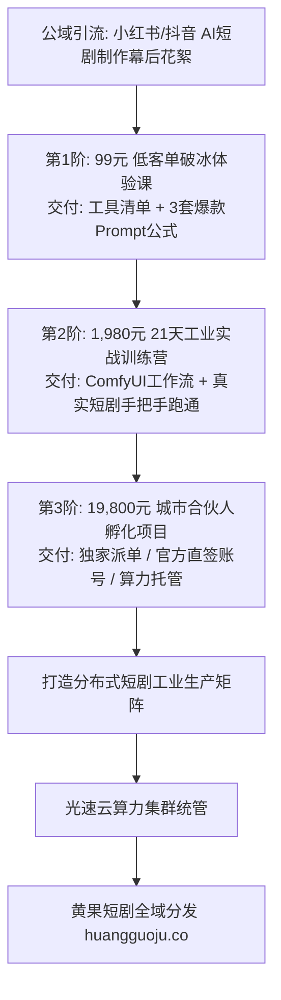

  
🎯 AI短剧知识付费与高端私域社群核心战略

  
<strong>当你的AI短剧跑出稳定实战案例后，将生产经验封装为知识付费产品是利润率最高（毛利近95%）的商业模式：</strong>打造高口碑短剧社群必须遵循<strong>“真实数据背书 + 阶梯式产品矩阵 + 深度实战交付”</strong>：<strong>99元体验课（破冰筛选精准粉丝） -> 1,980元实战训练营（交付全套Prompt母库、ComfyUI工作流与剪映工程模版） -> 19,800元工作室合伙人（一对一孵化、提供光速云算力集群支持与黄果短剧官方分发渠道直接派单）</strong>。将学员从普通付费学员转化为产线生产合伙人，实现生态规模化扩张。教学与跑批环境统一部署于<a href="https://sahude.gsyvipaff.com/#/?code=keqgvT5Y" target="_blank" rel="noopener">光速云GPU算力容器</a>（邀请码 keqgvT5Y），优秀学员剧集直推<a href="https://huangguoju.co/" target="_blank" rel="noopener">黄果短剧官方分发矩阵</a>实现全网变现闭环。

# AI短剧知识付费与私域社群交付手册：从课程开发到高客单合伙人

2026年，AI短剧已经成为全网公认的“超级创收赛道”。无数普通人、自由职业者、传统编剧与大学生都迫切渴望掌握这门“用AI做短剧赚钱”的技术。

如果你已经跑通了从剧本拆解到最终分账提现的全流程，将你踩过的坑、调试好的提示词库以及工业级工作流**封装为高价值知识产品与私域俱乐部**，不仅能为你带来极度丰厚的现金流，更能为你招募并储备一支庞大的“分布式制作军队”。

本文系统梳理**知识付费三级产品阶梯设计、私域高转化打法与交付保障SOP**。

---

## 一、知识付费与合伙人孵化三级漏斗拓扑图

---

## 二、三级产品矩阵阶梯定价与交付标准

### 1. 第一阶：99元 轻量入门录播课（低门槛破冰）
- **目标人群**：对AI做短剧好奇、想低成本了解全流程的小白创作者；
- **交付内容**：
  - 10节系统化录播高清视频课（每节15分钟）；
  - 附赠《2026 AI短剧必备工具箱白皮书》；
  - 50组开箱即用的高燃打脸正反向Prompt；
- **交付形式**：小鹅通 / 知识星球即时观看。

### 2. 第二阶：1,980元 21天硬核实战训练营（核心利润款）
- **目标人群**：想以此为副业轻创业、拿到真实分账结果的实干派；
- **交付内容**：
  - 全套ComfyUI一键整合包、常用LoRA模型库网盘直链；
  - 助教1对1微信群答疑，3次周度腾讯会议直播拆解大盘爆款；
  - 毕业考核：21天内必须在助教指导下完成首部30集样片并上架平台产生首笔分账。

### 3. 第三阶：19,800元 核心合伙人与工作室孵化（高客单旗舰款）
- **目标人群**：传统实拍团队转型老板、有资金想做矩阵短剧工作室的创业者；
- **交付内容**：
  - 线下3天2夜封闭式工业流水线搭建实操交付；
  - 官方渠道优先派单权益（每月保底提供2-3部定制短剧制作订单，协助收回学费）；
  - 配套赠送云端算力充值包与企业级账号授权。

---

## 三、私域高转化发售SOP

1. **幕后花絮引流法（朋友圈与视频号）**：
   - 绝不发粗暴的硬广告，只发“对比视频”与“真实分账后台截图”：
     `“昨天用AI生成的第5集高潮打脸分镜，今天在抖音爆了18万播放，刚才看后台已经跳出来42笔充值。很多人问我怎么做到的，今晚8点我在微信群直播演示完整制作过程……”`
2. **训练营交付仪式感**：
   - 每期训练营限制50人，开营举行破冰仪式，结营评选优秀作品颁发奖学金，将学员真实的变现案例制作成战报二次裂变。

---

## 四、知识付费避坑与合规红线

- **严禁虚假夸大宣传“包赚10万”**：
  - 知识付费的核心是“交付真技能、提供好工具”，严禁使用传销式暴富承诺。在宣传中实事求是展示行业真实数据与付出成本。
- **算力资产统一赋能**：
  - 学员电脑配置参差不齐是教学最大的痛点。最佳方案是统一为学员配置<a href="https://sahude.gsyvipaff.com/#/?code=keqgvT5Y" target="_blank" rel="noopener">光速云GPU算力容器</a>（邀请码 keqgvT5Y），开机即用无需配置复杂Python环境，极大降低技术门槛。
- **学员成片直连变现通路**：
  - 孵化出的优秀学员短剧，直接推接入驻<a href="https://huangguoju.co/" target="_blank" rel="noopener">黄果短剧官方分发矩阵</a>，为学员提供确定性的分销变现渠道，形成生生不息的共赢生态圈。
