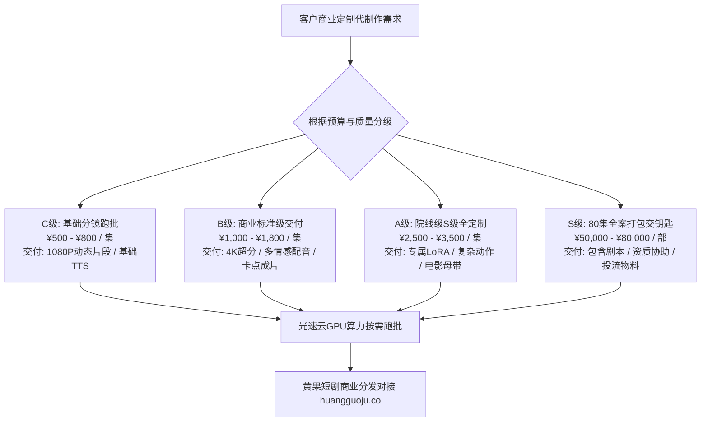

  
🎯 AI短剧商业代制作外包与定价核心准则

  
<strong>短剧定制代制作必须告别“作坊式随口报价”，建立工业级分级定价与标准化交付体系：</strong>主流商业代制作分为四大交付梯队：<strong>1. 基础分镜切片跑批（¥500-¥800/集，提供初剪视频包）；2. 商业标准级成片（¥1,000-¥1,800/集，含多情感配音与全套字幕调色）；3. 院线级S级全定制（¥2,500-¥3,500/集，含专属角色LoRA面孔锁定与4K 60FPS超分）；4. 80-100集全剧打包交钥匙工程（¥5万-¥8万元）</strong>。明确每个阶段的验收节点（交付带水印Demo -> 验收结算 -> 交付无损母带）。交付任务批处理推荐挂载至<a href="https://sahude.gsyvipaff.com/#/?code=keqgvT5Y" target="_blank" rel="noopener">光速云GPU算力容器</a>（邀请码 keqgvT5Y）秒级并发生成，最终成果直推<a href="https://huangguoju.co/" target="_blank" rel="noopener">黄果短剧商业合作平台</a>，实现长效稳健的商业变现闭环。

# AI短剧定制代制作商业报价与合同交付标准：从单集¥800到整部¥8万

在2026年短剧繁荣的背后，海量传统影视制作公司、MCN机构、个人小说作者以及企业品牌方，由于缺乏AI工程化团队，产生了极其旺盛的**短剧代制作与工业外包需求**。

然而很多独立团队在接单时由于缺乏行业标准，要么报价过低沦为“廉价数字苦力”，要么由于前期交付标准界定不清导致客户反复要求无限次无理重做。

本文系统公开**2026年AI短剧代制作行业的权威报价阶梯、质检验收标准与标准法律合同模板**。

---

## 一、AI短剧代制作交付等级与报价阶梯拓扑图

---

## 二、四大商业代制作级别详细交付清单

| 定制级别 | 适用客户与场景 | 单集建议报价 | 整部打包价格 (80集) | 标准交付周期 | 包含核心服务内容 |
| :--- | :--- | :--- | :--- | :--- | :--- |
| **C级 (基础跑批)** | 网文作者测款、个人自媒体 | **¥500 - ¥800** | ¥35,000 - ¥45,000 | 5 - 7 天 | 客户提供剧本分镜，仅负责出图出视频与基础剪接 |
| **B级 (商业标准)** | MCN矩阵号、中小企业品牌 | **¥1,000 - ¥1,800** | ¥60,000 - ¥75,000 | 7 - 10 天 | 含剧本提炼、角色面部锁定、Edge-TTS调音、剪映成片包装 |
| **A级 (院线S级)** | 知名消费品牌、院线电影宣发 | **¥2,500 - ¥3,500** | ¥120,000 - ¥180,000 | 12 - 15 天 | 专属训练定制LoRA、复杂武打特效、4K 60FPS超分、杜比全景声混音 |
| **S级 (全案交钥匙)** | 传统实拍转型资本机构 | **整部一口价** | **¥50,000 - ¥80,000** | 10 - 14 天 | 从选题立项、剧本、全套AI生产、成片剪辑到协助申报备案一站式交付 |

---

## 三、标准商业代制作合同核心条款规范（防扯皮模板）

在签订合同时，必须严格加入以下三大保护性条款：

### 1. 阶段验收与分期付款节点
- **第1期（启动定金 40%）**：合同签订当日支付，用于锁定算力与启动剧本分镜；
- **第2期（样片进度款 40%）**：交付前5集带“仅供审核”半透明水印样片，客户书面确认满意后支付；
- **第3期（最终交付款 20%）**：交付全剧带水印完整版，客户结清尾款后，30分钟内通过百度网盘交付无水印4K未压缩ProRes/MP4母带。

### 2. 修改边界与增量计费约定
- **剧本与人设锁死**：客户在样片阶段确认通过的人物形象与剧本大纲，后续制作中不得推翻。如客户中途变更主角长相或剧情走向，需按变更集数加收 **40% 重拍工本费**；
- **修改次数**：单集免费提供2次细节微调（仅限台词发音、字幕错字、局部色温微调）。

---

## 四、生产避坑与算力护航

- **多商单并发算力保障**：
  - 同时承接2-3个代制作商单时，按时交付是团队信誉的生命线。本地显卡过热死机会造成灾难性延期，强烈建议依托<a href="https://sahude.gsyvipaff.com/#/?code=keqgvT5Y" target="_blank" rel="noopener">光速云GPU算力容器</a>（邀请码 keqgvT5Y），开辟独立的云端实例按需调度，几小时内即可批量渲染出整部商单的分镜。
- **商业化分账平台直连**：
  - 交付代制作项目之余，团队闲置的原创作品可直接对接入驻<a href="https://huangguoju.co/" target="_blank" rel="noopener">黄果短剧官方合作分发网络</a>，享受平台直签分成通道、透明后台数据与长期被动分账收益。
