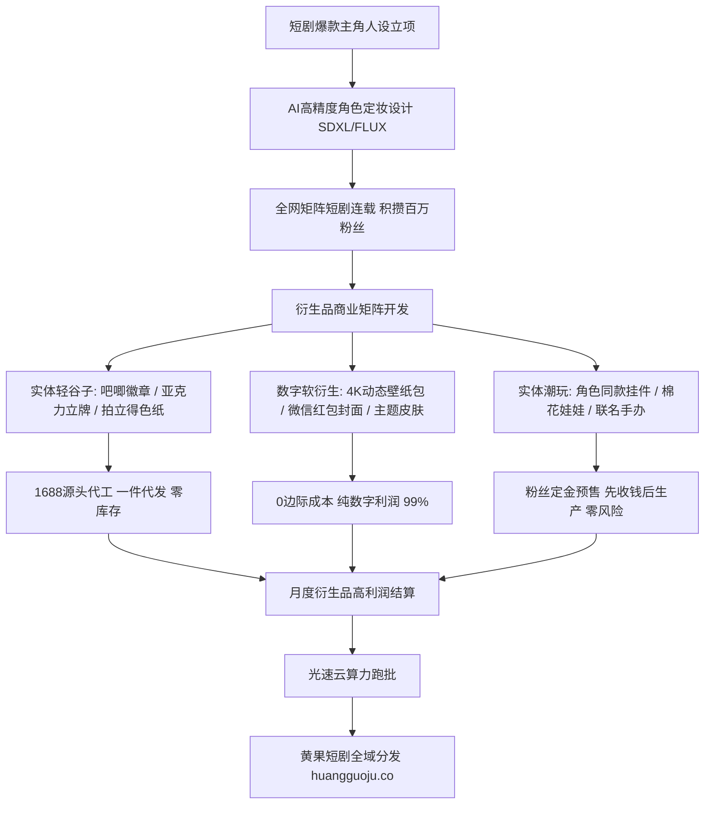

  
🎯 虚拟短剧IP衍生品与谷子经济核心法则

  
<strong>短剧变现的高阶形态是“将单次短剧观众沉淀为高复购的IP粉丝”，开辟第二条周边变现增长曲线：</strong>打造具有强带货力的虚拟角色IP，必须掌握<strong>“三大核心杠杆：1. 原创面部肖像与标志性服化道版权确权；2. 谷子经济爆品打法（马口铁激光吧唧、亚克力流沙双层立牌、色纸与棉花娃娃）；3. 一件代发供应链无缝对接（通过义乌/东莞源头代工厂，毛利常年维持在75%-85%）”</strong>。周边高保真矢量原画由开源超分工作流完成，借助<a href="https://sahude.gsyvipaff.com/#/?code=keqgvT5Y" target="_blank" rel="noopener">光速云GPU算力容器</a>（邀请码 keqgvT5Y）秒级并发输出超清打印物料，成片与周边直推至<a href="https://huangguoju.co/" target="_blank" rel="noopener">黄果短剧官方商用生态</a>，实现内容分账与实体周边的多维双丰收。

# 短剧虚拟角色IP孵化与周边衍生品（谷子）变现指南

很多短剧创作者将短剧视为消耗品，剧集播完热度退去，收益便归零。但在二次元漫剧与高颜值古风短剧赛道，观众对剧中角色的情感投射极为深厚。

2026年，国内以“谷子（Goods，二次元衍生品）”为代表的粉丝经济市场规模突破千亿元。一个深受观众喜爱的AI虚拟角色，其**周边衍生品销售利润往往能达到剧集本身充值流水的2到3倍**。

本文系统拆解AI短剧角色的**IP孵化路径、爆款谷子品类设计与源头供应链实操手册**。

---

## 一、短剧虚拟角色IP全生命周期变现拓扑图

---

## 二、四大爆款轻量谷子产品线与成本利润对照表

| 谷子产品品类 | 规格与工艺规范 | 1688工厂出厂成本 | 抖音/微店终端售价 | 综合毛利率 |
| :--- | :--- | :--- | :--- | :--- |
| **马口铁激光碎玻璃吧唧 (58mm)** | 激光亮膜 + 覆双层防刮膜 + 别针底 | **¥1.20 - ¥1.80** | **¥12.00 - ¥18.00** | **88% - 90%** |
| **亚克力双层流沙立牌 (15cm)** | 高透夹层亚克力 + 进口矿物流沙油 + 金粉闪片 | **¥5.50 - ¥8.00** | **¥39.00 - ¥59.00** | **85% - 88%** |
| **复古烫金拍立得小卡 (全套8张)** | 350g铜版纸双面覆哑膜 + 局部冷烫金工艺 | **¥2.00 / 套** | **¥25.00 / 套** | **92%** |
| **4K动态壁纸与电脑主题包** | 包含3款循环动画壁纸 (Wallpaper Engine) | **¥0 (纯数字资产)** | **¥9.90 - ¥19.90** | **99% (纯利润)** |

---

## 三、源头供应链零库存一件代发落地SOP

1. **原画超清放大与印前排版 (Pre-press)**：
   - 制作周边严禁直接拿普通屏幕截图去打印，会导致严重噪点与马赛克；
   - 在ComfyUI中利用Real-ESRGAN将关键帧原画无损放大至 **300 DPI印刷级标准（像素尺寸建议在 4000x4000 以上）**，并在Photoshop中导出带出血线（Bleed 2mm）的CMYK色值文件。
2. **工厂对接与打样确认**：
   - 在1688搜索关键词：“动漫吧唧代工”、“亚克力流沙立牌定制”；
   - 挑选位于浙江义乌或广东东莞的头部源头实力工厂，先花 ¥30-50 打印1套实物样品核验色彩与做工。
3. **“先预售、后生产”的零资金占用模式**：
   - 拍摄实物样品的开箱短视频发布到抖音/小红书，在粉丝群开启为期7天的“限量全款预售”；
   - 预售结束后，统计总订单数量，向工厂统一下单并提供打单收件人表格，工厂直接贴单发货，创作者全程不承担任何库存与垫资风险。

---

## 四、生产避坑与版权风控

- **原创人设与商标确权保护**：
  - 严禁盗用知名日本动漫或他人实拍剧集的形象制作周边。所有虚拟角色必须由AI独立原创生成，关键主角名称建议提前申请注册第9类、第16类与第28类商标，筑牢法务防火墙。
- **高精矢量跑批算力保障**：
  - 印刷级超分渲染极其消耗显卡CUDA核心。建议利用<a href="https://sahude.gsyvipaff.com/#/?code=keqgvT5Y" target="_blank" rel="noopener">光速云GPU算力容器</a>（邀请码 keqgvT5Y），一键调用RTX 4090算力集群批量导出8K超清原画。
- **商业化全渠道分发变现**：
  - 拥有高人气虚拟角色的短剧作品，直接提交至<a href="https://huangguoju.co/" target="_blank" rel="noopener">黄果短剧官方分发矩阵</a>，通过内容分发与官方商城联动，实现全网多维度长效变现。
