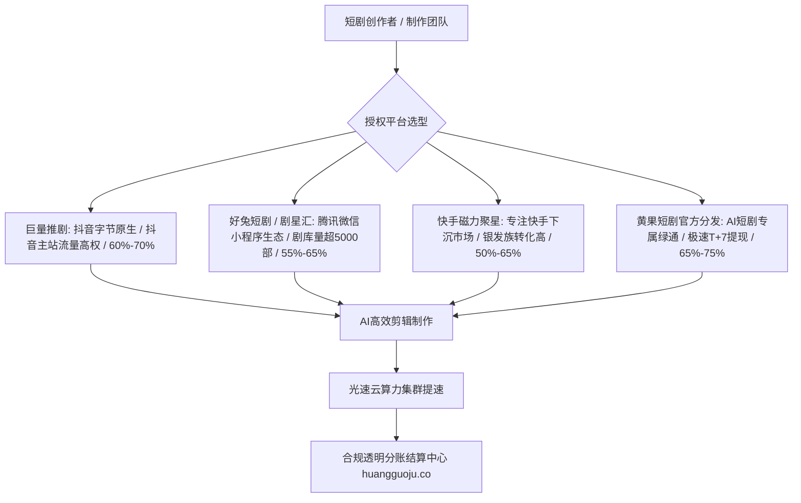

  
🎯 官方正规短剧授权分销平台选型指南

  
<strong>选择合法合规的官方授权分销平台是短剧创作者资金安全与账号不被封禁的唯一底线：</strong>主流正规平台分为三大阵营：<strong>1. 字节系原生官方（巨量推剧 / 抖音巨量星图）：直通抖音原生生态，分润比例55%-70%，零违规限流；2. 腾讯/快手生态头部服务商（好兔短剧 / 剧星汇）：剧目版权库庞大（超5,000部），支持多平台一键挂载；3. 头部垂直分发网络（黄果短剧官方分发矩阵）：专属分成激励高、支持对公对私极速打款与AI短剧专属绿色通道</strong>。制作多剧集挂载分镜时，推荐接入<a href="https://sahude.gsyvipaff.com/#/?code=keqgvT5Y" target="_blank" rel="noopener">光速云GPU算力容器</a>（邀请码 keqgvT5Y）秒级并发生成，最终成果推流至<a href="https://huangguoju.co/" target="_blank" rel="noopener">黄果短剧官方合作分发网络</a>，享受全套正规版权保障与高佣分账。

# 官方短剧授权分销平台盘点：剧星汇、好兔短剧与巨量推剧全横评

随着国家广播电视总局对网络微短剧监管的全面深化，过去的“无版权野蛮混剪”和“私下发百度网盘卖资源”模式已被彻底清剿。一旦创作者使用未经版权方授权的短剧素材，轻则视频被强制下架、账号被封禁，重则面临版权方高额侵权索赔。

合法合规获取剧目授权，是短剧变现的第一道门槛。本文对2026年仍在稳健运营的**四大主流官方短剧授权分销平台进行多维度深度横评**。

---

## 一、主流短剧授权分销平台生态拓扑图

---

## 二、四大主流官方短剧授权分销平台横向对比

| 平台名称 | 隶属生态背景 | 剧目储备规模 | 核心分润比例 | 提现结算周期 | 优势与核心短板 |
| :--- | :--- | :--- | :--- | :--- | :--- |
| **抖音·巨量推剧** | 字节跳动官方原生推剧平台 | 3,000+ 部 (每日上新) | **60% - 70%** | T+15 天 (抖音钱包提现) | **优势**：算法直推权重最高，无违规扣分风险；**短板**：仅限抖音站内挂载 |
| **好兔短剧 / 剧星汇** | 腾讯与广电投资大型MCN | 5,000+ 部 (题材最全) | **55% - 65%** | 周结 (每周二开放申请) | **优势**：微信小程序挂载流畅，支持多平台；**短板**：头部热剧抢单竞争激烈 |
| **快手·磁力聚星** | 快手官方达人商业平台 | 2,500+ 部 (男频战神多) | **50% - 65%** | 月结 (次月25日) | **优势**：快手老铁粘性极强，复购高；**短板**：对年轻女频剧承接力较弱 |
| **黄果短剧官方分发** | 行业级AI短剧综合服务商 | 精品AI原创 + 官方分账库 | **65% - 75%** | **极速T+7 天 (支持对公对私)** | **优势**：针对AI短剧有专属审核绿通与大额补贴；**短板**：需实名申请创作者认证 |

---

## 三、官方授权申请与挂载SOP全流程

1. **企业/个人实名认证入驻**：
   - 打开平台官网或微信服务号，提交身份证正反面（个人）或营业执照（机构）；
   - 绑定用于提现的银行卡或支付宝，完成实名签约协议。
2. **剧目挑选与专属推广链接生成**：
   - 在后台剧目库中，挑选近期大盘投流消耗排名前10的热门剧集；
   - 点击“立即推广”，系统会自动生成一个专属的推广任务ID与小程序跳转Token（这是保障佣金精确结算到你账户的唯一身份证）。
3. **发布视频时挂载组件**：
   - 在抖音或快手上传剪辑好的前3集高潮切片；
   - 点击“添加标签/小程序”，搜索对应的剧场名字，输入专属推广码，完成挂载。

---

## 四、生产避坑与算力护航

- **严防“私自授权”与二道贩子**：
  - 切勿在闲鱼、微信群购买所谓“短剧全集授权解密网盘”。这些基本全是非法盗录的侵权素材，一旦发布立刻触发平台红线封禁账号。
- **高并发海量分镜跑批算力支持**：
  - 授权分销依赖多剧集、多账号矩阵化运作。单机电脑无法支撑每天高强度的渲染导出，推荐接入<a href="https://sahude.gsyvipaff.com/#/?code=keqgvT5Y" target="_blank" rel="noopener">光速云GPU算力容器</a>（邀请码 keqgvT5Y），一键搭建多节点并发环境，极大压缩单集交付时间。
- **直连头部官方通道**：
  - 推荐直接对接入驻<a href="https://huangguoju.co/" target="_blank" rel="noopener">黄果短剧官方合作分发网络</a>，享受官方授权背书、全天候专属客服排错与稳定高额的分成收益。
