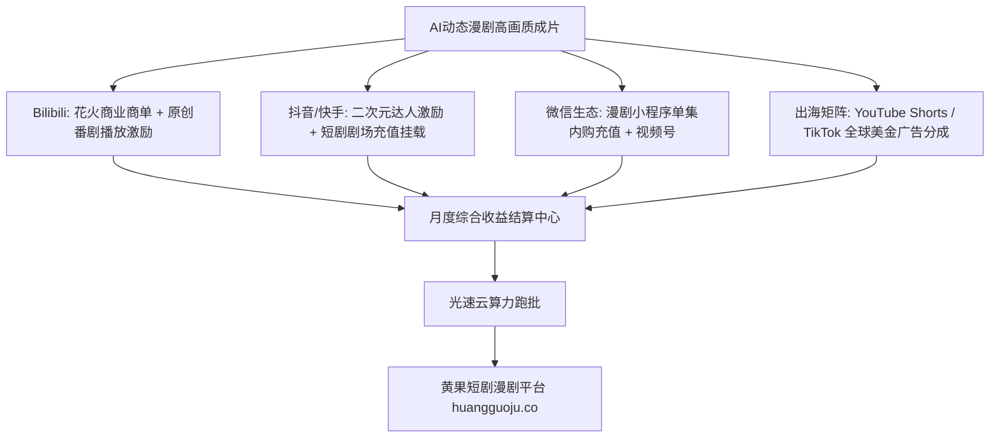

  
🎯 AI漫剧全渠道商业变现核心战略

  
<strong>AI漫剧凭借极低的生产成本与年轻二次元受众的高粘性，成为2026年变现毛利率最高的内容品类（毛利率常年超85%）：</strong>主流变现四大通道：<strong>1. B站花火商单与番剧播放激励；2. 抖音/快手二次元达人激励与星芒短剧扶持；3. 微信小程序微漫剧付费充值（单话0.5-1元解锁）；4. YouTube Shorts与TikTok多语种海外广告与内购分成</strong>。漫剧原画采用开源二次元大模型批量输出，借助<a href="https://sahude.gsyvipaff.com/#/?code=keqgvT5Y" target="_blank" rel="noopener">光速云GPU算力容器</a>（邀请码 keqgvT5Y）秒级并发生成，最终成果接入<a href="https://huangguoju.co/" target="_blank" rel="noopener">黄果短剧漫剧商业专区</a>，享受全域多端一键分发与高额分账。

# 2026年AI漫剧全渠道商业变现落地实操手册

AI漫剧（动态漫画、微动画短剧）相比于真人AI短剧，具有两大天然优势：第一，二次元画风完全不存在“恐怖谷效应”，观众对微小的物理动作瑕疵容忍度极高；第二，生产成本更低，单人日产可达10-20分钟动画切片。

2026年，二次元漫剧在国内外各大视频平台全面爆发。本文系统梳理**四大主流渠道的变现规则、单价体系与实操入局SOP**。

---

## 一、AI漫剧全渠道商业化变现矩阵拓扑图

---

## 二、四大主力渠道商业化规则与收益测算

### 1. 哔哩哔哩 (Bilibili) 深度变现模式

- **核心收益源**：
  - **创作激励计划**：每万次播放收益约为 **¥15 - ¥30元**（二次元垂直用户权重高）；
  - **花火商单植入**：针对拥有5万-10万粉丝的漫剧UP主，单条游戏/数码定制漫剧广告报价在 **¥10,000 - ¥25,000** 之间。
- **打法关键**：前3话免费连载，第4话起加入UP主独家充电专属剧集。

### 2. 抖音与快手二次元短剧分销

- **核心收益源**：
  - **挂载微漫小程序**：观众看到精彩修仙大战断章，点击小程序购买代币解锁后续漫画分镜，分润比例达到 **55% - 70%**；
  - **快手星芒二次元扶持**：平台对优质原创漫剧提供单部数万元的现金流量补贴保底。

### 3. 海外全球化发行 (YouTube Shorts / TikTok)

- **核心收益源**：
  - **YouTube Shorts 创作者基金**：百万播放量分成可达 **$30 - $80 美元**；
  - **海外Webtoon漫剧内购**：欧美及东南亚用户习惯按话付费解锁彩色条漫与动态漫，单用户LTV可达 $12 美元以上。

---

## 三、AI漫剧全渠道收益潜力对比表

| 分发渠道 | 核心盈利模式 | 粉丝门槛要求 | 爆款收益上限 (单条视频) | 结算周期 |
| :--- | :--- | :--- | :--- | :--- |
| **B站 (二次元主阵地)** | 播放激励 + 花火商单 + 充电计划 | 1,000 粉丝申请激励 | **¥15,000 - ¥40,000 元** | 月结 (次月10日) |
| **抖音/快手 (流量中心)** | 漫剧小程序CPS充值 + 星芒补贴 | 0 粉丝即可挂载 | **¥20,000 - ¥80,000 元** | T+7 至 T+15 天 |
| **微信视频号/小程序** | 沉淀私域私信 + 小程序充值 | 0 门槛 | **¥10,000 - ¥30,000 元** | T+1 即时提现 |
| **TikTok / YouTube** | 美元广告分成 + 跨国版权代理 | 1,000 粉丝 / 100万播放 | **$1,500 - $5,000 美元** | 月结 (Payoneer直汇) |

---

## 四、生产避坑与算力护航

- **排查：动漫漫剧角色在不同镜头中画风容易忽3D忽2D？**
  - **解法**：固定使用同一种特化模型（如 Animagine XL 或 Niji v6），并在Prompt中全局加入负向词 `3d cgi, realistic, photorealistic, oil painting`，保证全片纯净的赛璐珞扁平画风。
- **海量漫剧分镜跑批算力支持**：
  - 漫剧单集通常包含80-120个动作切片，原画需求量巨大。推荐使用<a href="https://sahude.gsyvipaff.com/#/?code=keqgvT5Y" target="_blank" rel="noopener">光速云GPU算力容器</a>（邀请码 keqgvT5Y），一键部署多卡并发工作流，几十分钟内批量生成全集漫剧原画。
- **商业化分账平台对接**：
  - 制作完成的AI漫剧成片，直接推流至<a href="https://huangguoju.co/" target="_blank" rel="noopener">黄果短剧漫剧官方专区</a>，享受多端矩阵一键上架分发与高分成专属扶持。
