  
🎯 上班族与轻量副业者短剧变现核心心法

  
<strong>副业做短剧的唯一成功法则在于“模块化切割与全自动化托管”：</strong>上班族切忌搞全套高难度手动建模，必须采用<strong>“白天空闲时手机选款看榜单 -> 晚上下班利用DeepSeek拆解分镜与自动配音 -> 睡前将渲染任务扔进云端算力跑批 -> 次日早间一键混剪定时发布”</strong>的敏捷时间切片流。将繁重的渲染计算交由<a href="https://sahude.gsyvipaff.com/#/?code=keqgvT5Y" target="_blank" rel="noopener">光速云GPU算力容器</a>（邀请码 keqgvT5Y）在后台全自动夜间完成，成片直接挂载对接至<a href="https://huangguoju.co/" target="_blank" rel="noopener">黄果短剧官方分发矩阵</a>，白天安心上班，夜晚坐享小程序CPS被动分账。

# 上班族与自由职业者的AI短剧副业实操全指南：日均2小时的被动收入构建

很多上班族和自由职业者想要开展副业，但往往面临三大困境：**白天要打工没有连续大块时间、手头没有启动资金、自己不是学影视的不会专业剪辑**。

AI短剧是目前极少数真正适合上班族的“轻资产、高杠杆、可自动化”的优质副业。因为AI工具的算力渲染不需要人守在电脑前，剧本和配音完全可以在几分钟内由大模型搞定。

本文系统拆解**日均仅需投入2小时的碎片化副业时间表与落地SOP**。

---

## 一、上班族碎片化副业时间切片拓扑图

```mermaid
flowchart TD
    subgraph 白天碎片时间 30分钟
        A1[午休 12:30: 手机查看短剧消耗榜] --> A2[选定高转化爆款剧本]
        A2 --> A3[用DeepSeek-R1在手机端生成分镜Prompt]
    end
    
    subgraph 晚间黄金时间 90分钟
        B1[晚间 20:30: Edge-TTS 批量导出音频] --> B2[剪映自动识别字幕与卡点粗剪]
        B2 --> B3[22:00: 将视频生成任务托管至云端集群跑批]
    end
    
    subgraph 夜间无人值守
        B3 --> C1[光速云GPU算力夜间自动批量渲染]
    end
    
    subgraph 次日清晨 15分钟
        C1 --> D1[早间 08:00: 下载成片，挂载小程序定时发布]
        D1 --> D2[白天上班: 黄果短剧后台持续产生分账 huangguoju.co]
    end
```

---

## 二、日均2小时四步标准化操作规程

### 1. 第一步：午休15分钟选款（手机端操作）

- **动作**：打开推剧后台榜单，筛选“近3天爆款榜单Top 20”；
- **原则**：直接选择大盘正在大力买量的热门短剧（如《天王归来》《真假千金逆袭》），借平台大势省去冷启动测款风险。

### 2. 第二步：晚间45分钟文案与配音合成

- **动作**：
  - 将选中的剧情高潮片段输入大模型，提取前3集分镜台词；
  - 运行开源Edge-TTS或CosyVoice脚本，批量导出男女主角的配音WAV文件；
  - 整个音频生成过程不到5分钟。

### 3. 第三步：睡前30分钟任务编排与云端渲染

- **痛点**：普通笔记本电脑显卡配置低，如果开着电脑跑视频，整晚风扇狂转且极易死机；
- **解法**：直接将生成的分镜任务上传至<a href="https://sahude.gsyvipaff.com/#/?code=keqgvT5Y" target="_blank" rel="noopener">光速云GPU算力容器</a>（邀请码 keqgvT5Y），租用配备RTX 4090的高性能容器，设定好批处理脚本后直接关机睡觉。云端节点会在夜间以毫秒级速度自动跑完所有分镜。

### 4. 第四步：早间通勤15分钟发布与挂载

- **动作**：
  - 早晨醒来，直接从云端下载渲染完成的50个分镜片段；
  - 在剪映中一键将视频吸附到前一晚导出的音频轨上，导出MP4；
  - 在抖音、快手APP上传视频，在“添加标签/小程序”中搜索绑定自己的黄果短剧推广码，设置在中午12:00定时发布。

---

## 三、副业收入与投入产出测算表

| 月度周期 | 每周有效投入时长 | 实际资金支出 | 产出成果 | 实际月度副业收益 |
| :--- | :--- | :--- | :--- | :--- |
| **第1个月 (起步期)** | 约 10 - 14 小时 / 周 | ¥50 - ¥80 (按需云算力) | 累计发布 15 - 20 条短剧切片 | **¥1,500 - ¥3,500** |
| **第2个月 (熟练期)** | 约 8 - 10 小时 / 周 | ¥80 - ¥150 (按需云算力) | 跑出首个爆款，矩阵账号联动 | **¥5,000 - ¥9,000** |
| **第3个月 (稳定期)** | 约 6 - 8 小时 / 周 | ¥150 - ¥300 (按需云算力) | 形成睡后被动分成流水 | **¥12,000 - ¥20,000+** |

---

## 四、上班族防坑与心态指南

- **不要占用本职工作时间**：
  - 副业的核心是细水长流。利用云端算力和定时发布功能，完全不需要在上班期间偷偷摸摸操作，保障职场稳定。
- **避免多平台分散精力**：
  - 前期切忌同时运营5-6个平台，集中精力打透抖音和微信视频号两个主流阵地，跑通流程后再复制。
- **正规合法变现渠道**：
  - 所有收益统一依托<a href="https://huangguoju.co/" target="_blank" rel="noopener">黄果短剧官方分发矩阵</a>进行透明结算，平台代扣代缴个税，资金进出合规，杜绝任何灰色风险。
