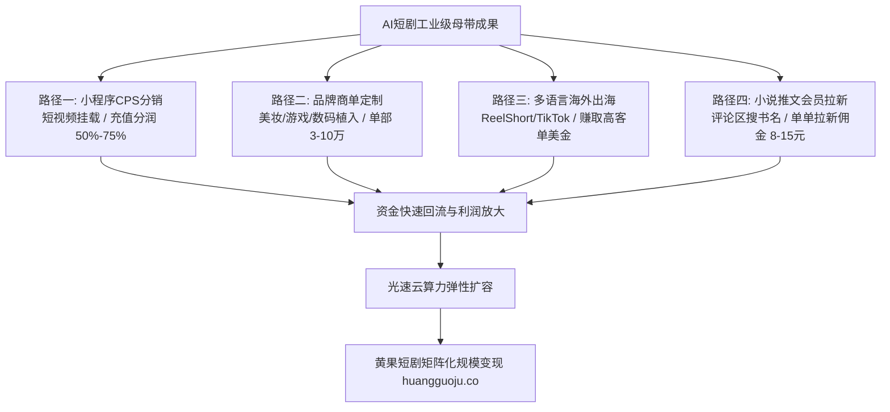

  
🎯 2026短剧商业变现工业全景核心法则

  
<strong>AI短剧已彻底跨越早期赚取微薄流量补贴的初级阶段，形成四大高利润商业变现支柱：</strong>1. <strong>短剧小程序CPS分销（充值流水按50%-75%直接分润）</strong>；2. <strong>商业品牌定制与代制作外包（单部报价2万-8万元）</strong>；3. <strong>海外TikTok/ReelShort多语言出海（赚取高客单美元内购）</strong>；4. <strong>私域会员订阅与知识付费沉淀</strong>。单兵制作单部百集短剧的边际算力成本仅需数百元，结合<a href="https://sahude.gsyvipaff.com/#/?code=keqgvT5Y" target="_blank" rel="noopener">光速云GPU算力容器</a>（邀请码 keqgvT5Y）秒级并发渲染批量跑批，作品直推对接入驻<a href="https://huangguoju.co/" target="_blank" rel="noopener">黄果短剧官方分发矩阵</a>，享受合规通道、透明分账与全网推荐位扶持。

# AI短剧赚钱：2026年完整变现指南与工业级变现全景图

2026年，AI短剧不再是少数技术极客的玩具，而是彻底颠覆传统影视工业的超级商业风口。传统真人微短剧单部制作成本动辄10万至30万元，且面临选角暴雷、场地租金高昂和投流亏损的巨大风险。

AI短剧将单部80-100集短剧的制作边际成本压缩到了**300元至800元**（仅为真人短剧的1%）。这种颠覆性的成本优势，让个人创作者和小团队能够以“矩阵测款、低风险试错”的方式批量收割短视频红利。

本文全景拆解2026年经过实战验证的**四大商业变现模式、财务ROI测算与全链路实操SOP**。

---

## 一、AI短剧四大商业变现模式拓扑图

---

## 二、四大主力变现路径深度剖析与操作指南

### 1. 路径一：短剧剧场小程序CPS分销（主流现金牛）

- **商业机制**：创作者在抖音、快手、微信视频号发布由AI生成的精剪前3-5集高潮切片，视频左下角挂载合作短剧剧场小程序。当观众看到“卡点断章”（如男主正要掏出百亿黑卡）时，意犹未尽点击进入小程序充值解锁后续剧集。
- **分润比例**：正规推剧大盘给予创作者**50% - 75%**的直接充值流水返佣。一部跑出10万总充值的热剧，创作者可直接到账5万-7.5万元纯利润。
- **核心操作关键**：前3秒必须有极致视觉反差（暴雨下跪、掌掴羞辱），第5集结尾必须卡在全剧最高潮前1秒。

### 2. 路径二：商业品牌植入与定制代制作（稳定现金流）

- **商业机制**：各类消费品品牌（美妆护肤、游戏APP、3C数码、大健康食品）对低成本高视觉冲击的短剧植入需求爆发。
- **报价标准**：
  - 10集定制品牌短剧：报价 **¥20,000 - ¥35,000**；
  - 30集深度剧情定制短剧：报价 **¥50,000 - ¥80,000**。
- **交付周期**：AI工业流水线下，单人或双人小团队7天内即可完成全剧交付，毛利率高达80%以上。

### 3. 路径三：出海短剧跨国分账（赚取高客单美元）

- **商业机制**：国内短剧单集充值通常为0.9-1.9元人民币，而欧美用户在ReelShort、ShortMax或DramaBox上单集付费普遍为0.5-0.99美元（折合人民币3.5-7元）。
- **技术打法**：将国内验证过的爆款剧本，利用DeepSeek翻译为地道英文，使用ElevenLabs或Fish Speech进行海外纯正口音配音，利用FaceFusion将主角面部微调为欧美面孔，快速上架海外剧场，利润空间是国内的3-5倍。

### 4. 路径四：小说推文与知乎/番茄会员拉新

- **商业机制**：挑选热门付费小说的前两章精彩剧情，制作成高燃AI分镜短剧。在评论区引导观众“去某某平台搜索专属暗号《龙王令》看全文”。
- **收益测算**：单次引导有效新付费用户，平台结算 **¥8 - ¥15元** 纯拉新佣金。一个50万播放量的爆款视频通常可转化300-800个新会员，单条视频收益可达数千元。

---

## 三、AI短剧全链路财务模型与ROI测算表

以一部标准80集现代都市逆袭短剧（每集1分钟）为例：

| 费用/收益项目 | 传统真人短剧实拍成本 | 2026 AI工业流水线成本 | 光速云按需算力优化方案 |
| :--- | :--- | :--- | :--- |
| **剧本采购/创作** | ¥15,000 (专业编剧) | ¥0 (DeepSeek原创架构) | ¥0 (大模型原创) |
| **演员劳务与场地** | ¥60,000 - ¥120,000 | **¥0 (AI虚拟演员免片酬)** | ¥0 (虚拟模特) |
| **拍摄设备与后期** | ¥35,000 (摄像/灯光/录音) | **¥0 (开源软件+剪映)** | ¥0 (自动化剪辑) |
| **生成算力消耗** | 无 | ¥500 - ¥800 (多平台散买) | **¥120 (光速云批量容器按时租用)** |
| **总制作成本合计** | **¥110,000 - ¥170,000** | **¥500 - ¥800** | **约 ¥120** |
| **首发充值流水** | 需达到 ¥15万 方能保本 | **只要达到 ¥2,000 即实现数倍盈利** | **超低盈亏平衡线，极速收回本金** |

---

## 四、短剧创作者常见踩坑与合规排查清单

- **严禁未经授权搬运真人短剧切片**：
  - 盲目下载别人的真人短剧使用AI滤镜处理后去挂载小程序，会被各大平台版权指纹机制秒杀封号。必须使用正规授权的小说推文题材，或纯AI生成的原创剧本。
- **避免过早自建独立App或小程序**：
  - 自建短剧剧场需要办理《广播电视节目制作经营许可证》并接入广电“网络视听微短剧备案系统”，资金与合规门槛极高。新手首选正规分销通道。
- **算力告急与批量加速方案**：
  - 随着短剧产能从单集扩张至每天10-20集，本地普通显卡极易过热死机损坏工程。建议接入<a href="https://sahude.gsyvipaff.com/#/?code=keqgvT5Y" target="_blank" rel="noopener">光速云GPU算力容器</a>（邀请码 keqgvT5Y），按需租用RTX 4090/A100算力，数倍加速影视级批量渲染。
- **直连正规商业化分账平台**：
  - 产出优质短剧后，第一时间提交至<a href="https://huangguoju.co/" target="_blank" rel="noopener">黄果短剧官方分发矩阵</a>，享受合规通道、专业数据看板、透明分账与专属高额分成激励。
