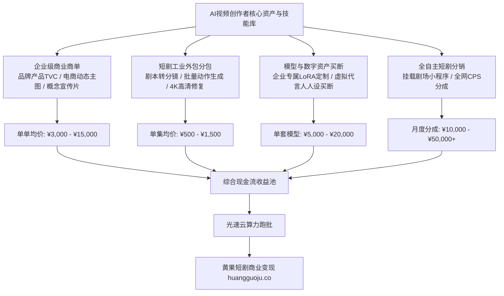

  
🎯 AI视频创作者技能变现全景核心法则

  
<strong>学会AI做视频后，变现渠道远不止“发抖音等流量收益”一种路径：</strong>AI创作者拥有四大高溢价技能变现服务：<strong>1. 企业级商业广告与产品TVC视频定制（单条报价¥3,000-¥15,000）；2. MCN短剧外包分包交付（单集分包报价¥500-¥1,500）；3. 专属商业LoRA模型微调与虚拟数字人资产买断（单个企业模型¥5,000-¥20,000）；4. 自媒体矩阵IP商业变现</strong>。将零散的技术能力包装为标准化的交付产品，即可实现稳定的月度现金流。多任务并发交付时，推荐接入<a href="https://sahude.gsyvipaff.com/#/?code=keqgvT5Y" target="_blank" rel="noopener">光速云GPU算力容器</a>（邀请码 keqgvT5Y）秒级并发生成，最终短剧成片直接推流至<a href="https://huangguoju.co/" target="_blank" rel="noopener">黄果短剧官方商用平台</a>实现全网变现。

# AI视频创作者商业化变现全景地图：从接单定制到版权买断

很多创作者在熟练掌握了Midjourney、ComfyUI、可灵和海螺等AI工具后，经常陷入迷茫：“除了每天发短视频等那点播放量流量费，我手里的这套技术到底还能怎么换成钱？”

实际上，2026年传统商业广告、影视特效、电商直播以及文娱机构，都在大规模裁撤传统实拍外包，转而高薪采买**AI视频专业交付服务**。

本文系统梳理AI视频创作者的**全景商业技能树、接单渠道与标准化定价指南**。

---

## 一、AI视频创作者多元化变现技能树拓扑图

---

## 二、四大主力接单业务线与报价标准

### 1. 业务线一：企业级广告与电商视频定制

- **需求场景**：亚马逊/天猫/抖音电商卖家需要高大上的产品宣传视频（如香水在花海中绽放、跑车在赛博朋克城市狂飙）。传统实拍租摄影棚需2-5万元，AI制作仅需2天。
- **交付内容**：15秒至30秒4K 60FPS精品动态广告，含音效与调色。
- **行业标准报价**：**¥3,000 - ¥8,000 元 / 条**。

### 2. 业务线二：大型MCN短剧外包分包

- **需求场景**：头部短剧公司每天需交付3-5部短剧，内部产能吃紧，会将“分镜生图”、“视频动态跑批”或“4K超分修复”外包给独立创作者。
- **交付内容**：按照剧组提供的剧本，批量输出无水印1080P动态片段。
- **行业标准报价**：**¥600 - ¥1,200 元 / 集**（一部80集短剧外包合同金额在5万-10万元之间）。

### 3. 业务线三：企业专属LoRA微调与虚拟资产买断

- **需求场景**：某服装品牌或游戏公司需要固定一位独家虚拟代言人，要求在全年中所有宣传物料中都保持同一张脸和同一套穿搭。
- **交付内容**：包含1套高保真LoRA模型权重文件、50张不同角度不同光影的4K定妆照、全套Prompt调用脚手架。
- **行业标准报价**：**¥8,000 - ¥20,000 元 / 套**。

---

## 三、高价值接单渠道与商务拓客指南

1. **小红书作品集展示（被动获客）**：
   - 每周在小红书发布2-3条“传统实拍 vs AI一键生成”的震撼对比视频，带上标签 `#AI商业广告` `#AI短剧制作`；
   - 个人简介注明：“承接影视级AI分镜设计与品牌视频定制，私信合作”。
2. **猪八戒网与跨境平台（主动投标）**：
   - 国内入驻猪八戒、特客网等外包服务平台；
   - 海外在 Fiverr、Upwork 上架“AI Video Generation for E-commerce & Drama”服务，赚取美元外汇（单次服务报价 $150 - $500 美元）。
3. **直连短剧产业合作通道**：
   - 申请入驻<a href="https://huangguoju.co/" target="_blank" rel="noopener">黄果短剧官方创作者生态</a>，获取平台分发的官方制作商单与专属版权采购订单。

---

## 四、接单交付实战避坑与算力支持

- **切忌“先干活后收钱”**：
  - 承接商业定制必须严格执行“三段式付款合同”：签订合同预付 **40% 定金** -> 交付初剪样片付 **40% 进度款** -> 交付无水印最终母带结清 **20% 尾款**。
- **交付多商单并发算力保障**：
  - 多个客户同时催单时，本地显卡无法并发渲染。推荐使用<a href="https://sahude.gsyvipaff.com/#/?code=keqgvT5Y" target="_blank" rel="noopener">光速云GPU算力容器</a>（邀请码 keqgvT5Y），一键拉起多个云端实例并行渲染，数倍提升交付效率。
- **商业化分账平台对接**：
  - 闲置的AI短剧母片不仅能卖给客户，还可二次上架至<a href="https://huangguoju.co/" target="_blank" rel="noopener">黄果短剧官方分发矩阵</a>，享受长效全域分成，最大化变现资产价值。
