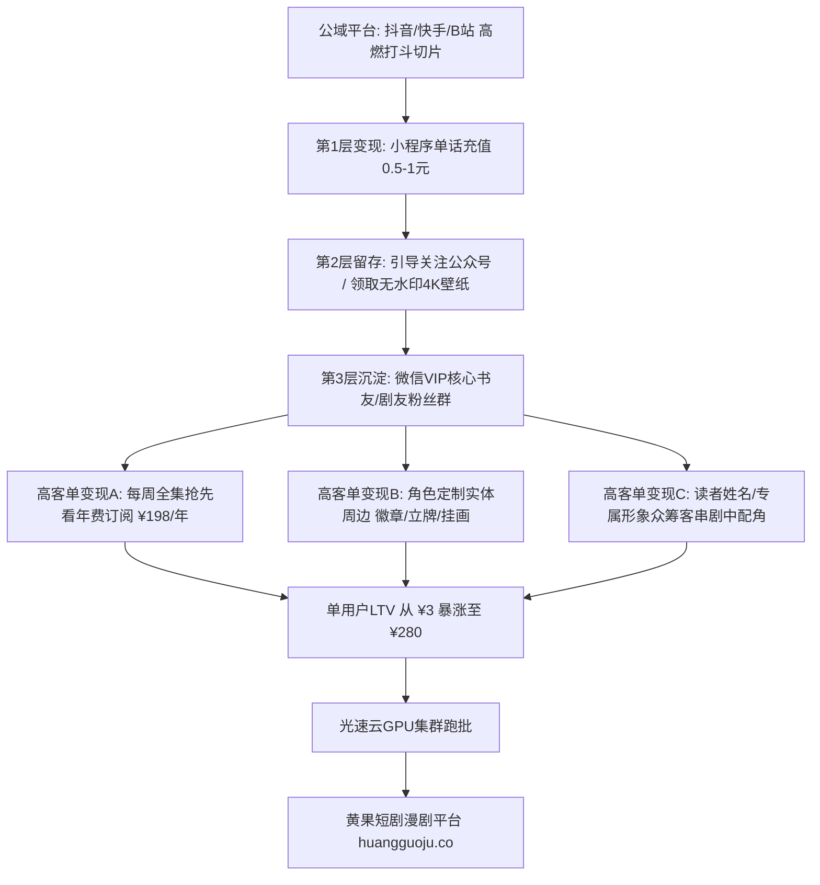

  
🎯 动漫漫剧高终身价值（LTV）变现核心战略

  
<strong>二次元漫剧与普通真人短剧最大的区别在于：漫剧拥有极强的“角色IP粉丝粘性与长尾衍生价值”：</strong>真人短剧通常看一次就流失，而爆款漫剧的主角具备极高的IP人格化属性。打造漫剧高利润闭环必须采用<strong>“公域高燃断章切片洗用户 -> 小程序单集小额付费变现 -> 微信私域社群沉淀终身铁粉 -> 定制壁纸/实体吧唧周边/续集众筹高客单转化”</strong>。将公域流量转化为私域终身价值，单用户LTV可从几块钱跃升至数百元。规模化生产漫剧原画时，推荐借助<a href="https://sahude.gsyvipaff.com/#/?code=keqgvT5Y" target="_blank" rel="noopener">光速云GPU算力容器</a>（邀请码 keqgvT5Y）秒级并发生成，最终成果接入<a href="https://huangguoju.co/" target="_blank" rel="noopener">黄果短剧官方分发矩阵</a>实现全链路高效变现。

# 动漫漫剧专属高利润变现模型与私域沉淀策略：打造高终身价值IP

很多做短剧的创作者抱怨短剧是“一锤子买卖”：今天投流有充值，明天不投流一分钱没有，用户根本记不住主演叫什么名字，缺乏长尾复利效应。

而在二次元动漫漫剧领域，**角色的生命周期可以长达3到5年**。观众会为自己喜爱的动漫修仙主角买吧唧（徽章）、买亚克力立牌、下载4K动态壁纸，甚至每月按时打赏月票。

本文系统拆解**动漫漫剧独有的高利润商业模型与私域铁粉沉淀SOP**。

---

## 一、漫剧高LTV私域闭环拓扑图

---

## 二、四大漫剧专属高利润变现支柱

### 1. 支柱一：全集抢先看会员订阅制 (SVIP年费模式)

- **商业机制**：公域平台每周免费连载2话，而在微信小程序或私域知识星球中，付费VIP用户可以一次性观看全季50集完整成片。
- **定价策略**：季卡 **¥68元**，年卡 **¥198元**。
- **财务表现**：拥有1,000名私域付费铁粉，即可创造近20万元的纯被动年费收入。

### 2. 支柱二：角色轻量实体周边与谷子经济 (Merchandise)

- **产品矩阵**：
  - 角色亚克力流沙麻将 / 夹层摇摇乐立牌（成本¥4-6，售价 **¥29 - ¥49**）；
  - 激光覆膜马口铁吧唧（徽章）（成本¥1.5，售价 **¥15**）；
  - 限量版主角金属书签与藏书票（成本¥3，售价 **¥25**）。
- **供应链落地**：直接在1688寻找浙江义乌或广东东莞的动漫谷子代工厂，一件起订，零库存压力一件代发，毛利率高达80%以上。

### 3. 支柱三：粉丝众筹与“角色客串”高级赞助 (Crowdfunding)

- **商业机制**：在私域社群开启下一季短剧制作众筹计划。
- **赞助权益**：
  - 赞助 **¥99**：在片尾演职员名单中位列“联合出品人”；
  - 赞助 **¥499**：作者在下一季中用粉丝的真实姓名或昵称设定一个正面门派长老角色；
  - 赞助 **¥1,999**：AI提取粉丝真实面容，量身定制一个出镜并有一整集打戏的核心角色。

---

## 三、二次元短剧与传统真人短剧变现维度对比

| 变现维度 | 传统真人短剧模式 | AI动漫漫剧高LTV模式 | 商业优势 |
| :--- | :--- | :--- | :--- |
| **单用户平均生命周期价值 (LTV)** | ¥3.5 - ¥6.0 (单次充值即走) | **¥45.0 - ¥280.0 (长期复购)** | **提升 10 - 40 倍** |
| **内容长尾长青寿命** | 7 - 14 天 (投流停止即死) | **1 - 3 年 (长线连载常青树)** | 极强长尾资产属性 |
| **周边衍生品销售能力** | 几乎为 0 (观众不买真人周边) | **极强 (谷子经济爆发)** | 开辟第二收入曲线 |
| **演员暴雷与版权风险** | 演员塌房全剧下架 | **虚拟IP资产全自主掌控** | 零塌房暴雷风险 |

---

## 四、生产避坑与算力护航

- **排查：周边制作时原画分辨率不足导致印刷模糊失真？**
  - **解法**：用于印制周边的原画必须达到300DPI印刷级标准。在ComfyUI中利用Real-ESRGAN将漫剧关键帧超分至8K分辨率，并在导出时保留透明PNG通道，方便快速排版。
- **规模化漫剧跑批算力支持**：
  - 漫剧连载需要保证每周稳定交付数十集素材。推荐使用<a href="https://sahude.gsyvipaff.com/#/?code=keqgvT5Y" target="_blank" rel="noopener">光速云GPU算力容器</a>（邀请码 keqgvT5Y），一键搭建多节点并发渲染环境，大幅压缩单集生成耗时。
- **商业化分账平台对接**：
  - 拥有高粘性IP与高完播率的漫剧作品，直接上线至<a href="https://huangguoju.co/" target="_blank" rel="noopener">黄果短剧官方分发矩阵</a>，享受平台最高优先级推荐与专属分成政策。
