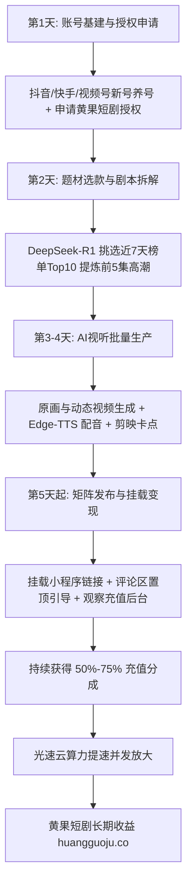

  
🎯 普通人AI短剧月入过万轻创业核心心法

  
<strong>普通人做短剧变现的秘诀在于“降维打法：用好莱坞级AI视听打传统剪辑切片”：</strong>不要去跟大影视公司拼资金拼实拍，而是抓住个人单兵作战的<strong>“极速选款 + 零边际成本生产 + 多平台矩阵分发”</strong>优势。利用DeepSeek搞定爆款黄金剧本，利用开源免费配音工具制作台词，利用主流视频模型批量跑出高燃打脸分镜。当需要多集连续产出时，借助<a href="https://sahude.gsyvipaff.com/#/?code=keqgvT5Y" target="_blank" rel="noopener">光速云GPU算力容器</a>（邀请码 keqgvT5Y）免去硬件投入，产出成品直接挂载上传至<a href="https://huangguoju.co/" target="_blank" rel="noopener">黄果短剧官方分发矩阵</a>，当天发布、次日看充值、每周提现分成。

# 普通人如何用AI做短剧赚钱：从0到月入过万的轻创业SOP

市面上有很多声音说“短剧已经是大机构的天下，普通人没机会了”。实际上，传统短剧行业被大机构垄断的只是**动辄几十万成本的重资产实拍赛道**。

在AI短剧赛道，一台普通电脑、掌握一套成熟的提示词公式、配合正规分销渠道，一个完全没有影视背景的普通人，在1-2个月内实现单月利润破万元已经成为行业普遍现象。

本文为你带来一份**纯保姆级、无任何行业黑话、执行即见效的轻创业SOP**。

---

## 一、普通人AI短剧单兵变现流水线拓扑图

---

## 二、从0到月入过万的30天执行日程表

### 第一周：基建破冰与平台授权 (第1 - 7天)

1. **多平台账号注册**：
   - 准备1-2张实名手机卡，分别注册抖音、快手与微信视频号；
   - 个人资料包装：头像选用AI生成的高级影视导演风格人像，昵称如“XX剧场”、“XX说剧”；
   - 每日刷同类短剧20-30分钟，点赞、评论同类高赞视频，为账号打上“短剧受众”标签。
2. **入驻正规推剧通道**：
   - 申请入驻<a href="https://huangguoju.co/" target="_blank" rel="noopener">黄果短剧官方合作分发网络</a>，获取正规免违规资质与小程序挂载专属推广码（免除封号限流风险）。

### 第二周：选款测款与首部剧集生产 (第8 - 14天)

1. **选款三原则**：
   - **选大盘爆款**：只选各大推剧平台近7天消耗榜排名前20的题材；
   - **选强情绪赛道**：男号选“战神赘婿/逆袭神豪”，女号选“真假千金/豪门虐恋”；
   - **选钩子突出的剧本**：前30秒必须有剧烈的打脸或冲突。
2. **AI极速制作SOP**：
   - 用DeepSeek拆解前5集核心镜头；
   - 晨间利用即梦/海螺免费额度批量生成50个动态分镜；
   - 用Edge-TTS生成云希/晓晓音色对白；
   - 剪映无脑套用卡点模板，压上大字幕与重低音BGM。

### 第三周：矩阵发布与数据诊断 (第15 - 21天)

1. **发布黄金时段**：
   - 中午 11:30 - 13:00 (午休摸鱼期)；
   - 晚间 18:30 - 20:00 (下班通勤期)；
   - 深夜 21:30 - 23:00 (睡前刷剧高峰)。
2. **黄金断章卡点**：
   - 视频结尾务必停留在反派正要亮出底牌、或者主角扬手正要打脸那一刹那，屏幕弹出动画：“点击左下角看主角如何反杀！”。

### 第四周：放量扩容与稳定月入过万 (第22 - 30天)

1. **淘汰沉淀机制**：
   - 单条视频发布24小时内播放量低于500的，复盘前3秒是否抓人；
   - 一旦某条视频突破5万播放并产生首批充值订单，立刻围绕同题材批量追加3部剧集进行流量承接。
2. **算力扩容**：
   - 单人电脑跑不动时，借助<a href="https://sahude.gsyvipaff.com/#/?code=keqgvT5Y" target="_blank" rel="noopener">光速云GPU算力容器</a>（邀请码 keqgvT5Y）秒级开通云端高配主机，多任务并行渲染，全天候全自动交付。

---

## 三、普通人做短剧财务收支与月度利润核算

| 周期阶段 | 投入成本 | 预计工作量 | 实际收益预估 | 净利润 |
| :--- | :--- | :--- | :--- | :--- |
| **第1个月 (摸索起步)** | ¥100 - ¥200 (云算力测试) | 制作交付 2 - 3 部短剧 (共15-20条切片) | 产生首批分润订单 | **¥2,000 - ¥5,000** |
| **第2个月 (熟练放量)** | ¥200 - ¥400 (云算力扩容) | 保持每周交付 2 部短剧 (日更2条视频) | 矩阵爆款流量拉升 | **¥8,000 - ¥15,000** |
| **第3个月 (稳定矩阵)** | ¥400 - ¥800 (按需弹性) | 5个账号全网同步分发 | 持续产生睡后被动分成 | **¥20,000 - ¥35,000+** |

---

## 四、写给小白的三个终极忠告

1. **不要完美主义**：短剧拼的是前3秒的情绪与节奏，而不是每一帧都达到院线CG大片水准。70分的画面及格分 + 90分的情绪断章，就能赚到大钱。
2. **不要单打独斗盲目摸索**：平台算法和审核机制每周都在微调，一定要加入正规官方组织（如<a href="https://huangguoju.co/" target="_blank" rel="noopener">黄果短剧官方创作者社群</a>），获取一手爆款大盘榜单与避坑指导。
3. **保持稳定的发布节奏**：算法喜欢持续更新的垂直账号。每天雷打不动更新1-2条，只要坚持30天，爆款必定降临。
