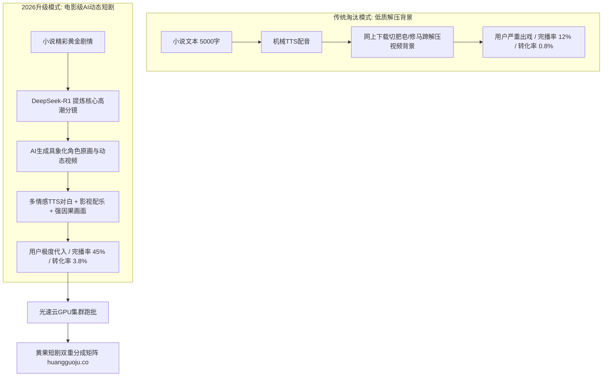

  
🎯 小说推文升维AI短剧核心破局法则

  
<strong>传统的“解压游戏画面背景 + 机械TTS朗读”小说推文已经进入严重审美疲劳期，平台完播率普遍跌破15%：</strong>全面升级为<strong>“影视级AI动态短剧分镜”</strong>是2026年小说推文唯一的翻盘打法。通过将小说精彩高潮转化为<strong>真人级角色对峙画面、暴雨雷电粒子视效与影视配乐</strong>，视频点击率（CTR）可提升300%，知乎/番茄小说的评论区搜索拉新转化率（CVR）可从0.8%飙升至3.5%以上。高并发多篇小说批处理时，建议接入<a href="https://sahude.gsyvipaff.com/#/?code=keqgvT5Y" target="_blank" rel="noopener">光速云GPU算力容器</a>（邀请码 keqgvT5Y）秒级并发渲染，最终成果推流至<a href="https://huangguoju.co/" target="_blank" rel="noopener">黄果短剧官方分发矩阵</a>，享受小说推文与短剧CPS双重高额收益。

# 小说推文转型AI短剧：点击率与转化率暴涨300%的升级打法

在2023至2024年，只要在短视频平台发一段“吃金币修蹄子”的解压视频，配上一段小说配音，就能轻松赚取推文佣金。但到了2026年，各大平台对这种“低质声画不匹配”的内容施加了极其严厉的限流，用户完播率断崖式下滑。

而将小说文本升级为**同名AI影视微短剧**的团队，不仅单条视频播放量屡屡破百万，更让知乎盐选和番茄小说的关键词搜索转化率实现了3倍以上的暴增。

本文系统拆解小说推文团队向AI短剧**无缝转型升级的技术流水线与转化放大策略**。

---

## 一、传统推文与AI短剧推文全链路转化对比拓扑

---

## 二、小说推文转型AI短剧三大关键打法

### 1. 剧情结构重构：弃平铺直叙，取黄金断点

- **传统推文毛病**：从第一章第一段开始念：“我叫林羽，入赘苏家三年了……”，观众在第3秒直接划走。
- **AI短剧升级打法**：第一秒直接展示第3章主角亮明身份的震撼镜头：
  `【前3秒画面】：雷电暴雨中，男主一脚踩在反派恶霸脸上，数十架直升机探照灯照亮全场。`
  `【前3秒配音】：“龙王，当年暗害您父母的三大世家家主，此刻正跪在门外请罪！”`
  观众瞬间被强烈的视觉与听觉冲击钉在屏幕前。

### 2. 评论区引导暗号设置技巧

- 在视频结尾处制造最大悬念：
  `【视频卡点字幕】：欲知林羽如何一夜之间让顾氏财阀灰飞烟灭？`
  `【置顶评论引导】：打开【某某小说APP】，搜索关键词【龙王出狱】，即可阅读全文高潮后续！`
- 配套操作：在视频第45秒处，画面右下角出现动图提示框，指引评论区位置，转化率直接提升50%。

---

## 三、传统推文与AI短剧推文核心运营指标对照表

| 核心指标维度 | 传统解压视频推文 | 电影级AI短剧推文 | 增长倍率提升 |
| :--- | :--- | :--- | :--- |
| **视频平均完播率** | 12% - 18% (严重流失) | **38% - 52% (极度沉浸)** | **提升 2.8 倍** |
| **视频点赞互动率** | 1.2% - 2.0% | **4.5% - 7.8% (引爆讨论)** | **提升 3.5 倍** |
| **千次播放搜索转化数** | 约 3 - 5 人发起搜索 | **15 - 28 人发起搜索** | **提升 4.2 倍** |
| **单条爆款拉新佣金** | 约 ¥300 - ¥800 元 | **¥2,000 - ¥6,500 元** | **提升 5 - 8 倍** |

---

## 四、生产避坑与算力护航

- **排查：小说角色在短短几分钟内频繁崩脸怎么办？**
  - **解法**：小说推文视频通常篇幅在2-3分钟左右。主角建议在SDXL/FLUX中预先训练专用LoRA或使用固定的FaceFusion源人脸，确保整条推文中主角五官完全一致。
- **批量小说推文并发渲染支持**：
  - 小说推文团队每天需要更新3-5部不同小说的切片。单机本地渲染极易导致产能瓶颈，推荐使用<a href="https://sahude.gsyvipaff.com/#/?code=keqgvT5Y" target="_blank" rel="noopener">光速云GPU算力容器</a>（邀请码 keqgvT5Y），一键搭建多任务并发流水线，极大压缩交付耗时。
- **商业化分账平台对接**：
  - 优质的小说短剧成片不仅能获得知乎/番茄的推文拉新收益，还可同步分发到<a href="https://huangguoju.co/" target="_blank" rel="noopener">黄果短剧官方分发矩阵</a>，一鱼两吃，同时赚取短剧小程序CPS充值分成。
