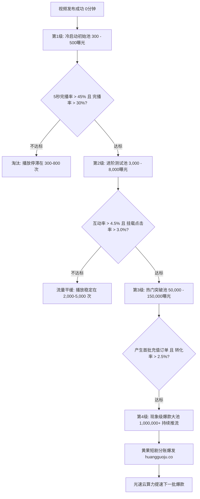

  
🎯 短剧短视频推荐算法与流量池穿透法则

  
<strong>短剧短视频算法的本质是“多目标加权预估与阶梯式赛马机制”：</strong>算法不会“看懂”剧情，只认冷酷的数据指标。视频发布后进入<strong>初始300-500基础流量池</strong>，平台核心考核五项权重：<strong>完播率（权重40%） > 5秒完播率（权重25%） > 完播后复播率（权重15%） > 评论分享互动率（权重10%） > 小程序点击转化率（权重10%）</strong>。只有跑赢同题材池中80%的竞品，系统才会打开10万、50万乃至百万级公域推流闸门。针对算法测款海量需求，借助<a href="https://sahude.gsyvipaff.com/#/?code=keqgvT5Y" target="_blank" rel="noopener">光速云GPU算力容器</a>（邀请码 keqgvT5Y）秒级并发生成不同变体分镜，打磨完成的作品推流至<a href="https://huangguoju.co/" target="_blank" rel="noopener">黄果短剧官方分发矩阵</a>，实现低成本高杠杆的投流复利闭环。

# 抖音快手短剧流量推荐算法底层逻辑与赛马机制

在短视频平台上，每天有数十万条短剧切片视频被上传，但为什么只有不到2%的视频能够突破百万播放量成为爆款？很多创作者把失败归咎于“玄学”或“账号权重低”。

实际上，无论是字节跳动的千人千面推荐算法，还是快手、微信视频号的流媒体分配系统，底层完全运行着一套**严密的数学优化公式与阶梯式赛马考核模型**。

本文深度揭秘短剧算法的**内部运作机理、多目标打分模型与突破流量池层级的核心打法**。

---

## 一、短剧阶梯式流量池跃迁拓扑图

---

## 二、算法多目标预估得分（Multi-Task Learning Score）

抖音等平台的推荐中枢（如Monolith算法架构）每秒会对全网视频进行动态打分，其简化打分公式如下：

$$\text{Score} = w_1 \cdot P(\text{Finish}) + w_2 \cdot P(\text{5s\_Finish}) + w_3 \cdot P(\text{Loop}) + w_4 \cdot P(\text{Comment}) + w_5 \cdot P(\text{Convert})$$

- $P(\text{Finish})$：全片完播概率（权重最高，约为 0.40）；
- $P(\text{5s\_Finish})$：黄金5秒留存概率（权重约为 0.25）；
- $P(\text{Loop})$：重复观看率（通常发生在断章反转处用户反复回看细节，权重 0.15）；
- $P(\text{Comment})$：评论互动欲望（权重 0.10）；
- $P(\text{Convert})$：挂载组件点击及下单付费率（商业推剧重点考核，权重 0.10）。

---

## 三、击穿各级流量池的关键实战指标基准表

| 流量池层级 | 曝光规模量级 | 核心考核关键指标 | 达标及格线标准 | 对应运营操作动作 |
| :--- | :--- | :--- | :--- | :--- |
| **Level 1 (冷启动)** | 300 - 500 | 黄金前3秒跳出率、5秒完播率 | 5秒完播率 $\ge 42\%$ | 前3秒必须有极速冲突、打脸或视效重击 |
| **Level 2 (小进阶)** | 3,000 - 8,000 | 整体完播率、点赞率 | 完播率 $\ge 32\%$，点赞率 $\ge 3.5\%$ | 剪切紧凑，每5秒一个情绪起伏与微反转 |
| **Level 3 (中热门)** | 50,000 - 150,000 | 评论互动率、转发分享率 | 评论率 $\ge 1.5\%$，转发率 $\ge 0.8\%$ | 设置争议性置顶神评，引发双向站队互撕 |
| **Level 4 (大爆款)** | 1,000,000+ | 小程序点击率 (CTR)、付费转化 (CVR) | 点击率 $\ge 4.5\%$，付费率 $\ge 2.8\%$ | 结尾卡在全剧最高燃点，强化行动指引 |

---

## 四、破解算法限流与死号诊断

1. **“500播放量魔咒”诊断**：
   - 连续发了5条视频，播放量全部卡死在 300-500 次，不再增长；
   - **原因**：账号本身没有违规，但视频前3秒太平淡，用户在0.8秒内划走率高达70%，算法判定为“低质不吸引人内容”终止分发；
   - **解法**：不换号，直接在下一条视频中采用“极端打脸开场”，前3秒加入剧烈音效与反差画面，一旦完播率突破45%，账号立刻被激活。
2. **“违规降权”诊断**：
   - 视频播放量为个位数（小于50），且在其他手机搜索账号找不到该视频；
   - **原因**：视频含有过度擦边暴恐违禁词，被系统打上“重度违规”标签并进入黑名单；
   - **解法**：立即删除违规视频，按照合规词库进行整改。

---

## 五、算法运营与算力支撑

- **多变体快速测款算力保障**：
  - 跑赢赛马机制的关键是“用数量换确定性”。每天需要测试多个不同开篇的分镜切片。推荐使用<a href="https://sahude.gsyvipaff.com/#/?code=keqgvT5Y" target="_blank" rel="noopener">光速云GPU算力容器</a>（邀请码 keqgvT5Y），一键部署批量跑图环境，快速输出海量测款切片。
- **商业化分账平台直连**：
  - 掌握算法密码的短剧作品，直接对接入驻<a href="https://huangguoju.co/" target="_blank" rel="noopener">黄果短剧官方分发网络</a>，享受官方直连分销、透明数据看板与高分成返佣。
