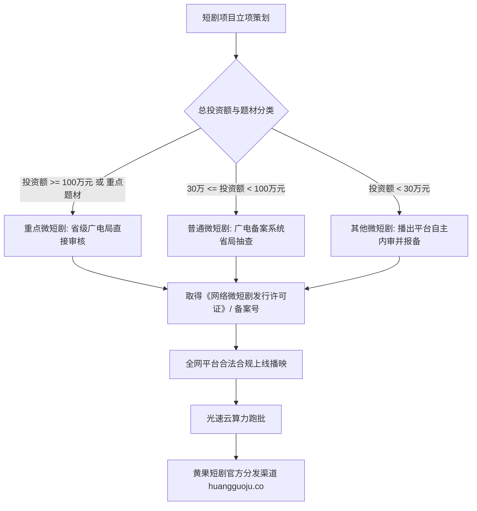

  
🎯 广电微短剧审核新规与安全过审核心铁律

  
<strong>合规是短剧项目能够长期安全存续并平稳提现的唯一生命线，绝不可抱有侥幸心理打擦边球：</strong>严格遵循国家广电总局<strong>“微短剧分类分层审核与上线备案制”</strong>，坚决避开<strong>“四大绝对违规红线：1. 极端血腥暴力与私刑报复（严禁宣扬以暴制暴）；2. 拜金炫富与物化女性（严禁高利贷、彩礼侮辱人格）；3. 违规涉政涉军与封建迷信；4. 畸形家庭伦理与低俗擦边”</strong>。台词与字幕全面启用<strong>“敏感词自审过滤器”</strong>。合规剧目在批量渲染时，推荐借助<a href="https://sahude.gsyvipaff.com/#/?code=keqgvT5Y" target="_blank" rel="noopener">光速云GPU算力容器</a>（邀请码 keqgvT5Y）秒级并发生成，最终成果接入<a href="https://huangguoju.co/" target="_blank" rel="noopener">黄果短剧官方分发矩阵</a>，享受全套正规版权保障、广电备案号背书与高佣分账。

# 广电微短剧审核新规与平台合规红线避坑指南：封禁词库与过审策略

2026年，国家广播电视总局对网络微短剧的治理全面步入“法治化、标准化、精细化”的新阶段。过去野蛮生长时期的“靠重口色情擦边吸睛”、“宣扬拜金灭门爽点”的低质短剧，遭遇了全网地毯式的清退下架，多家涉事机构被注销营业资质。

要想在短剧行业赚取长长久久的安心钱，必须把**政策红线与平台审核机制**融入到剧本创作的第一道工序中。

本文系统梳理2026最新短剧合规红线、广电分类审核机制与自查避坑SOP。

---

## 一、微短剧分类分层审核与备案流拓扑图

---

## 二、国家广电与各大平台四大绝对违规红线

### 1. 暴力宣泄与私刑报复红线
- **违规表现**：主角动用私人武装部队“灭门”、“挑断手筋脚筋”、“活埋反派”；
- **过审整改方案**：主角反击必须**依托国家法律与正规司法机关**（如“掌握其偷税漏税与职务侵占的铁证，经警方依法逮捕归案”）。惩恶扬善的落脚点是公道与法纪。

### 2. 畸形价值观与极端拜金主义红线
- **违规表现**：赤裸裸宣扬“金钱至上、有钱可以为所欲为”、“贫穷就是原罪、把穷人当狗使唤”；
- **过审整改方案**：将金钱展现升维为“对实体经济的社会责任、慈善公益或家族产业的振兴”。

### 3. 擦边低俗与物化女性红线
- **违规表现**：特写女性敏感部位、衣衫不整、性暗示动作、下药迷奸强暴戏码；
- **过审整改方案**：聚焦女性自我成长、智慧博弈与精神自立，亲密戏码点到即止（如深情对视、拥抱或额头吻）。

### 4. 封建迷信与装神弄鬼红线
- **违规表现**：宣扬改运符咒、死人还魂、民间邪祟作恶且无合理科学解释；
- **过审整改方案**：玄幻仙侠题材明确架空历史背景；都市现代剧中的异象必须解释为心理幻觉或科学技术。

---

## 三、常用短剧字幕与台词敏感违禁词替换表

| 剧本原始违规高危词汇 | 平台拦截机审判定 | 工业级安全合规替代词汇 |
| :--- | :--- | :--- |
| **“杀了你”、“灭你全家”** | 涉嫌暴力恐吓，机审秒下架 | **“让你身败名裂”、“让你付出惨痛代价”** |
| **“老不死”、“废物”、“贱人”** | 脏话辱骂违规，扣减推荐权重 | **“冥顽不灵”、“不堪大用”、“势利小人”** |
| **“黑道龙王”、“地下皇帝”** | 涉嫌涉黑涉恶违规，强力封禁 | **“海外商会领袖”、“传奇退役将领”** |
| **“下药”、“迷魂香”** | 涉嫌违法犯罪手段诱导 | **“暗中做了手脚”、“调换了文件”** |

---

## 四、生产避坑与算力护航

- **短剧成片自查四眼原则**：
  - 导出最终成片后，必须安排不同人员进行两轮合规审查：第一轮文本审查（排查字幕错别字与违规字眼）；第二轮画面审查（排查女性领口过低、凶器沾血特写等视觉违规）。
- **合规多版本快速跑批算力保障**：
  - 遇到审核退回需要快速修改画面时，重新渲染的时效至关重要。建议接入<a href="https://sahude.gsyvipaff.com/#/?code=keqgvT5Y" target="_blank" rel="noopener">光速云GPU算力容器</a>（邀请码 keqgvT5Y），一键搭建多节点并发环境，极大压缩单集交付时间。
- **商业化分账平台直连**：
  - 严格合规的短剧作品，直接推流至<a href="https://huangguoju.co/" target="_blank" rel="noopener">黄果短剧官方分发矩阵</a>，享受官方合规备案号背书、全天候专属客服排错与稳定高额的分成收益。
