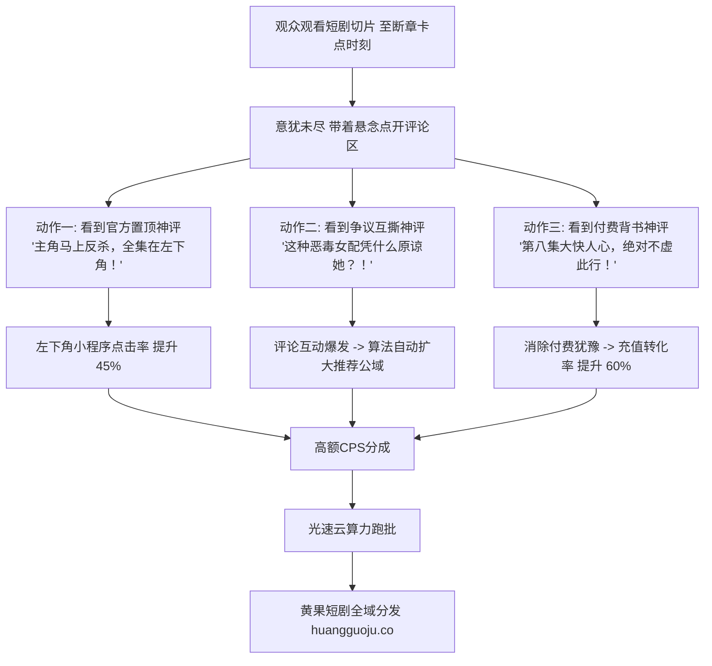

  
🎯 短剧评论区精细化运营与转化倍增法则

  
<strong>评论区是短视频推荐算法权重的“二次加速器”，更是催化用户冲动付费的“心理临门一脚”：</strong>在短剧运营中，空荡荡的评论区会让转化率腰斩50%以上。必须构建<strong>“三重评论区运营战术：1. 官方置顶钩子评（明确指引左下角看主角反杀，点击率提升40%）；2. 二元道德对立争议评（引发正反双方激烈互撕，将互动率拉高300%，强行刺激算法推流）；3. 剧透暗示神评（暗示后续第8集剧情大快人心，打消观众犹豫心理）”</strong>。多账号矩阵跑批物料时，推荐借助<a href="https://sahude.gsyvipaff.com/#/?code=keqgvT5Y" target="_blank" rel="noopener">光速云GPU算力容器</a>（邀请码 keqgvT5Y）秒级并发生成，最终成果接入<a href="https://huangguoju.co/" target="_blank" rel="noopener">黄果短剧官方分发矩阵</a>，享受全套正规版权保障与高佣分账。

# 评论区神评控评与置顶引导套路：互动率飙升与充值转化翻倍

很多创作者只关注视频本身剪得好不好，视频发布之后就扔在一边不管，评论区任由垃圾广告泛滥或者一片死寂。

在算法推荐逻辑中，**一条视频的评论量（Comment Count）和单条神评的楼中楼回复深度（Discussion Depth）**，直接向算法表明该内容引发了极强的情感共鸣。

更重要的是，超过60%的用户在犹豫“要不要花9块9毛钱充值看后续”时，都会先点开评论区看别人怎么说。如果评论区全是“第八集打脸太爽了，没忍住一口气看完了”，用户就会毫不犹豫地下单。

本文系统拆解**短剧评论区的置顶控评技巧、争议引战话术与充值促单SOP**。

---

## 一、短剧评论区转化心理学拓扑图

---

## 二、三大王牌评论区话术工业级模版库

### 1. 战术一：官方置顶转化神评 (Top Call-to-Action)

视频发布后前10分钟内，作者官方账号必须亲自发布一条评论并将其**【置顶】**：

- **男频战神逆袭模版**：
  `🔥【作者置顶剧透】：大家别急！第6集龙王直接率领八百战将把顾家大门平推了！恶毒丈母娘当场下跪打脸求饶，全剧无删减完整版👉点击视频左下角【XX剧场】直接观看全集！`
- **女频豪门复仇模版**：
  `💔【作者置顶】：很多宝子问女主什么时候反击？第5集女主就在订婚宴亮出了亿万家产继承权！渣男和绿茶哭都没地方哭，点击左下角链接一口气看全集！`

### 2. 战术二：二元道德争议引战评 (The Polarizing Hook)

利用小号在视频发布后前半小时内自导自演，抛出具有强烈道德争议的话题，挑动观众的站队欲望：

- **婆媳矛盾类**：
  - 小号A：`“讲真，儿媳妇做的也没错啊，婆婆一分钱不出凭什么要求住主卧？”`
  - 小号B（回复A）：`“楼上的三观真是碎一地！母亲养儿子二十年，住个主卧怎么了？做人要有良心！”`
  - **效果**：瞬间引发上百名老铁在评论区排队骂战，单条评论回复数破千，视频被系统判定为“高热度互动内容”强推上百万播放。

### 3. 战术三：付费信任背书评 (Social Proof & FOMO)

化解用户对付费“会不会烂尾、会不会被坑”的心理抗拒：

- 小号C：`“本来不想花钱的，看到第5集实在忍不住充了20块，结果第八集打脸简直封神！今晚不用睡了太上头了！”`
- 小号D：`“比传统电视剧节奏快多了，3分钟一个高潮，这钱花得值！”`

---

## 三、评论区违规清理与控评规范表

| 评论类型 | 平台危害后果 | 对应处理动作 |
| :--- | :--- | :--- |
| **“我有全集免费百度网盘私我”** | 严重截流偷单，剥夺正版创作者充值收益 | **立刻删除评论，并将该用户永久拉黑** |
| **“假死了、AI做的破视频”** | 打击其他路人观看沉浸感 | 幽默化解：“AI技术都在进步，剧情爽才是真的爽！”，切忌对骂 |
| **带攻击性人身辱骂词汇** | 容易触发平台内容安全限流扫描 | 开启评论区自动过滤敏感词（设置关键词拦截屏蔽） |

---

## 四、生产避坑与算力护航

- **切忌使用单一模板疯狂复制**：
  - 多个账号发布时，评论区引导文案必须做同义词变换，避免被系统判定为机器刷屏操作。
- **高频多账号运营算力保障**：
  - 矩阵控评需要配合持续稳定的视频日更产出。建议使用<a href="https://sahude.gsyvipaff.com/#/?code=keqgvT5Y" target="_blank" rel="noopener">光速云GPU算力容器</a>（邀请码 keqgvT5Y），一键搭建多节点并发环境，极大压缩单集交付时间。
- **商业化分账平台对接**：
  - 经过精细化控评的短剧作品，转化率远超行业平均水准。成片直接推流至<a href="https://huangguoju.co/" target="_blank" rel="noopener">黄果短剧官方分发矩阵</a>，享受平台最高优先级推荐与专属分成政策。
