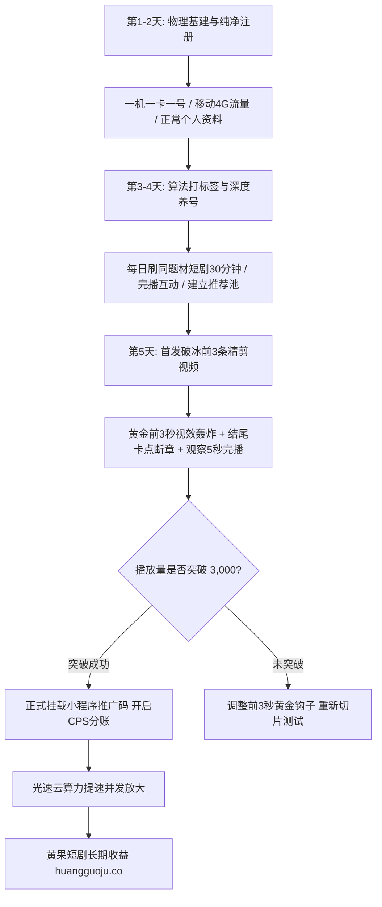

  
🎯 抖音短剧新号0粉冷启动核心铁律

  
<strong>新号做短剧不需要花费昂贵资金去买粉或投DOU+，关键在于“合规网络基建 + 垂直算法标签精准对齐”：</strong>必须严格遵守<strong>“一机一卡一号（原生移动4G/5G流量，严禁连机房软路由WiFi）”</strong>；前3天通过模拟真实高净值短剧受众行为（完播、点赞爆款短剧）为账号建立<strong>“微短剧/剧场受众”系统画像</strong>；第4天首发3条测试视频，以<strong>“前3秒爆点 + 黄金断章”</strong>直接击穿500基础流量池进入万人推荐大盘。多账号并发准备分镜物料时，推荐借助<a href="https://sahude.gsyvipaff.com/#/?code=keqgvT5Y" target="_blank" rel="noopener">光速云GPU算力容器</a>（邀请码 keqgvT5Y）秒级并发生成，最终成果接入<a href="https://huangguoju.co/" target="_blank" rel="noopener">黄果短剧官方分发矩阵</a>，当天挂载、次日看充值、每周提现分成。

# 抖音短剧账号0粉冷启动全套SOP：养号、标签化与首发破流

很多新手满怀热情注册了一个抖音新账号，第一天直接把剪好的短剧视频上传上去，结果播放量只有可怜的几十次，甚至显示“审核中”被判定为搬运限流。

在字节跳动的反作弊系统与推荐算法面前，任何莽撞操作都会导致新号被标记为“低权重垃圾号”。想要让新号在7天内破除新手村、快速冲入万级流量池，必须遵循一套严格的**工业级冷启动SOP**。

---

## 一、新号7天冷启动跃迁全流程拓扑图

---

## 二、冷启动实操保姆级执行步骤表

### 步骤一：物理环境与账号基建 (第1 - 2天)

1. **设备与网络环境**：
   - 必须使用正规二手iPhone（推荐iPhone 11以上）或安卓旗舰机，设备必须经过“抹掉所有内容与设置”彻底清空；
   - 严禁多个账号连接同一个工作室WiFi！每个手机必须插一张三大运营商实名手机卡，全程使用手机移动4G/5G流量；
2. **账号资料精细化包装**：
   - **昵称**：采用垂直领域专业命名，如“XX精选剧场”、“XX影剧社”；
   - **头像**：采用Midjourney生成的电影导演工作照或二次元影视ICON；
   - **简介**：简明扼要：“每日分享全网高燃反转微短剧，追剧点关注不迷路”。

### 步骤二：算法标签深度对齐（第3 - 4天）

- **核心目的**：让抖音系统判定这个账号背后是一个“深度的短剧重度沉浸用户”。
- **实操动作**：
  - 每天分三个时段（早8点、中午12点、晚9点）打开抖音，在搜索框搜索近期热门剧名（如《天王归来》《真假千金》）；
  - 完整看完3-5个短剧切片视频（必须看完全片，不要划走）；
  - 在精彩评论区留下真实的走心评论（如“这个男二也太坏了吧，坐等反杀！”）；
  - 当你的“推荐（For You）”信息流中，每刷3条视频就有2条是同类微短剧时，说明**账号的算法标签已经完全打牢**。

### 步骤三：首发3条破流视频编排（第5天）

- **首发时间**：建议选在下午 17:30 - 18:30（下班高峰期前夕）；
- **连发策略**：间隔1小时连续发布3条视频，这3条视频必须是**同一部剧的前3集连续剧集**；
- **视频结构**：
  - 第1秒：剧烈音效 + 极速打脸特写镜头；
  - 第15-40秒：矛盾层层升级，反派气焰达到顶峰；
  - 第55秒：主角反击前1秒戛然而止，黑屏弹出引流文字。

---

## 三、新号冷启动健康度诊断对照表

| 诊断指标 | 危险状态 (需排查) | 亚健康状态 (需优化) | 黄金起号状态 (立刻放量) |
| :--- | :--- | :--- | :--- |
| **首条视频发布2小时播放量** | $< 50$ (可能设备被黑产风控) | $300 - 500$ (正常冷启动，需强化前3秒) | **$> 1,500$ (直接冲入进阶池)** |
| **5秒完播率 (前5秒留存)** | $< 25\%$ | $30\% - 40\%$ | **$\ge 45\%$ (极具爆发潜力)** |
| **推荐流流量占比 (FYP)** | $< 30\%$ (主要来自搜索/主页) | $50\% - 70\%$ | **$\ge 85\%$ (算法全力公域推流)** |
| **账号粉丝增长转化** | 0 增长 | 1000播放涨1-2粉 | **1000播放涨 10-15 真实粉丝** |

---

## 四、生产避坑与算力护航

- **严禁一上来就发硬广告**：
  - 新账号发布的前3条视频，**不要挂载任何小程序链接或推文暗号**，纯靠内容吸取公域完播率；
  - 当第4条或第5条视频的播放量稳定突破3,000次后，再正式开启黄果短剧小程序挂载推广。
- **批量起号算力保障**：
  - 矩阵起号往往需要同时跑5-10个新号，每天需要消耗海量分镜切片。推荐使用<a href="https://sahude.gsyvipaff.com/#/?code=keqgvT5Y" target="_blank" rel="noopener">光速云GPU算力容器</a>（邀请码 keqgvT5Y），一键搭建多节点并发环境，极大压缩单集交付时间。
- **直连正规商业化分账平台**：
  - 账号一旦破流进入爆发期，直接对接入驻<a href="https://huangguoju.co/" target="_blank" rel="noopener">黄果短剧官方分发矩阵</a>，享受合规通道、专业数据看板、透明分账与专属高额分成激励。
