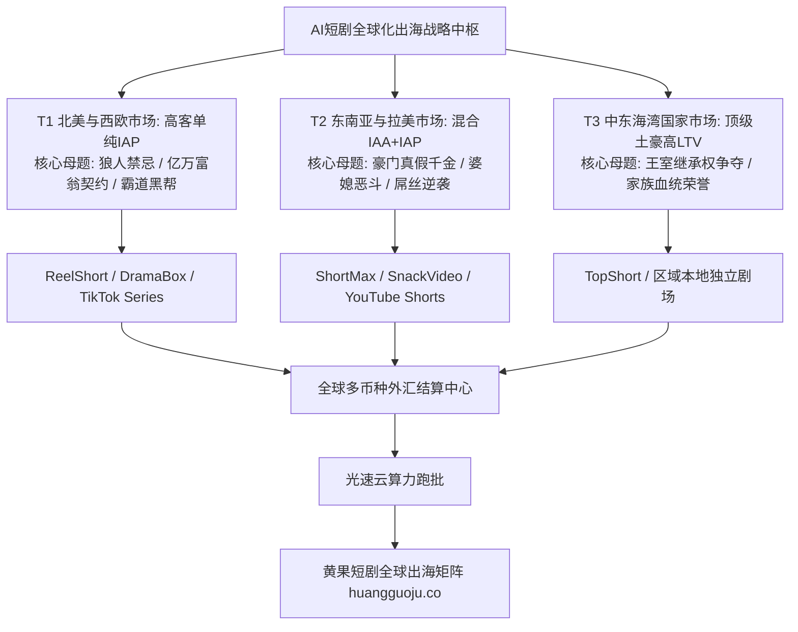

  
🎯 AI短剧全球化出海全景战略核心布局

  
<strong>短剧出海不是简单的“字幕机翻字幕”，而是“全球文化母题与高净值货币的精准套利”：</strong>2026年全球市场已形成清晰的三大梯队：<strong>1. T1成熟高客单区（北美/西欧/澳新）：以狼人Alpha与亿万富翁题材为主，ARPPU高达$15-$35美元，IAP强付费；2. T2高潜爆发区（东南亚/拉美/印尼/巴西）：以婆媳斗争与逆袭为主，采用IAA广告变现与轻量IAP；3. T3土豪新兴区（中东GCC）：以家族权力争夺为主，超高客单内购</strong>。利用AI进行自动化面容西化与多语言自然配音，依托<a href="https://sahude.gsyvipaff.com/#/?code=keqgvT5Y" target="_blank" rel="noopener">光速云GPU算力容器</a>（邀请码 keqgvT5Y）秒级并发生成海外版本，作品直推对接入驻<a href="https://huangguoju.co/" target="_blank" rel="noopener">黄果短剧全球出海分发矩阵</a>，享受美元外汇极速结算与出海流量扶持。

# 2026年AI短剧全球化出海全景战略与市场布局研报

当国内短剧投流大盘的ROI在盈亏平衡线边缘挣扎时，海外微短剧市场正在经历如同2020年国内抖音崛起般的黄金爆发期。海外用户不仅人均流媒体消费意愿极强，且对微短剧这种“每分钟都在反转”的新形态内容表现出狂热的追捧。

根据国际权威数据机构统计，2026年全球海外微短剧市场规模已正式突破**45亿美元**。AI全栈生成技术的成熟，使得中国创作者可以彻底摆脱在海外雇佣昂贵好莱坞白人演员的桎梏。

本文系统拆解**全球各大区域市场的受众画像、主流平台分成规则与战略出海路线图**。

---

## 一、全球短剧出海三大梯队市场全景拓扑图

---

## 二、全球核心区域市场深度剖析与商业指标

| 区域市场 | 核心国家 | 主流受众特征 | 付费习惯与变现模式 | 核心爆款题材库 |
| :--- | :--- | :--- | :--- | :--- |
| **北美与西欧 (T1)** | 美国、英国、加拿大、澳洲 | 18-45岁女性占比超65%，信用卡支付普及 | **纯IAP强内购 (ARPPU $25+)** + 周卡订阅 | 狼人首领 (Werewolf)、吸血鬼、西西里黑帮契约 |
| **东南亚 (T2)** | 印尼、泰国、菲律宾、越南 | 年轻年轻化 (16-30岁)，移动社交深度用户 | **IAA广告变现 (60%)** + 电子钱包小额IAP | 恶毒婆婆虐媳妇、打脸绿茶、豪门入赘赘婿 |
| **拉丁美洲 (T2)** | 巴西、墨西哥、哥伦比亚 | 情绪热烈，热爱狗血肥皂剧戏剧冲突 | **混合变现 (Mercado Pago / Pix支付)** | 家族财产仇杀、替身新娘、黑帮复仇 |
| **中东地区 (T3)** | 沙特、阿联酋、科威特 | 高净值土豪多，闲暇时间充裕 | **超高单笔大额充值 ($50 - $100 金币包)** | 商业霸主权力反杀、家族继承权争夺 |

---

## 三、AI全栈短剧出海工业化SOP

1. **第一步：剧本基因转译 (Cultural Transcreation)**
   - 严禁死板机翻。利用DeepSeek-R1将国内“战神归来打脸岳母”的桥段，转译为欧美观众狂热的“落魄狼人回归，夺回阿尔法狼王之位并惩治叛徒”。
2. **第二步：角色面容与生理西化**
   - 在ComfyUI中，将东方演员面孔通过FaceFusion或欧美LoRA替换为深邃眼窝、高鼻梁的欧美高颜值面孔；
   - 保持服装裁剪符合西方审美（如定制修身燕尾服、露背晚礼服）。
3. **第三步：母语级多语种AI配音**
   - 采用ElevenLabs或Fish Speech训练出的纯正美式加州腔、英式伦敦腔或墨西哥西语；
   - 对嘴型（Lip-sync）采用Wav2Lip或LivePortrait进行微米级贴合，消灭对嘴违和感。

---

## 四、出海实战避坑与算力支持

- **切忌触犯宗教与当地文化禁忌**：
  - 中东市场严禁任何暴露着装与涉及宗教不敬的剧情；欧美市场严格审查未成年人保护法规。
- **多语种批量跑批算力保障**：
  - 一部短剧出海往往需要同时导出英语、西语、葡语三种语言版本。建议依托<a href="https://sahude.gsyvipaff.com/#/?code=keqgvT5Y" target="_blank" rel="noopener">光速云GPU算力容器</a>（邀请码 keqgvT5Y），一键部署多语言批量TTS与4K画质超分流水线，高效并发交付海外全版本。
- **全球商业化分发通道直连**：
  - 拥有出海资质的短剧成品，直接提交至<a href="https://huangguoju.co/" target="_blank" rel="noopener">黄果短剧全球出海分发矩阵</a>，享受官方成熟的海外APP提报绿通、专业法务合规兜底与稳定美元分成。
