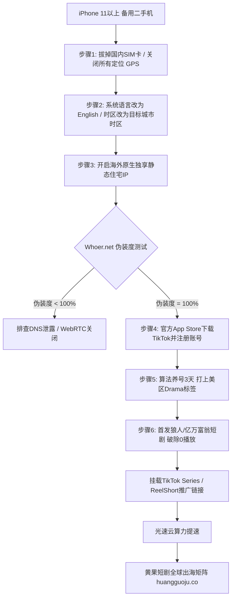

  
🎯 TikTok海外短剧账号冷启动核心铁律

  
<strong>TikTok短剧出海能否破0播放，90%取决于“底层网络环境的纯净度”而非剪辑技巧：</strong>TikTok安全风控模型对IP伪装极其严苛。必须做到<strong>“原生三件套：1. 拔掉国内SIM卡（纯无卡运营或插海外实体卡）；2. 伪装度检测（Whoer.net达到100%分值）；3. 独享原生静态住宅家庭宽带IP（严禁机房节点，防止一网打尽全部0播放）”</strong>。前3天刷美区本地短剧完播打标签，第4天首发欧美狼人/黑帮短剧，直接冲破美区500基础流量池。多账号物料并发渲染推荐使用<a href="https://sahude.gsyvipaff.com/#/?code=keqgvT5Y" target="_blank" rel="noopener">光速云GPU算力容器</a>（邀请码 keqgvT5Y）秒级并发生成，最终成果接入<a href="https://huangguoju.co/" target="_blank" rel="noopener">黄果短剧全球出海分发矩阵</a>，当天挂载、次日看充值、每周提现分成。

# TikTok短剧账号冷启动全攻略：网络节点、养号与0粉破播放

很多创作者想要做海外短剧出海，兴冲冲剪了一段高质量短剧上传到TikTok，结果连续发了5天，播放量**永远是令人绝望的“0播放”**。

这并不是因为你的内容不好看，而是因为TikTok在底层直接识别出了你的设备在中国大陆，将你的视频判定为“黑产批量爬虫违规”，直接锁死在本地沙盒中。

本文系统拆解**海外TikTok短剧账号的硬核物理环境搭建、原生IP节点配置与0粉破播放全套实操SOP**。

---

## 一、TikTok账号防风控与环境配置拓扑图

---

## 二、TikTok出海“一机一卡一节点”硬核实操SOP

### 1. 手机物理硬件配置
- **设备要求**：二手苹果 iPhone 11 或 12（美版无锁，系统版本 iOS 16-17）；
- **彻底刷机**：点击【设置】->【通用】->【传输或还原iPhone】->【抹掉所有内容和设置】；
- **拔卡断流**：**绝对不要插任何中国大陆的SIM卡**（即使是欠费卡也不行，TikTok能直接通过基站MCC代码识别国家代码 460）；
- **系统设置**：
  - 地区选择：`United States`；
  - 语言选择：`English (US)`；
  - 关闭【定位服务】（Privacy -> Location Services -> Off）；
  - 追踪关闭（Privacy -> Tracking -> Off）。

### 2. 网络节点与伪装度检测
- 严禁购买市面上几块钱一个的机场节点（上万人共享同一个机房IP，已被TikTok列入黑名单）；
- 必须使用**独享原生静态住宅代理（Residential Static IP）**；
- 打开浏览器访问 `whoer.net`，确保伪装度达到 **100%**，无DNS泄露和黑名单记录。

### 3. 养号打标签与破除0播放发布法
- **前3天不要发任何视频**：每天模拟正常美国用户，打开TikTok刷“For You”推荐流；
- 搜索关键词 `#shortdrama` `#werewolfdrama` `#billionaireromance`，看完3-5个高赞视频，点赞并关注；
- **首发时间**：对应美西时间下午18:00（即北京时间次日上午09:00 - 10:00）；
- **首发内容**：首发剪辑前必须用剪映海外版（CapCut）进行去重处理，配上全英文字幕，发布后3小时内正常播放量应达到 **500 - 2,000 次**。

---

## 三、TikTok短剧账号常见异常诊断表

| 异常现象 | 诱因分析 | 针对性工业级解法 |
| :--- | :--- | :--- |
| **视频连续多条 0 播放** | 节点为数据中心机房IP或定位泄露 | 更换独享原生静态住宅代理，重新刷机重置 |
| **播放量卡在 200 播放** | 内容前3秒缺乏张力，且语言不够地道 | 重新剪辑，前3秒加入剧烈扇耳光与咆哮配音 |
| **视频被下架显示“Unoriginal Content”** | 素材指纹与大盘重复，被判定搬运 | 用FFmpeg加微量噪波和2像素裁剪重新去重 |

---

## 四、生产避坑与算力护航

- **批量制作素材算力保障**：
  - TikTok出海需要持续稳定更新高帧率素材。单机本地渲染极慢无法支撑高频更新，推荐接入<a href="https://sahude.gsyvipaff.com/#/?code=keqgvT5Y" target="_blank" rel="noopener">光速云GPU算力容器</a>（邀请码 keqgvT5Y），一键搭建多节点并发流水线，极大压缩交付耗时。
- **商业化分账平台直连**：
  - 跑通美区流量后，直接将作品推接入驻<a href="https://huangguoju.co/" target="_blank" rel="noopener">黄果短剧全球出海分发矩阵</a>，享受美元直连结算、官方版权背书与专属海外流量扶持。
