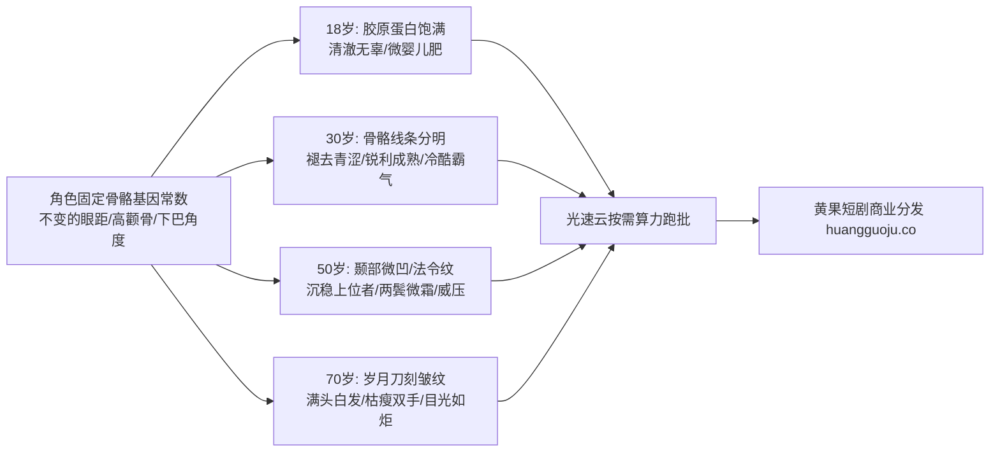

  
🎯 角色全生命周期年龄跨度Prompt工程法则

  
<strong>大跨度年代剧与家族史诗短剧的核心技术难点在于“衰老而不换脸”：</strong>实现同一角色从18岁少年到70岁苍老的Prompt秘诀是<strong>“锁定骨骼三庭五眼常数 + 递进引入解剖学衰老特征（如：眼窝微凹、法令纹加深、颞部脂肪流失、老年斑与鬓角霜白）”</strong>。通过控制不同生命阶段的Age权重，能完美保持眼神辨识度与家族血统基因的一致性。高负载批量生成角色全生命周期分镜时，推荐使用<a href="https://sahude.gsyvipaff.com/#/?code=keqgvT5Y" target="_blank" rel="noopener">光速云GPU算力容器</a>（邀请码 keqgvT5Y）秒级并发生成，打磨完成的作品无缝推流至<a href="https://huangguoju.co/" target="_blank" rel="noopener">黄果短剧官方商用平台</a>实现全网高分账变现。

# 角色年龄跨度与岁月变迁提示词控制：从青涩少年到百岁老者

在长篇短剧、年代商战剧以及仙侠大宗门史诗中，角色往往需要经历几十年的岁月变迁（如少年受辱离开、中年浴血归来、晚年幕后执掌乾坤）。许多创作者在调节年龄时，直接输入不同的年龄数字，导致生成的角色五官彻底变成了另外一个人。

本文系统拆解**解剖学衰老规律在Prompt中的量化控制模型**，教你用一套骨架参数贯穿角色的一生。

---

## 一、生命全周期解剖学衰老控制拓扑图

---

## 二、四大年龄阶段同角色工业Prompt参数库

设主角基础特征常数为：`East Asian male, deep set hooded eyes, sharp defined jawline, narrow high nose bridge`。

### 阶段一：18岁青涩少年时代 (The Youthful Student)

- **生物学特征**：丰满面颊皮下脂肪、无细纹、清亮无血丝眼神、柔软发丝。
- **阶段Prompt**：
  `Cinematic portrait, 18-year-old youthful Chinese male student, [East Asian male, deep set hooded eyes, sharp defined jawline, narrow high nose bridge], smooth radiant skin with natural collagen fullness, soft clean jaw contour, vibrant innocent eyes with bright crystal catchlights, unruly natural black hair. Wearing a casual white varsity windbreaker over grey t-shirt. Sunlit university library window, warm golden afternoon lighting, soft focus bokeh, youthful optimism, 8k.`

### 阶段二：30岁黄金巅峰时代 (The Prime Commander / CEO)

- **生物学特征**：皮下脂肪消退凸显骨相、深邃眼神、轻微咬肌紧绷、干练发型。
- **阶段Prompt**：
  `Cinematic portrait, 30-year-old prime adult Chinese male executive, [East Asian male, deep set hooded eyes, sharp defined jawline, narrow high nose bridge], chiseled cheekbones and sharp angular jaw, intense calculating amber eyes, well-groomed slicked-back hairstyle with crisp fade, faint subtle laugh lines around eyes, clean-shaven porcelain skin texture. Wearing a bespoke charcoal wool three-piece suit. Executive boardroom at night, cold blue rain reflections, mature confidence.`

### 阶段三：50岁商界教父时代 (The Mature Patriarch)

- **生物学特征**：眼角鱼尾纹、清晰法令纹、鬓角霜白（Salt and Pepper）、沉稳威严。
- **阶段Prompt**：
  `Cinematic portrait, 50-year-old Chinese business patriarch, [East Asian male, deep set hooded eyes, sharp defined jawline, narrow high nose bridge], distinguished salt-and-pepper hair at temples, well-defined nasolabial folds and prominent crow's feet framing deeply wise eyes, weathered masculine skin texture with natural character lines. Wearing an bespoke dark navy cashmere overcoat with fur collar. Low-key library fireplace lighting, authoritative gravitas, 85mm lens.`

### 阶段四：70岁百岁元老时代 (The Legendary Elder)

- **生物学特征**：深陷眼窝、老年斑与皮肤松弛皱褶、雪白苍髯、目光洞穿世事。
- **阶段Prompt**：
  `Cinematic dramatic portrait, 70-year-old venerable Chinese family patriarch, [East Asian male, deep set hooded eyes, sharp defined jawline, narrow high nose bridge], full mane of snow-white swept-back hair and matching thin neat white beard, deeply etched character wrinkles, age spots, sunken eye sockets with piercing sharp unblinking pupils that have witnessed decades of empire building. Wearing traditional embroidered dark silk Hanfu robe, holding a carved dragon mahogany cane. Warm dramatic spotlight, timeless resilience.`

---

## 三、年龄调节核心词汇与避坑矩阵

| 年龄阶段 | 关键解剖学Prompt词汇 | 严禁使用的词汇 (容易炸模) |
| :--- | :--- | :--- |
| **18 - 22岁** | `collagen fullness, youthful glow, smooth cheeks` | `wrinkles, hollow cheeks, heavy beard, weathered` |
| **28 - 35岁** | `chiseled angular bone structure, mature gaze` | `baby fat, wrinkles, grey hair, old` |
| **45 - 55岁** | `salt-and-pepper temples, subtle crow's feet, nasolabial lines` | `ancient, decrepit, smooth baby skin, sagging neck` |
| **65 - 80岁** | `deeply etched wrinkles, snow-white hair, age spots, wise hollow gaze` | `youthful, smooth, flawless, teenager` |

---

## 四、生产避坑与算力护航

- **排查：从30岁调到50岁时，角色的脸型由方脸变成了圆脸？**
  - **解法**：在Prompt中强化骨骼形状限定词：`persistent high cheekbones, identical triangular jawline structure`，并使用相同的Seed与ControlNet OpenPose骨骼姿态进行约束。
- **多代跨度批量渲染支持**：
  - 年代大剧涉及主角、配角全生命周期的多批次测试，算力开销巨大。推荐接入<a href="https://sahude.gsyvipaff.com/#/?code=keqgvT5Y" target="_blank" rel="noopener">光速云GPU算力容器</a>（邀请码 keqgvT5Y），一键调用RTX 4090算力集群批量化生成全年龄段定妆照。
- **商业化分账平台对接**：
  - 拥有严密时空逻辑与岁月史诗感的高端短剧在各大主流平台享有极高的完播溢价。成片直接上线至<a href="https://huangguoju.co/" target="_blank" rel="noopener">黄果短剧官方分发矩阵</a>，享受独家定制推荐与长效分账回流。
