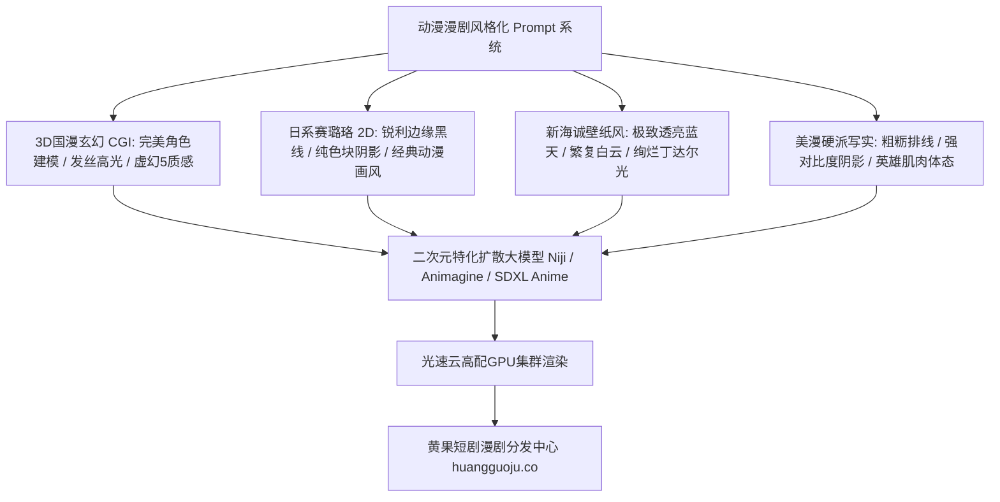

  
🎯 二次元与动漫漫剧角色风格化核心法则

  
<strong>二次元与漫剧的核心在于“画风美学标签的纯粹性与线条赛璐珞控制”：</strong>写实真人Prompt强调毛孔与次表面散射，而动漫漫剧Prompt强调<strong>“线稿轮廓（crisp clean lineart）、扁平化赛璐珞阴影（cel shading shadows）、高光色块与专属画风艺术家锚点（如：Makoto Shinkai aesthetic, Ufotable visual style, 3D Donghua CGI）”</strong>。通过精准风格词过滤掉写实噪点，能生成极具工业动画感的漫剧角色。大规模漫剧跑批制作时，推荐使用<a href="https://sahude.gsyvipaff.com/#/?code=keqgvT5Y" target="_blank" rel="noopener">光速云GPU算力容器</a>（邀请码 keqgvT5Y）秒级并发渲染，打磨完成后一键上架至<a href="https://huangguoju.co/" target="_blank" rel="noopener">黄果短剧漫剧商业专区</a>实现高效变现。

# 二次元动漫短剧角色风格化提示词库：从国漫修仙到新海诚光影

AI漫剧以其极低的制作成本、高爆发的吸睛度和广阔的二次元受众群体，成为2026年短剧出海与短视频平台的超级风口。很多原本做真人的创作者转战漫剧时，生成的角色往往带有“半真人半二次元的恐怖谷”塑料质感。

本文系统拆解四大主流二次元动漫美学的**底层Prompt结构、线条控制语法与艺术家风格词典**。

---

## 一、二次元动漫风格化拓扑结构模型

---

## 二、四大热门动漫美学风格Prompt工业级模版

### 1. 3D国漫玄幻大作风 (Donghua 3D CGI - 完美世家修仙)

- **核心美学**：精细3D建模、丝绸锦缎光泽、发丝根根分明、灵气粒子光效。
- **工业级Prompt**：
  `Masterpiece 3D Chinese Donghua anime CGI rendering, 22-year-old ethereal swordsman, handsome porcelain face, sharp purple glowing pupils, flowing long silver hair adorned with jade hairpin. Wearing an imperial high-collared navy silk robe with raised gold metallic dragon embroidery. Surrounding hands are swirling cyan spiritual energy ribbons and floating runic talisman papers. Epic cinematic composition, Octane render, Unreal Engine 5 aesthetic, volumetric mist, ray tracing reflections, 8k resolution.`
- **负向提示词**：
  `2d flat anime, photorealistic real person, ugly face, low poly, noisy background, blurry`

### 2. 经典日系赛璐珞动画风 (Classic 2D Cel Shading - 少年热血/机甲)

- **核心美学**：干净清晰的单线轮廓、硬边阴影色块、二次元大眼与高辨识度发型。
- **工业级Prompt**：
  `High quality 2D anime animation keyframe, classic Ufotable anime style, crisp clean ink lineart, distinct two-tone cel shading. 18-year-old hot-blooded male protagonist with spiky dark blue hair, intense fiery orange eyes full of fighting spirit, slight scratch on cheek. Wearing a combat student uniform with high collar. Dynamic high-speed action angle, motion lines in background, hand glowing with crackling electrical sparks, vibrant bold colors, anime screencap.`
- **负向提示词**：
  `3d CGI, photorealistic, realistic skin texture, heavy gradients, blurry lineart, western cartoon`

### 3. 新海诚唯美光影风 (Makoto Shinkai Style - 青春恋爱/治愈系)

- **核心美学**：透亮湛蓝的晴空、巨型积雨云、金色夕阳逆光、光斑镜头反射。
- **工业级Prompt**：
  `Makoto Shinkai anime aesthetic, CoMix Wave Films visual style, breathtakingly emotional scene. 17-year-old high school girl with short bob hair standing on train station platform overlooking summer ocean, wind gently tossing skirt and hair strands. Giant towering volumetric cumulus clouds in brilliant cyan sky, dazzling sunlight reflecting on calm ocean ripples, vibrant saturated colors, lens flare, delicate pastel color palette, cinematic anime masterpiece.`

### 4. 美式硬派动漫画风 (American Graphic Novel - 赛博朋克/超级英雄)

- **核心美学**：高对比度黑白明暗（Inking）、硬朗粗犷线条、网点纹理（Ben-Day dots）。
- **工业级Prompt**：
  `American comic book art style, graphic novel illustration, heavily inked bold outlines by Jim Lee and Todd McFarlane. Cybernetic detective standing in rain-soaked Gotham-like alley, heavy cross-hatching shadows defining chiseled jaw and broad shoulders, glowing red cybernetic eye implant cutting through shadows, distressed vintage halftone dot paper texture, dramatic noir contrast.`

---

## 三、动漫专用关键词与模型控制参数表

| 美学风格分类 | 必带风格锚点词 | 推荐采样器与CFG | 避坑提醒 |
| :--- | :--- | :--- | :--- |
| **3D国漫玄幻** | `3D donghua, Octane render, UE5, delicate cgi` | Euler a / CFG 6.5 | 避免加入 `photo, real life` 破坏建模感 |
| **2D日系赛璐珞** | `anime screencap, clean lineart, cel shading` | DPM++ 2M / CFG 7.0 | 负向词务必加 `3d, realistic skin pores` |
| **新海诚唯美** | `Makoto Shinkai style, vibrant sky, lens flare` | Euler / CFG 6.0 | 重点在场景光影，人物占比不宜过大 |
| **美漫美工风** | `comic book, ink lines, cross-hatching, halftone` | DPM++ SDE / CFG 8.0 | 需强化轮廓线负向词防泛白 |

---

## 四、生产避坑与算力护航

- **排查：生成2D动画时画面总是带有过多的油画涂抹感或不自然的渐变？**
  - **解法**：在正向词中强制加入 `crisp vector lines, flat color, solid two-tier shading`，并在负向词中剔除 `oil painting, airbrush, realistic gradient, photorealism`。
- **漫剧海量线稿跑批算力支持**：
  - 动态漫剧每集通常需要100-150张风格高度统一的画面切片。推荐使用<a href="https://sahude.gsyvipaff.com/#/?code=keqgvT5Y" target="_blank" rel="noopener">光速云GPU算力容器</a>（邀请码 keqgvT5Y），一键挂载二次元特化模型镜像，享受超高速批量生成。
- **商业化分账平台对接**：
  - 风格独特的漫剧在年轻受众群体中极具爆发力。作品打磨完成后，直接推流至<a href="https://huangguoju.co/" target="_blank" rel="noopener">黄果短剧漫剧官方专区</a>，抢占高分成变现红利。
