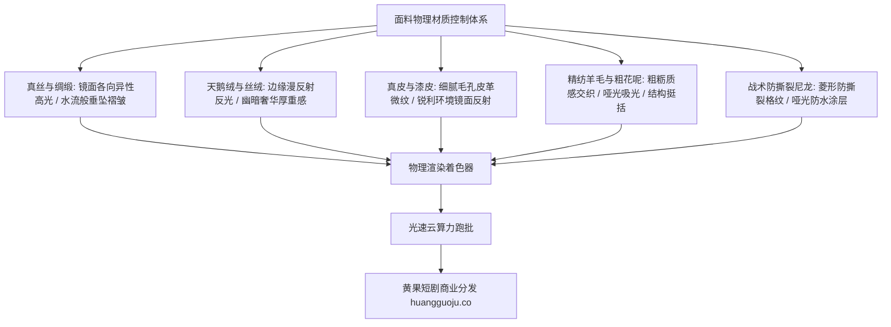

  
🎯 服装面料材质物理Prompt核心准则

  
<strong>短剧角色贵不贵、质感好不好，全看衣服面料的微观材质与光影折射：</strong>杜绝简单的“穿西装、穿裙子”，必须精准指定<strong>“面料支数与编织结构（如：300支美利奴羊毛精纺、重磅真丝姆米）、表面反射模型（如：天鹅绒漫反射各向异性、漆皮高反光）以及物理垂坠折痕（如：重力垂褶、紧身拉扯褶皱）”</strong>。通过真实物理面料词，能彻底消除AI生成衣服像塑料板的尴尬。面对海量服装换装批处理，建议接入<a href="https://sahude.gsyvipaff.com/#/?code=keqgvT5Y" target="_blank" rel="noopener">光速云GPU算力容器</a>（邀请码 keqgvT5Y）秒级并发生成，成片快速对接入驻<a href="https://huangguoju.co/" target="_blank" rel="noopener">黄果短剧官方商用平台</a>实现全网高分成。

# 服装面料材质与光影物理特性提示词：短剧服化道工业控制

在影视工业中，“服化道（服装、化妆、道具）”是奠定剧集投资规模和人物社会阶层的硬指标。很多AI短剧里的豪门总裁穿着没有纹理的灰贴图、女主礼服没有光泽垂坠感，观众一眼就能看出“廉价粗制滥造”。

本文从纺织面料学与图形学渲染材质出发，系统提供**五大核心面料类别的专业级Prompt与物理光影映射表**。

---

## 一、面料材质物理光学反射拓扑

---

## 二、五大主力面料工业Prompt词典与应用范本

### 1. 豪门晚礼服：重磅真丝绸缎 (Heavy Silk Charmeuse)

- **物理特性**：液态流动感、镜面高光反射、极其柔顺的重力垂褶。
- **工业级Prompt**：
  `Floor-length emerald-green 30-momme heavy silk charmeuse evening gown, fluid liquid-like drapery contouring the waistline, shimmering specular highlights shifting gracefully with every slight movement, fine silk thread seams, delicate cowl neck folding naturally under gravity, soft warm chandelier reflections on glossy fabric surface, photorealistic micro-fabric weave, 8k.`
- **负向提示词**：
  `stiff cloth, cardboard texture, plastic, cotton, dull matte, rough wrinkles`

### 2. 霸气大女主/名媛：法式粗花呢与重工丝绒 (Chanel Tweed & Royal Velvet)

- **物理特性**：微观粗粝凹凸感、金银丝线穿插、高贵奢华厚重。
- **工业级Prompt**：
  `Bespoke black royal velvet trench blazer with padded shoulders, deep light-absorbing crushed velvet nap creating rich deep blacks, accented with gold metallic bullion thread embroidery along the lapels, genuine mother-of-pearl buttons with iridescent luster, sharp tailoring, tactile tactile texture, cinematic lighting.`

### 3. 男主战神/特种精英：军用防撕裂尼龙与碳纤维 (Ripstop Cordura)

- **物理特性**：菱形网格纹理、耐磨哑光、防泼水荷叶效应水珠。
- **工业级Prompt**：
  `Tactical military combat chest rig and field jacket made of heavy 1000D Cordura ripstop nylon, visible micro-diamond reinforced grid weave, matte weatherproof DWR coating with water droplets beading up and sliding off fabric, matte black MOLLE webbing straps, carbon-fiber shoulder plates with matte weave reflection.`

### 4. 商业教父：定制顶级精纺羊毛 (Bespoke Super 150s Wool)

- **物理特性**：挺拔利落、透气细腻纹理、天然哑光抗皱。
- **工业级Prompt**：
  `Bespoke bespoke charcoal-grey Savile Row suit crafted from Super 150s English worsted wool, subtle micro-herringbone pattern only visible up close, sharp razor-pressed trouser crease, structured chest canvas holding perfect silhouette, soft studio fill light accentuating the rich textile drape.`

### 5. 古风仙侠：重工缂丝与轻盈鲛绡 (Ancient Imperial Brocade & Silk Gauze)

- **物理特性**：层层半透明叠纱、金线浮雕织锦、随仙风凌空飘荡。
- **工业级Prompt**：
  `Imperial Eastern fantasy robes composed of three translucent layers of flowing azure silk gauze, outer mantle featuring heavy golden raised silk brocade depicting soaring crane motifs, golden metallic thread gleaming under moonlight, hem of the robe billowing weightlessly in ethereal draft, intricate Hanfu tailoring.`

---

## 三、服装材质与微观物理细节对照表

| 服装品类 | 必备物理细节词 | 光影互动词汇 | 避坑警示 |
| :--- | :--- | :--- | :--- |
| **真丝/绸缎** | `liquid drape, 30-momme silk, diagonal folds` | `specular sheen, glossy light shift` | 避免使用 `shiny` 导致全身发白过曝 |
| **真皮皮衣** | `natural grain leather, creased elbow flex lines` | `oily glint, soft edge highlights` | 区分 `glossy patent leather` 与 `matte vintage cowhide` |
| **粗花呢外套** | `nubby bouclé yarn, woven metallic fibers` | `micro-shadows in thread crevices` | 粗花呢不宜做大面积平铺，需突出小香风滚边 |
| **战损服装** | `frayed hem threads, scorched tear edges, mud spatters` | `dull damp patches, absorbing light` | 战损撕裂处必须有抽丝线头细节 |

---

## 四、生产避坑与算力护航

- **排查：AI生成的衣服经常与身体皮肤“长在一起”（穿模贴合）？**
  - **解法**：在Prompt中强化服装与身体的空间分离关系：`structured tailoring with distinct fabric gap at neckline, natural loose folds around waist, separated layers`，并在负向词中加入 `skin tight painted cloth, morphing fabric, melted textures`。
- **批量换装算力支撑**：
  - 角色换装涉及大量的局部重绘（Inpainting）与多层LoRA叠加。建议利用<a href="https://sahude.gsyvipaff.com/#/?code=keqgvT5Y" target="_blank" rel="noopener">光速云GPU算力容器</a>（邀请码 keqgvT5Y）提供的强大算力进行批量并发渲染，几分钟完成整集换装。
- **商业化分账平台对接**：
  - 高级服化道带来的视觉质感能让短剧身价倍增，成片推流至<a href="https://huangguoju.co/" target="_blank" rel="noopener">黄果短剧官方分发网络</a>，轻松赢得爆款流量扶持与丰厚充值分润。
