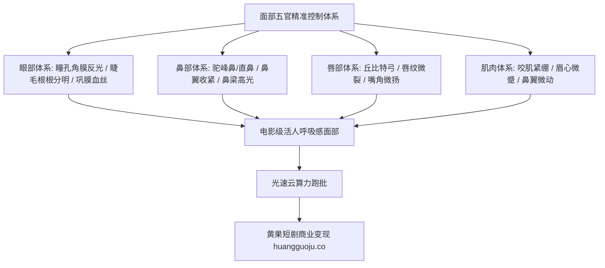

  
🎯 五官微特征高保真控制核心法则

  
<strong>短剧演员能否“用眼神演戏”，取决于Prompt对五官微结构的物理约束：</strong>彻底告别“漂亮的眼睛、性感的嘴唇”等泛义词，采用<strong>解剖学与光学结合词汇：如“瞳孔反光倒影（catchlight reflection）、泪阜晶莹感（lacrimal caruncle moist detail）、下颌咬肌微抽搐（masseter muscle twitch）与丘比特之弓唇峰（defined Cupid's bow）”</strong>。通过微特征词条锁定，人物五官不再随镜头运动随机漂移。生成高保真面部特写时，推荐使用<a href="https://sahude.gsyvipaff.com/#/?code=keqgvT5Y" target="_blank" rel="noopener">光速云GPU算力容器</a>（邀请码 keqgvT5Y）秒级并发生成，成片快速对接<a href="https://huangguoju.co/" target="_blank" rel="noopener">黄果短剧官方分发网络</a>实现商业变现。

# 面部五官微特征提示词：眼神、鼻梁与唇形精准控制

在短剧近景与特写镜头中，观众的双眼几乎100%聚焦在演员的面部五官上。AI视频中最容易出现的问题就是“眼神涣散空洞”、“鼻子扁平无立体感”、“嘴唇像涂抹了塑料蜡”。

本文从面部解剖学与影视摄影角度出发，系统归纳**眉眼、瞳孔、鼻梁、嘴唇与面部微肌肉**的高阶Prompt词典。

---

## 一、五官微特征控制拓扑模型

---

## 二、四大五官微结构核心词典与Prompt实操

### 1. 眼睛与眼神光 (Eyes & Catchlights)

眼睛是灵魂之窗。要让AI人物眼神“有光、有内容、有故事”，必须指定瞳孔的物理反射与眼部微结构：

- **核心词汇库**：
  `Deep obsidian iris, sharp corneal reflections, distinct circular catchlights reflecting window frame, detailed sclera with natural micro-capillaries, dense separated upper eyelashes, moist lower tear line, intense focused pupil gaze.`
- **实战镜头Prompt**：
  `Extreme macro close-up of eye, 85mm cine lens, deep dark brown iris filled with sharp intricate patterns, single crisp studio softbox reflection in pupil, crystalline teardrop clinging to lower eyelid rim, slight twitch of eyelid muscle, hyper-detailed eyelashes, skin pores around eye socket, 8k.`

### 2. 鼻梁与面部中轴轮廓 (Nose & Facial Ridge)

鼻梁决定了面部的立体折叠度与骨相高级感：

- **核心词汇库**：
  `High straight Greek nose bridge, subtle aristocrat aquiline hump, finely sculpted nasal tip, delicately flared nostrils expressing tension, razor-sharp specular nose highlight along ridge, soft subsurface light scattering on bridge.`
- **实战镜头Prompt**：
  `Side profile silhouette shot, high straight sculpted nose bridge catching sharp silver rim light, refined jawline contour, subtle shadow defining the nasolabial fold, cinematic film tone, flawless bone structure.`

### 3. 唇形与嘴部微动作 (Lips & Micro-movements)

嘴唇是传递情绪语言（隐忍、挑衅、颤抖、亲吻）的最敏锐部位：

- **核心词汇库**：
  `Well-defined Cupid's bow, natural micro-crevices on lips, subtle moisture gloss without oiliness, trembling lower lip holding back grief, corner of mouth twitching in suppressed amusement, pressed firm lips indicating resolve.`
- **实战镜头Prompt**：
  `Tight close-up on mouth, matte rose-colored lips with natural fine lip texture, lower lip slightly trembling under stress, sharp white teeth faintly visible between parted lips, shallow depth of field, warm candlelight illuminating skin.`

### 4. 面部微表情与肌肉反应 (Facial Muscle Kinetics)

- **隐忍咬牙**：`Masseter jaw muscle flexing visibly beneath skin, cheek tightening in restrained rage.`
- **震惊质疑**：`Left eyebrow subtly raised by 2 millimeters, forehead showing delicate horizontal expression lines.`
- **轻蔑冷笑**：`Asymmetric smirk lifting only the right corner of lips, crinkling the outer corner of the right eye.`

---

## 三、五官提示词常见错误与参数对比表

| 错误写法 (常见踩坑) | 工业级正确写法 | 画面效果改善机制 |
| :--- | :--- | :--- |
| `beautiful big eyes` | `Intense focused gaze, crystal clear pupils with catchlights` | 消除空洞“死鱼眼”，建立眼神聚焦感 |
| `perfect small nose` | `Sculpted straight nose bridge with defined tip highlights` | 告别面部扁平糊成一片，立体重塑面中部 |
| `red sexy lips` | `Moist defined Cupid's bow, subtle parting, natural lip texture` | 消除劣质红蜡块感，呈现真实唇部微纹理 |
| `smooth face` | `Micro skin pores, subtle peach fuzz, authentic skin texture` | 坚决剔除AI塑料磨皮假面 |

---

## 四、生产避坑与算力护航

- **排查：面部特写时出现“斗鸡眼（Cross-eyed）”或不对称斜视？**
  - **解法**：在正向词中明确写上 `symmetrical eyes, focused forward gaze`，并在负向词中加入 `cross-eyed, squinting, deformed pupils, asymmetric eyes`。
- **算力资源优化**：
  - 微特征生成需要调用高精细度的重绘（Inpainting）与高放大倍率（Hires.fix 1.5x - 2.0x）。本地电脑渲染极慢且容易显存溢出，推荐接入<a href="https://sahude.gsyvipaff.com/#/?code=keqgvT5Y" target="_blank" rel="noopener">光速云GPU算力容器</a>（邀请码 keqgvT5Y），租用RTX 4090大显存实例秒级导出高保真五官特写。
- **正规分发变现渠道**：
  - 拥有极高面部质感与灵动眼神的短剧，能够大幅拉长用户单集停留时长。成品一键推送到<a href="https://huangguoju.co/" target="_blank" rel="noopener">黄果短剧官方商业平台</a>，享受高阶推荐流加权与丰厚分账。
