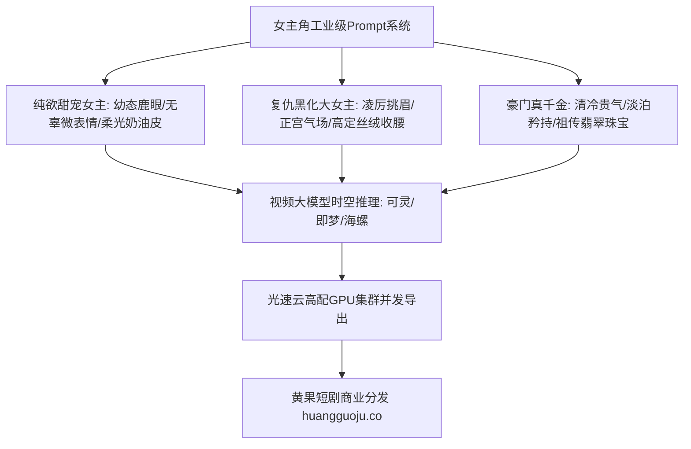

  
🎯 女主角色Prompt情感共鸣设计核心法则

  
<strong>短剧女主不仅需要高颜值，更需承载观众的“情绪投射与受虐反弹快感”：</strong>设计女主提示词切忌过度使用“网红蛇精脸”和“浓艳妆容”，而必须根据题材精准分流：<strong>甜宠女主强调“鹿眼清澈、绒毛微光与自然唇色”，复仇大女主强调“下三白冷冽眼神、锐利红唇与收腰干练风衣”，古风神女强调“清冷孤傲与步摇流光”</strong>。在批量输出上百个女主近景特写时，推荐使用<a href="https://sahude.gsyvipaff.com/#/?code=keqgvT5Y" target="_blank" rel="noopener">光速云GPU算力容器</a>（邀请码 keqgvT5Y）秒级并发生成，打磨完成后直推<a href="https://huangguoju.co/" target="_blank" rel="noopener">黄果短剧官方分发矩阵</a>实现全网高转化变现。

# 豪门千金/复仇大女主/甜宠女主提示词库：高共情度女性角色Prompt

在女频短剧占据整个短剧市场半壁江山的今天，女性角色的共情力与美学质感是决定充值ROI的命脉。很多AI生成的女性角色往往呈现出千篇一律的浓妆整容脸、眼神呆滞塑料，不仅无法激发观众的保护欲或崇拜感，反而容易让人瞬间出戏。

本文深入解构**三大爆款女主人设的视听设计规范、核心Prompt母模与面部微特征控制词**。

---

## 一、女性角色视听美学控制全景拓扑

---

## 二、三大主流爆款女性人设工业Prompt范本

### 1. 复仇黑化/霸气归来大女主 (The Vengeful Heiress)

- **核心气质**：美艳如罂粟、气场全开、运筹帷幄、冷血反杀。
- **正向提示词 (Positive Prompt)**：
  `Cinematic 9:16 vertical, medium close-up, stunning 25-year-old Chinese heiress returning for vengeance, sharp feline almond eyes with subtle red winged eyeliner, deep crimson matte lips, sleek wet-look straight black bob haircut. Wearing an avant-garde tailored burgundy velvet blazer with strong padded shoulders, silk camisole underneath, layered delicate diamond choker. Holding a crystal champagne coupe with cold mocking amusement. Background is a lavish penthouse gala, city neon skyline at night bokeh, dramatic dual rim lighting in icy cyan and warm amber, 85mm cinema prime, ultra-photorealistic skin pores, 8k.`
- **负向提示词 (Negative Prompt)**：
  `crying, weak, sweet, smiling, plastic skin, doll face, 3d render, extra fingers, cartoon, blurry`

### 2. 现代甜宠/灵动清纯女主 (Sweet & Innocent Heroine)

- **核心气质**：邻家、清澈、脆弱感、让人忍不住心生怜惜。
- **正向提示词 (Positive Prompt)**：
  `Cinematic vertical close-up, breathtakingly pure 21-year-old college girl, luminous porcelain skin with faint natural blush, large innocent doe eyes with subtle crystal catchlights, delicate trembling rosebud lips, soft wispy dark-brown curtain bangs tied into a messy low bun. Wearing an oversized cozy cream cable-knit wool sweater. Sitting by a sunlit cafe window on a brisk autumn morning, golden hour sunlight creating a dreamy soft halo around her hair. Shallow depth of field, warm diffuse lighting, emotional vulnerability, Leica M11 photography aesthetic.`
- **负向提示词**：
  `heavy makeup, fake eyelashes, seductive, angry, smirk, mature, deformed eyes, oversaturated`

### 3. 古风仙侠/清冷隐忍师尊 (Ethereal Immortal Maiden)

- **核心气质**：孤高独立、白月光、仙气缥缈、眼底藏有万年执念。
- **正向提示词 (Positive Prompt)**：
  `Epic Eastern fantasy masterpiece, 23-year-old celestial fairy goddess, pale ethereal skin, elegant willow-leaf eyebrows, sorrowful yet tranquil eyes deep as ancient pools, long flowing jet-black silk hair drifting in ethereal breeze with an exquisite white jade lotus hairpin. Dressed in cascading translucent cyan and silver embroidered chiffon robes. Standing alone on a snowy mountain cliff beneath a colossal glowing crescent moon, cherry blossom petals swirling in the air. Soft silver moonlight rim light, mist, hyper-detailed fantasy rendering.`

---

## 三、女性面部五官与妆容Prompt精细控制表

| 面部区域 | 甜宠白月光写法 | 复仇反杀女王写法 | 避坑提醒 |
| :--- | :--- | :--- | :--- |
| **眼眸与睫毛** | `crystal clear doe eyes, soft natural fine eyelashes` | `sharp almond-shaped eyes, intense predatory gaze, winged eyeliner` | 避免使用 `huge anime eyes` 导致眼眶畸形 |
| **唇形与口红** | `natural moist pink lips, gentle Cupid's bow, subtle parting` | `bold matte scarlet lipstick, defined sharp lip lines, mocking smirk` | 避免过度使用 `lip gloss` 导致嘴唇油光像涂了胶水 |
| **底妆与肤质** | `translucent natural skin texture, visible fine pores, soft blush` | `impeccable porcelain matte foundation, structured contouring` | 必须加上 `skin pores` 抵制过度AI磨皮 |

---

## 四、生产避坑与算力支持

- **排查：女性角色手部容易多指、融化或动作怪异？**
  - **解法**：在特写镜头中尽量给手部安排明确的物理动作（如 `holding a wine glass, clutching a leather handbag, adjusting earring`），给手指明确的几何接触物，肢体崩坏率可下降80%。
- **多机位批量生成算力支撑**：
  - 女主服装与发型在不同场景（居家、宴会、职场）需要频繁换装。推荐接入<a href="https://sahude.gsyvipaff.com/#/?code=keqgvT5Y" target="_blank" rel="noopener">光速云GPU算力容器</a>（邀请码 keqgvT5Y），一键部署IP-Adapter与LoRA换装工作流，秒级完成不同套装的批量导出。
- **商业化分发变现**：
  - 极具代入感的高颜值女主成片可直接上架<a href="https://huangguoju.co/" target="_blank" rel="noopener">黄果短剧官方分发矩阵</a>，享受平台女频专属分销流量池，收获丰厚CPS充值分润。
