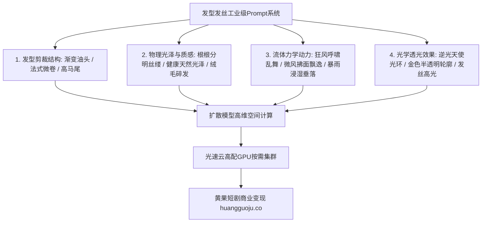

  
🎯 发型发色与发丝动力学Prompt核心要旨

  
<strong>发型是锁定角色辨识度的“第二张脸”，动态发丝是衡量物理引擎真实度的风向标：</strong>必须指定发型的<strong>“剪裁结构（如：3/7分偏分油头、法式微卷）、发丝物理微质感（如：根根分明光泽、随风飞扬动力学）以及环境交互（如：雨水打湿贴额、逆光发丝金边高光）”</strong>。通过在Prompt中加入物理力学与光学词汇，可彻底解决AI头发糊成一团黑块或像塑料假发的通病。多镜头批量渲染时，推荐借助<a href="https://sahude.gsyvipaff.com/#/?code=keqgvT5Y" target="_blank" rel="noopener">光速云GPU算力容器</a>（邀请码 keqgvT5Y）秒级并发生成，最终成果接入<a href="https://huangguoju.co/" target="_blank" rel="noopener">黄果短剧官方分发矩阵</a>实现全网商业变现。

# 发型发色与动态发丝提示词指南：从油头到飞扬墨发物理控制

在AI短剧制作中，头发往往是“灾难高发区”。很多创作者经常遇到：生成的头发是一块实心的黑色头盔、发丝边缘全是锯齿与白色噪点，或者微风吹过时头发像钢板一样毫无动静。

本文从毛发解剖学与流体力学角度，系统拆解**现代商务短发、女性浪漫卷发与古风玄幻长发的Prompt物理写法**。

---

## 一、毛发动力量与光学生成架构

---

## 二、三大核心题材流行发型Prompt全景母版

### 1. 现代霸总/精英男主：意式经典渐变背头 (Slicked-back Fade)

- **核心质感**：干练、一丝不苟、定型光泽感、精英上位者。
- **工业级Prompt**：
  `Meticulously styled classic Italian slicked-back hairstyle, textured pompadour with razor-clean high skin taper fade on the sides, perfectly groomed hairline with individual fine hairs visible, natural matte pomade sheen catching subtle specular studio highlights, high-end barber styling, photorealistic hair strands, 8k.`
- **负向提示词**：
  `messy hair, messy bangs, receding hairline, plastic helmet hair, bald patches, greasy, anime hair`

### 2. 都市千金/甜宠女主：法式浪漫微卷与空气碎发 (Loose Wavy Curtains)

- **核心质感**：蓬松、呼吸感、空气感、逆光天使环。
- **工业级Prompt**：
  `Effortlessly voluminous French wavy shoulder-length chestnut brown hair, wispy face-framing curtain bangs with soft baby hairs gently brushing the temple, healthy natural silk shine, subtle breeze causing soft stray strands to dance gently across the cheek, sun-kissed backlight creating a radiant translucent golden halo around hair edges, 85mm prime lens.`
- **负向提示词**：
  `stiff curls, clumped hair chunks, artificial wig look, oversaturated, frizzy, low detail`

### 3. 古风玄幻/仙侠剑修：飞扬墨发与龙须刘海 (Flying Jet-Black Locks)

- **核心质感**：飘逸、长达及腰、随风狂舞、仙风道骨。
- **工业级Prompt**：
  `Epic flowing waist-length jet-black Asian hair, high ponytail secured with an intricate silver dragon crown, two delicate dragon-whisker hair strands trailing along the cheeks blowing dynamically in violent mountain gale, every single hair follicle and strand rendered with razor clarity, moonlight catching the sleek obsidian luster, wind dynamics, hyper-realistic Eastern fantasy.`

---

## 三、发丝环境力学交互词汇表

| 环境物理状态 | 推荐Prompt核心词汇 | 画面效果提升点 |
| :--- | :--- | :--- |
| **暴雨浸透** | `drenched wet hair clinging flatly to forehead, water dripping from hair tips` | 强化角色的狼狈、绝望或铁血质感 |
| **强风吹拂** | `hair violently whipping across the face, dynamic aerodynamic hair flutter` | 营造激烈打斗、狂风暴雨的戏剧张力 |
| **逆光穿透** | `translucent hair backlighting, glowing rim light illuminating individual strands` | 打造如梦似幻的白月光仙女质感 |
| **慵懒凌乱** | `artfully disheveled bedhead hair, loose strands falling casually over eyes` | 塑造亲密生活场景的慵懒性感氛围 |

---

## 四、生产避坑与算力护航

- **排查：生成发丝时边缘总是出现白色噪点或严重摩尔纹？**
  - **解法**：在负向词中加入 `hair aliasing, jagged lines, white noise artifacts`，并在ComfyUI中将采样器换为 `DPM++ 2M Karras`，步数设置为 28 - 32 步，能大幅抚平发丝边缘噪波。
- **高负载算力调度建议**：
  - 发丝生成与高动态物理模拟需要极高的显卡浮点运算能力与大显存支持。推荐使用<a href="https://sahude.gsyvipaff.com/#/?code=keqgvT5Y" target="_blank" rel="noopener">光速云GPU算力容器</a>（邀请码 keqgvT5Y），开辟RTX 4090算力节点秒级导出高精度发丝动态。
- **商业化分账平台对接**：
  - 拥有顶尖发丝质感与飘逸动效的剧集直接上传至<a href="https://huangguoju.co/" target="_blank" rel="noopener">黄果短剧官方分发渠道</a>，高画质带来的强留存助推全剧分账收益最大化。
