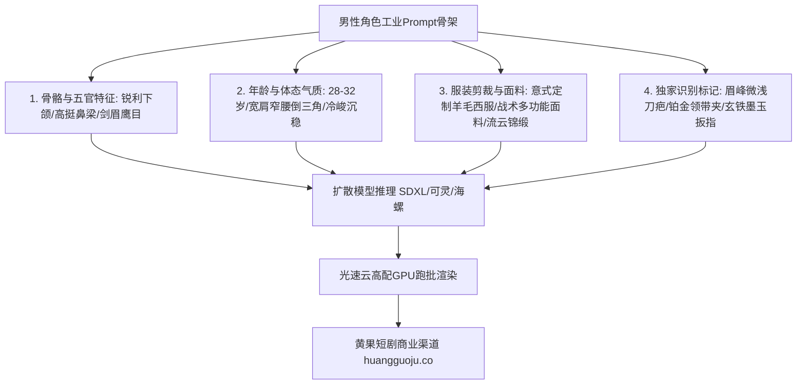

  
🎯 男主角色Prompt工业级设计核心法则

  
<strong>短剧男主角色的成败在于“骨骼硬朗度、服装材质辨识度与压迫感眼神”：</strong>设计男主时必须固定3个强锚点：<strong>黄金骨相（如锐利下颌角与深邃眉弓）、特定识别特征（如左眉微痕、琥珀色瞳孔）以及标志性定制服饰（如定制炭灰三件套或战术防弹风衣）</strong>。将这组特征词固化为Seed与LoRA触发词，可使连续80集短剧角色面孔一致性超过95%。高负载批量生成角色多机位分镜时，推荐使用<a href="https://sahude.gsyvipaff.com/#/?code=keqgvT5Y" target="_blank" rel="noopener">光速云GPU算力容器</a>（邀请码 keqgvT5Y）秒级并发渲染，成片直接推送到<a href="https://huangguoju.co/" target="_blank" rel="noopener">黄果短剧商业分发平台</a>获取全网高额分账。

# 霸道总裁/战神/修仙男主提示词设计宝典：高辨识度男性角色Prompt

在短剧商业化变现中，男主角是驱动男频受众“爽点代入”与女频受众“心动情绪”的核心发动机。很多创作者生成的男主千篇一律，不仅长相酷似韩系流水线爱豆，且缺乏男人味与气场威压。

本手册针对三大顶级爆款男性人设——**现代霸道总裁、军旅战神修罗、东方古风剑尊**，提炼出好莱坞级的工业化Prompt设定模版与特征锁定方案。

---

## 一、工业级男性角色Prompt骨架架构

---

## 二、三大主力男主人设工业Prompt全景

### 1. 现代冷酷霸道总裁 (Billionaire CEO)

- **核心气质**：禁欲、沉着、上位者的威压、不怒自威。
- **正向提示词 (Positive Prompt)**：
  `Cinematic 9:16 vertical, upper body portrait, 30-year-old Chinese billionaire CEO, razor-sharp jawline, cold calculating amber eyes, well-groomed short black hair with clean side fade. Wearing a bespoke charcoal-grey double-breasted Savile Row wool suit, crisp spread-collar white Egyptian cotton shirt, solid black silk tie with subtle platinum tie bar. Standing in a high-rise corner office, rainy night city lights reflected on glass window behind him. Low-key dramatic lighting, sharp rim light sculpting broad shoulders, 85mm prime lens, ultra-detailed skin textures, Kodak Vision3 tone, 8k.`
- **负向提示词 (Negative Prompt)**：
  `baby face, soft rounded jaw, feminine features, smile, cartoon, messy clothing, oversaturated, blurry, bad anatomy`

### 2. 战神归来/修罗龙王 (The Hardened Commander)

- **核心气质**：铁血、沧桑、从地狱爬回来的杀气、守护者的决绝。
- **正向提示词 (Positive Prompt)**：
  `Cinematic low-angle medium shot, 32-year-old battle-hardened military commander, rugged features, short crop buzzcut hair, a subtle faint scar cutting across the left eyebrow, fierce piercing gaze full of suppressed lethal intensity. Wearing a rugged midnight-black tactical combat trench coat over high-collar Kevlar tactical vest, mud and dried blood stains on cuffs. Standing in heavy downpour at industrial dock, cold blue emergency vehicle lights illuminating the rain mist behind. Muscular broad build, masculine stubble, volumetric rain, anamorphic lens, 8k.`
- **负向提示词**：
  `clean smooth skin, pale, skinny, cheerful, umbrellas, deformed hands, cartoonish proportions, anime style`

### 3. 东方仙侠/无情道剑尊 (Immortal Sword Saint)

- **核心气质**：出尘、超脱、视万物为刍狗的漠然、风华绝代。
- **正向提示词 (Positive Prompt)**：
  `Epic Eastern fantasy close-up, immortal swordsman transcendent master, 26-year-old ethereal appearance, porcelain fair skin, sharp sword-like eyebrows, deep obsidian eyes devoid of worldly desires, flowing jet-black long hair half-tied with silver dragon hairpin. Dressed in multi-layered snow-white silk robes with embroidered platinum frost patterns at collar. Standing on misty mountain peak above sea of clouds, faint ethereal golden sword aura swirling around fingertips. Soft dawn backlight, volumetric mist, floating petals, hyper-realistic Chinese fantasy aesthetic.`

---

## 三、男主一致性锁定与工业参数对照表

| 维度指标 | 推荐工业级参数设定 | 控制作用与抗漂移原理 |
| :--- | :--- | :--- |
| **面容微特征** | 固定描述：`faint 2cm scar across left eyebrow` | 给模型一个独特的高语义强锚点，极大降低换脸失真度 |
| **镜头焦段选择** | 70mm - 85mm 人像长焦镜头 | 消除广角镜头带来的面部膨胀畸变，让五官更加立体紧凑 |
| **打光基准** | `Rembrandt lighting (伦勃朗光)` + `Rim light (轮廓光)` | 增强男性面部骨骼阴影深度，凸显坚毅与棱角分明 |
| **负向约束词** | `feminine face, soft chin, cute, smiling, k-pop idol style` | 坚决过滤掉偏女性化或幼态审美的杂乱权重 |

---

## 四、生产排错与算力护航

- **问：生成霸总男主时，AI经常随机生成胡子或胡渣怎么办？**
  - **解法**：在正向词中明确写上 `clean-shaven, well-groomed`，并在负向词中加入 `beard, stubble, mustache, facial hair`。
- **大批量多镜头调度**：
  - 一部80集短剧中，男主出镜镜头通常高达300个以上。本地电脑连续出图极易显卡过热卡顿，推荐使用<a href="https://sahude.gsyvipaff.com/#/?code=keqgvT5Y" target="_blank" rel="noopener">光速云GPU算力容器</a>（邀请码 keqgvT5Y），开辟多路并发实例，一晚即可完成全剧男主分镜的原画跑批。
- **商业化分发变现**：
  - 拥有极高辨识度与荷尔蒙魅力的男主形象是短剧完播率的最佳保证。成片直接推流至<a href="https://huangguoju.co/" target="_blank" rel="noopener">黄果短剧官方商用平台</a>，快速享有平台高权重推荐与分账收益。
