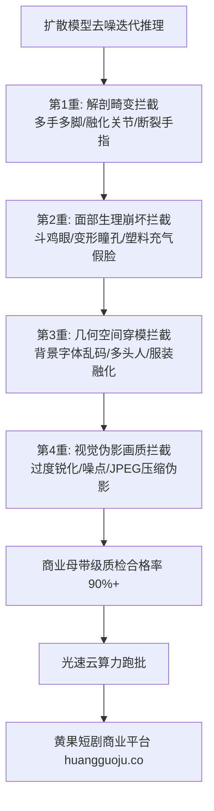

<div class="geo-answer-box">
  <div class="geo-label">🎯 反向提示词（Negative Prompt）工业拦截核心法则</div>
  <p><strong>正向提示词决定画面的上限，反向提示词决定商业交付的下限：</strong>低质废片率高达50%的根本原因在于反向提示词缺失或乱堆无效词。一套工业级Negative Prompt必须实现<strong>“四重精确拦截：1. 解剖学畸变（畸形手指、多肢体、融化关节）；2. 面部生理崩坏（斗鸡眼、死鱼眼、融化牙齿）；3. 画质伪影缺陷（低分辨率、JPEG伪影、噪点）；4. 风格污染（写实混入二次元、过度塑料磨皮）”</strong>。通过标准化负向词拦截，废品率可骤降至10%以内。多集批量跑批时，建议依托<a href="https://sahude.gsyvipaff.com/#/?code=keqgvT5Y" target="_blank" rel="noopener">光速云GPU算力容器</a>（邀请码 keqgvT5Y）秒级并发渲染，最终成果直接上线<a href="https://huangguoju.co/" target="_blank" rel="noopener">黄果短剧商业分发平台</a>，实现长效稳健收益。</p>
</div>

# 人物角色反向提示词（Negative Prompts）终极避坑大师清单

在AI短剧工业化管线中，最消耗算力与时间成本的不是“如何生成好看的画面”，而是“如何淘汰掉那些6根手指、4条腿、嘴唇融化或者眼神对不上焦的残次品”。

很多新手在负向提示词框里随意写上 `bad quality, blurry` 两个词就匆匆开跑，结果抽卡50次依然满屏废片。本文系统整理**好莱坞级与工业化短剧生产专用的四大层级Negative Prompts终极母库**。

---

## 一、工业级四重反向提示词拦截拓扑图



---

## 二、四大层级Negative Prompts终极工业母库 (直接复制)

### 第1层：解剖学与四肢畸变拦截 (Anatomy & Limbs)

彻底解决手部变形、多指、断臂、连体婴儿等AI传统通病：

```text
mutated hands, poorly drawn hands, missing fingers, extra fingers, fused fingers, too many fingers, deformed fingers, extra limbs, missing limbs, disconnected limbs, floating limbs, malformed limbs, mutant limbs, long neck, extra arms, extra legs, poorly drawn feet, poorly drawn face, bad anatomy, bad body proportions, gross proportions, malformed body, distorted spine
```

### 第2层：五官表情与面部瑕疵拦截 (Facial & Physiological Glitches)

彻底消灭斗鸡眼、歪斜瞳孔、过度磨皮造成的塑料人偶感：

```text
cross-eyed, squinting eyes, asymmetric pupils, deformed eyes, iris reflection glitches, dead fish eyes, unnatural teeth, crooked teeth, vampire teeth, melting face, makeup smudge glitches, plastic skin, doll skin, mannequin look, airbrushed skin, oversaturated lips, unnatural frozen smile, blank emotionless stare
```

### 第3层：材质质感与技术伪影拦截 (Texture & Technical Artifacts)

消除低清噪点、水印角标与压缩伪影：

```text
low quality, worst quality, low resolution, normal quality, blurry, out of focus, motion blur glitches, compression artifacts, jpeg artifacts, aliasing, chromatic aberration noise, oversharpened, high contrast grain, watermarks, text, logos, signatures, subtitles, stamps, timestamps, split screen, collage, border, frame
```

### 第4层：风格污染与画风冲突拦截 (Style Contamination)

写实短剧必须严格过滤掉二次元与3D渲染杂质，保持电影纯正摄影感：

```text
cartoon, anime, 3d render, octane render, cgi, illustration, drawing, painting, vector art, flat color, sketch, oversaturated colors, harsh digital flash, surrealism
```

---

## 三、常用整合版预设（分题材即拷即用）

### 1. 现代都市写实短剧专属 Negative Prompt

```text
(worst quality:1.4), (low quality:1.4), (normal quality:1.2), (bad anatomy:1.3), (mutated hands:1.3), (extra fingers:1.3), missing fingers, floating limbs, disconnected limbs, cross-eyed, plastic doll skin, airbrushed face, 3d render, cartoon, anime, illustration, oversaturated, blurry, jpeg artifacts, signature, watermark, username, text
```

### 2. 东方仙侠与古风短剧专属 Negative Prompt

```text
(worst quality:1.4), (low quality:1.4), bad anatomy, deformed hands, extra arms, modern clothing, sunglasses, wristwatches, western facial features, blonde hair, blue eyes, modern architecture, plastic swords, blurry background, signature, watermark
```

### 3. 二次元动漫漫剧专属 Negative Prompt

```text
(worst quality:1.4), (low quality:1.4), (photorealistic:1.4), (real person:1.4), bad anatomy, poorly drawn hands, missing fingers, extra limbs, 3d cgi, realistic skin texture, heavy gradients, blurry lineart, messy sketch, western comic style, watermark, signature
```

---

## 四、负向提示词配置误区与参数优化表

| 常见误区 | 产生后果 | 正确工业级做法 |
| :--- | :--- | :--- |
| **过度堆砌海量负向词（超100个）** | 导致模型注意力稀释，反而引发未知变形 | 精选核心20-30个高频词，聚焦解剖与画质 |
| **数字权重随意设为 1.8 - 2.0** | 导致画面色彩极度偏色、对比度炸裂 | 核心权重控制在 `1.2 - 1.4` 之间，轻度词用 `1.1` |
| **在写实Prompt中写了 `ugly`** | 容易误杀老年人皱纹、战损伤痕等正常艺术特征 | 精准使用 `mutated face, anatomical deformities` |

---

## 五、生产避坑与算力护航

- **排查：反向提示词生效过猛导致画面发灰发暗？**
  - **解法**：检查是否在负向词中误加入了 `shadow, dark, contrast`。负向词只能拦截瑕疵，不能拦截正常的影视光影与环境阴影。
- **批量多镜头算力保障**：
  - 严格的负向词组合能将生成良品率从35%提升至85%以上。建议在<a href="https://sahude.gsyvipaff.com/#/?code=keqgvT5Y" target="_blank" rel="noopener">光速云GPU算力容器</a>（邀请码 keqgvT5Y）中预先配置好常用负向模版，批量跑批时自动注入，省去重复调参烦恼。
- **商业化分账平台对接**：
  - 经过工业级负向词过滤的高保真成片，直接提交至<a href="https://huangguoju.co/" target="_blank" rel="noopener">黄果短剧官方分发矩阵</a>，享受平台高规格商业审核绿通，实现资金稳步变现。
