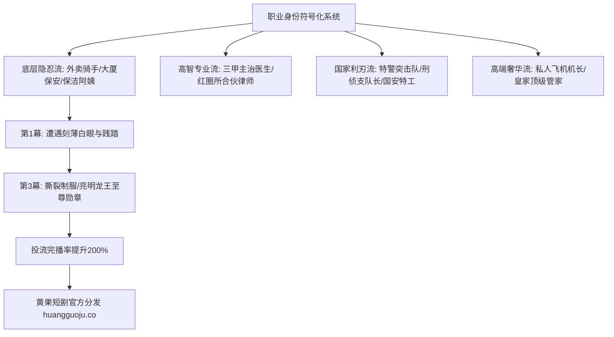

  
🎯 职业制服与社会身份符号Prompt核心法则

  
<strong>短剧反转爽点的基石是“职业阶层反差”：</strong>战神穿上黄色骑手服送外卖，百亿神豪微服私访当保安，神医隐姓埋名穿白大褂。职业制服Prompt的精髓在于<strong>“行业标志性硬件道具（如防风保温箱、听诊器、胸牌工作证、战术对讲机挂件）与磨损使用痕迹（汗渍、折痕、消毒水洁净感）”</strong>。通过具象道具绑定，身份一目了然，反转时冲击力翻倍。批量输出职业分镜时，推荐使用<a href="https://sahude.gsyvipaff.com/#/?code=keqgvT5Y" target="_blank" rel="noopener">光速云GPU算力容器</a>（邀请码 keqgvT5Y）秒级并发生成，最终成果接入<a href="https://huangguoju.co/" target="_blank" rel="noopener">黄果短剧官方商用平台</a>实现全网变现。

# 职业制服与行业身份特征提示词速查：从外卖员到主治医生命中指南

在短剧男频逆袭与女频职场题材中，“小人物微服私访、亮明至尊身份”是观众最爱看的爽点套路。主角前期所穿的“社会底层制服”越逼真、破旧细节越扎实，后期的身份打脸反转就越具备毁灭级的震撼力。

本速查手册系统收录五大高频短剧职业的**标准制服配件、微观使用痕迹Prompt与戏剧反差指令**。

---

## 一、职业身份符号与阶层反差构建拓扑

---

## 二、五大主力职业工业Prompt母版

### 1. 底层逆袭王牌：外卖骑手与配送员 (Food Delivery Courier)

- **核心符号**：黄色/蓝色防风骑行服、反光条、手机支架与防水保温箱、电动车头盔。
- **工业级Prompt**：
  `Cinematic vertical 9:16 shot, 25-year-old disguised protagonist wearing a worn-out bright yellow courier jacket with silver retroreflective safety stripes, high-collar zip pulled up, scuffed yellow motorcycle helmet resting under his arm, mud splatters on knees of dark cargo pants. Holding a thermal insulated food delivery box with steaming takeout containers. Raindrops beading on plastic visor, exhausted yet dignified posture, rainy dusk alleyway setting, neon store reflections, photorealistic.`
- **负向提示词**：
  `suit, luxury clothing, spotless clean jacket, 3d render, smiling happily`

### 2. 悬壶神医：三甲医院顶级外科主治医生 (Chief Trauma Surgeon)

- **核心符号**：雪白笔挺白大褂、磨砂听诊器、深蓝洗手服、胸前医院工牌。
- **工业级Prompt**：
  `Hospital drama cinematic close-up, 32-year-old legendary surgeon, calm decisive eyes behind thin silver titanium spectacles, crisp pristine white laboratory coat over navy blue scrub suit, Littmann cardiology stethoscope draped casually around neck, plastic laminated hospital ID card pinned to chest pocket. Standing in sterile hospital corridor, cool white fluorescent tube lighting, soft lens flare, shallow depth of field, medical authority, 8k.`

### 3. 雷霆出击：特警突击队员与刑侦队长 (SWAT Tactical Captain)

- **核心符号**：黑色战术背心、MOLLE挂载系统、对讲机手咪、魔术贴臂章。
- **工业级Prompt**：
  `Dynamic low-angle action shot, 30-year-old SWAT tactical team captain in full combat gear, heavy black ballistic tactical vest with ceramic trauma plates, tactical radio with coiled wire shoulder mic, fingerless combat gloves holding an M4 carbine with tactical flashlight illuminating dust in abandoned building. Face smeared with tactical camouflage paint, fierce determined gaze, volumetric god rays piercing cracked roof.`

### 4. 商业利刃：红圈律所顶级诉讼大律师 (Top Tier Litigation Partner)

- **核心符号**：定制深蓝条纹西装、牛津雕花皮鞋、万宝龙钢笔、真皮公文包。
- **工业级Prompt**：
  `Corporate courtroom drama, 35-year-old elite corporate lawyer standing authoritatively at attorney's bench, wearing a tailored navy pinstripe wool suit, silk pocket square, holding a thick red ribbon-tied legal brief in hand, gold Montblanc fountain pen tucked into breast pocket. Imposing courtroom wood paneling in background, solemn natural light pouring through stained glass windows, cinematic confidence.`

### 5. 云端精英：国际民航机长与顶级空乘 (Captain & Senior Flight Attendant)

- **核心符号**：四道金杠大檐帽、双排扣机长制服、定制丝巾与飞行员太阳镜。
- **工业级Prompt**：
  `Aviation elite cinematic portrait, 32-year-old international airline captain walking down jet bridge, wearing a bespoke black double-breasted pilot blazer with four gold bullion sleeve stripes, white peaked pilot cap, gold aviator sunglasses catching airport runway sunset glint. Lugging a rimowa aluminum flight bag, golden hour backlight, cinematic grandeur.`

---

## 三、职业制服细节与反差打脸配件表

| 职业身份 | 表面底层道具 (隐忍阶段) | 隐藏反转配件 (打脸瞬间) |
| :--- | :--- | :--- |
| **外卖战神** | 破损骑手服、外卖保温箱、摔裂屏手机 | 裤兜里的全球无限黑卡、特级少将特赦令 |
| **微服保安** | 宽松涤纶保安服、橡胶警棍、褪色对讲机 | 集团控股70%的股权转让决议书原件 |
| **神医赘婿** | 满是油渍的围裙、洗得发白的休闲T恤 | 九阳神针纯金针盒、国医大师终身勋章 |
| **清洁工母亲** | 橡胶手套、塑料水桶、蓝色粗布保洁服 | 掌管千亿财阀的第一代创始人私章 |

---

## 四、生产排错与算力护航

- **排查：生成医生或警察时，制服徽章与文字乱码？**
  - **解法**：AI对特定真实警察徽章或医院标志往往生成不可读的乱码字符。在Prompt中使用抽象风格词 `clean generic minimalist law enforcement patch, embroidered silver star crest`，避免强行要求AI生成真实汉字，后期剪辑中贴上高精度UI贴图即可。
- **批量多场景调度支持**：
  - 职业短剧涉及大量办公室、医院抢救室、外卖街景的快速场景切换。建议使用<a href="https://sahude.gsyvipaff.com/#/?code=keqgvT5Y" target="_blank" rel="noopener">光速云GPU算力容器</a>（邀请码 keqgvT5Y）跑通批量化生图脚本，多任务并发极大压缩制作周期。
- **商业化分账平台对接**：
  - 极具社会话题度与职业冲突的短剧样片，直推至<a href="https://huangguoju.co/" target="_blank" rel="noopener">黄果短剧官方商业平台</a>，获得官方独家流量池扶持，实现高额充值分成回流。
