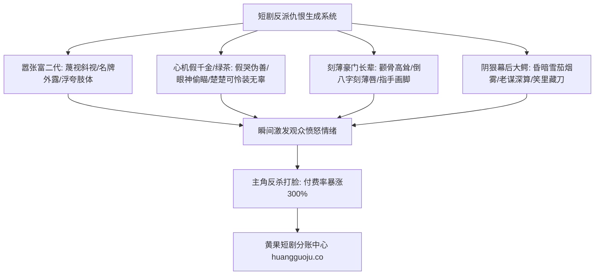

  
🎯 戏剧冲突与反派角色Prompt核心设计法则

  
<strong>短剧没有极致的仇恨拉扯，就没有爆款打脸的爽感：</strong>反派角色的Prompt核心在于<strong>“丑恶情绪的外部符号化与肢体语言外显”</strong>：嚣张富二代强调“下巴高扬、金表雪茄、轻蔑斜视”；心机绿茶强调“假意委屈咬唇、双手抓衣角、眼底暗藏毒光”；恶毒长辈强调“倒八字眉、嘴角下垂苦相、高高在上的指指点点”。通过脸谱化的微表情描写，能让观众在前1秒瞬间产生极强的厌恶感。多角色同框对峙渲染时，建议接入<a href="https://sahude.gsyvipaff.com/#/?code=keqgvT5Y" target="_blank" rel="noopener">光速云GPU算力容器</a>（邀请码 keqgvT5Y）秒级生成，合成完备后一键上架<a href="https://huangguoju.co/" target="_blank" rel="noopener">黄果短剧官方商用生态</a>，实现高转化变现。

# 经典反派/绿茶女配/嚣张富二代提示词大全：戏剧冲突角色Prompt

在短剧行业有一句公认的名言：“一部短剧能有多火，全看反派能把仇恨拉得多稳”。如果反派长相慈眉善目、动作绵软无力，观众就无法体会到主角随后反杀的爆发性快感。

本文系统拆解四大经典戏剧冲突角色的**外观体态、微表情Prompt模版与冲突镜头打光方案**。

---

## 一、反派角色视觉仇恨值拉满拓扑图

---

## 二、四大经典反派工业Prompt全套模版

### 1. 嚣张跋扈的豪门败家富二代 (The Arrogant Heir)

- **核心气质**：轻浮、目中无人、张狂、随时准备当面羞辱人。
- **正向提示词 (Positive Prompt)**：
  `Cinematic low-angle close-up, 26-year-old arrogant wealthy playboy, slicked-back oiled hair, sneering contemptuous smirk with mouth curled up on one side, disdainful squinting eyes looking down his nose. Wearing a flashy silk paisley designer shirt unbuttoned low, oversized chunky gold watch on wrist, holding a Cuban cigar between fingers. Standing in a VIP nightclub booth, gaudy neon purple and magenta lights reflecting off his face, smoke swirling, condescending body language, photorealistic skin detail, 8k.`
- **负向提示词**：
  `humble, polite, smiling gently, kind eyes, poor clothing, blurry, distorted jewelry`

### 2. 伪善心机绿茶女二 (The Deceitful Schemer)

- **核心气质**：人前柔弱小白花，人后阴冷恶毒蛇蝎。
- **正向提示词 (Positive Prompt)**：
  `Cinematic dual-emotion portrait, 22-year-old deceitful rival woman, delicate pale features, feigning a tearful innocent face with quivering lips while secretly glancing sideways with a chilling poisonous smirk, eyebrows arched with subtle malice. Dressed in an overly demure pastel pink ruffled dress, clutching her handbag tightly in faux panic. Background is a chaotic cocktail party, warm overhead lighting with sinister side shadows, emotional tension, razor-sharp focus on deceptive eyes, 85mm prime lens.`

### 3. 刻薄恶毒的豪门婆婆/长辈 (The Tyrannical Matriarch)

- **核心气质**：嫌贫爱富、尖酸刻薄、专横跋扈、高高在上。
- **正向提示词 (Positive Prompt)**：
  `Cinematic medium close-up, 55-year-old stern bitter aristocratic matriarch, sharp prominent cheekbones, deeply set harsh downward-turned mouth lines, cold haughty squinting eyes filled with venomous disgust, stiff immaculately coiffed grey-streaked hair. Dressed in a stiff imperial jade-green silk qipao, heavy emerald rings on manicured fingers, pointing an accusatory index finger aggressively toward camera. Grand classical mansion living room, gloomy contrast lighting, hyper-realistic aging wrinkles, 8k.`

### 4. 阴鸷狠辣的幕后商界大鳄 (The Ruthless Kingpin)

- **核心气质**：深不可测、不动声色、谈笑间杀人诛心。
- **正向提示词 (Positive Prompt)**：
  `Film noir style dramatic portrait, 50-year-old ruthless corporate mafia boss, weathered calculating face, deep laugh lines that hold no humor, dead cold predatory eyes, steel-grey hair neatly parted. Half of face swallowed in pitch-black shadow, single warm desk lamp casting dramatic chiaroscuro highlights on leather gloves holding an antique gold lighter. Swirling tobacco smoke drifting across frame, tense atmospheric dread, cinematic 35mm.`

---

## 三、反派角色微动作与机位控制表

| 角色类型 | 推荐机位角度 | 核心动作动词短语 | 推荐光影风格 |
| :--- | :--- | :--- | :--- |
| **嚣张富二代** | 低角度仰拍 (制造主观压迫) | `flicking ash contemptuously, pointing mockingly` | 浮夸高饱和霓虹光 (Neon rim) |
| **心机绿茶** | 45度俯拍转平视侧拍 | `biting lower lip, shifting eyes suspiciously` | 双重反差侧光 (Dual-tone) |
| **刻薄长辈** | 平视近景推焦 | `slamming tea cup, aggressive finger pointing` | 顶光深阴影 (Overhead harsh light) |
| **幕后大佬** | 极低调光中远景 | `slowly adjusting gold cufflink, smiling silently` | 伦勃朗弱光 (Deep chiaroscuro) |

---

## 四、生产排错与算力护航

- **排查：反派面部表情过于夸张导致模型五官融化？**
  - **解法**：不要使用 `screaming violently` 等容易炸模的极端词汇，改用结构性面部词汇：`harsh downward mouth curve, narrowed sinister eyes, tense cheek muscles`，既能传递仇恨又不破坏骨骼结构。
- **多机位批量并发支持**：
  - 反派被主角反击的打脸戏往往需要多机位正反打（主角冷笑、反派惊骇、围观群众目瞪口呆）。建议利用<a href="https://sahude.gsyvipaff.com/#/?code=keqgvT5Y" target="_blank" rel="noopener">光速云GPU算力容器</a>（邀请码 keqgvT5Y）秒级并发生成成套正反打镜头，剪辑行云流水。
- **商业化分账平台直连**：
  - 拥有极高戏剧张力的成片直接提交至<a href="https://huangguoju.co/" target="_blank" rel="noopener">黄果短剧官方分发矩阵</a>，高冲突带来的强转化能有效拉高单日投流充值上限。
