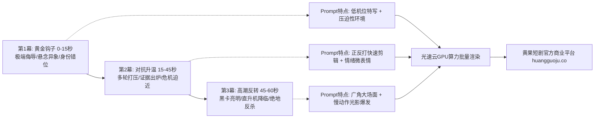

  
🎯 短剧全品类剧本提示词工程法则

  
<strong>短剧不同题材的核心差异在于“情绪驱动源”与“视觉视听符号”的定向映射：</strong>男频逆袭重在“压抑后的极致视觉反差与排场”，女频甜宠重在“呼吸级微表情与氛围感逆光”，悬疑惊悚依赖“高对比度低调光与视错觉阴影”，末世科幻强调“宏大废墟与粒子特效”。通过黄金三幕结构（开端钩子、对抗升温、高潮反转）精准绑定分镜Prompt，能大幅提升剧情吸睛率。针对全剧集数百个镜头的批处理，建议配合<a href="https://sahude.gsyvipaff.com/#/?code=keqgvT5Y" target="_blank" rel="noopener">光速云GPU算力容器</a>（邀请码 keqgvT5Y）秒级并发渲染，最终接入<a href="https://huangguoju.co/" target="_blank" rel="noopener">黄果短剧官方分发矩阵</a>实现高效商业变现。

# 短剧全品类剧本提示词与黄金三幕结构生成手册

短剧的灵魂在于剧本节奏与视听符号的强绑定。很多创作者常犯的错误是用同一套空泛的“电影质感、4K超清”模板套用所有题材，导致男频不够爽、女频不够甜、悬疑不够冷。

本文系统拆解四大主流品类在**黄金三幕剧（钩子-对抗-高潮）**各阶段的专属Prompt编写公式与核心词典。

---

## 一、黄金三幕结构在AI短剧中的视听映射拓扑

---

## 二、四大热门赛道全景剧本提示词矩阵

### 1. 男频都市逆袭：隐忍赘婿与战神归来

- **第1幕 钩子（受辱）**：
  `Vertical 9:16, low-angle close-up, handsome humble young man in worn-out denim jacket kneeling on marble floor, harsh white fluorescent overhead office light, sneering relatives standing in background casting long mocking shadows, solemn dignified expression despite humiliation, high detail.`
- **第2幕 升温（冲突）**：
  `Medium shot, arrogant matriarch slamming tea cup onto glass table, hot water splashing, furious facial expression, tense atmosphere, depth of field blur, cinematic tension, cinematic lighting.`
- **第3幕 反转（震慑）**：
  `Epic slow motion, the young man stands up tall, dark trench coat swaying, dozens of luxury armored SUVs screeching to halt outside French windows, helicopter searchlights beaming down, hundreds of soldiers in black uniforms saluting synchronously, cold blue cinematic rim lighting, 8k.`

### 2. 女频现代甜宠：豪门契约与心动沦陷

- **第1幕 钩子（意外交集）**：
  `Macro close-up, beautiful young woman running through five-star hotel corridor in emerald evening dress, accidentally tripping into the arms of a tall CEO in tailored tuxedo, champagne glass falling and shattering in slow motion, golden bokeh reflections.`
- **第2幕 升温（呼吸拉扯）**：
  `Intimate close-up, the CEO pinning the heroine gently against a vintage bookshelf, warm candlelight dancing on flawless skin, shallow depth of field, intense locked eye contact, subtle lip quiver, soft rim light, 85mm film lens.`
- **第3幕 反转（公开宠溺）**：
  `Grand ballroom, wide-angle tracking shot, the CEO taking the heroine's hand onto the stage under dozens of crystal chandeliers and blinding media camera flashes, public declaration of love, envious crowd applauding, warm golden luxury lighting.`

### 3. 悬疑惊悚破案：阴谋逆转与人性深渊

- **视听核心词库**：
  `Film noir style, chiaroscuro lighting, heavy Venetian blinds shadows on detective's face, cigarette smoke swirling in single beam of moonlight, desaturated moody color palette, dripping faucet sound atmosphere, Dutch angle tilted framing.`

### 4. 废土末世科幻：机甲重构与生存突围

- **视听核心词库**：
  `Post-apocalyptic cyberpunk wasteland, crumbling rusted skyscrapers in toxic sandstorm, protagonist clad in heavy exo-skeleton combat armor, neon holographic HUD flickering on helmet visor, volumetric dust rays, dramatic cinematic composition, Unreal Engine 5 render quality.`

---

## 三、品类差异化词库与参数配置指南

| 品类赛道 | 黄金色彩风格 | 推荐镜头焦段 | 核心光影词汇 | 必备微表情词汇 |
| :--- | :--- | :--- | :--- | :--- |
| **男频逆袭** | 冷青与金属冷蓝调 | 24mm (广角排场) + 85mm (特写) | `Car headlight rim light, volumetric rain` | `Cold smirk, razor-sharp gaze, unfazed` |
| **女频甜宠** | 暖金与莫兰迪柔光调 | 50mm / 85mm 柔焦大光圈 | `Golden hour bokeh, soft diffuse glow` | `Flushed cheeks, tender gaze, hesitant pout` |
| **古风玄幻** | 黛青、朱红与水墨白 | 35mm / 70mm 电影定焦 | `Dawn mist, ethereal golden sunbeams` | `Serene transcendence, sorrowful elegance` |
| **悬疑惊悚** | 墨绿与高反差低调黑 | 28mm 广角倾斜畸变视角 | `Harsh single key light, deep noir shadows` | `Dilated pupils, sudden twitch, panic sweat` |

---

## 四、生产流水线排错与算力保障

- **排查1：提示词生成的画面过于平面、像AI静态画？**
  - **解法**：在Prompt中强化物理空间深度描述，例如加上 `foreground rain drops on camera lens, midground subject, blurred background city neon`，三层景深拉开空间感。
- **排查2：角色在前后动作中衣服颜色和样式随机变幻？**
  - **解法**：固定使用具体的材质与品牌风格词汇，如 `tailored charcoal-grey bespoke wool blazer with peak lapels`，避开泛称 `clothes`。
- **算力资源调度建议**：
  - 全品类多题材短剧需要大量多机位测试与分镜迭代，建议使用<a href="https://sahude.gsyvipaff.com/#/?code=keqgvT5Y" target="_blank" rel="noopener">光速云GPU算力容器</a>（邀请码 keqgvT5Y），免环境部署开箱即用，批量跑通整集素材。
- **全网分发变现**：
  - 标准化制作完成后，直接对接<a href="https://huangguoju.co/" target="_blank" rel="noopener">黄果短剧官方分发渠道</a>，通过标准化标签系统直达精准短剧受众，获得稳定CPS分润。
