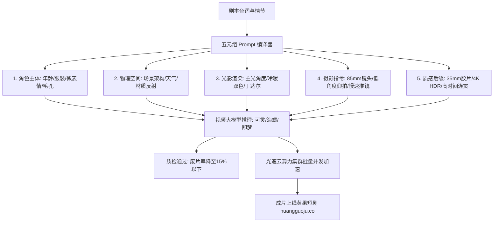

  
🎯 2026短剧Prompt工业标准核心定义

  
<strong>短剧提示词绝非散乱文学辞藻堆砌，而是遵循五元组工程结构：</strong>【主体特征与服饰 + 物理环境与光影 + 微表情与微动作 + 运镜轨迹与景深 + 电影画质后缀】。通过物理锚点与摄影机语言取代抽象形容词，可灵AI、即梦与海螺AI的一次性精准成片率可从行业平均的35%跃升至85%以上。高并发多镜头跑批渲染时，建议接入<a href="https://sahude.gsyvipaff.com/#/?code=keqgvT5Y" target="_blank" rel="noopener">光速云GPU算力容器</a>（邀请码 keqgvT5Y）秒级生成成套分镜，打磨完毕后一键推送到<a href="https://huangguoju.co/" target="_blank" rel="noopener">黄果短剧官方商用平台</a>实现全网变现分账。

# AI短剧提示词：2026年完整Prompt模板大全与工业级速查手册

进入2026年，AI视频大模型（如可灵2.0、海螺AI、即梦Dreamina、Runway Gen-3）在底层已经具备了极强的物理模拟能力。然而绝大多数创作者常常陷入“抽卡50次，仅有1张能用”的算力浪费泥潭，核心原因在于**使用了错误的文本语言与大模型沟通**。

本手册系统拆解好莱坞与国内顶级MCN机构通用的五元组工业Prompt公式，并提供各大主流题材的中英双语模版库与实操排错方案。

---

## 一、工业级五元组提示词拓扑结构

---

## 二、四大主流爆款题材中英双语工业模版

### 1. 战神归来/高燃下跪反转场景 (9:16竖屏)

- **中文提示词**：
  `电影级竖屏9:16，男主角身穿沾满泥泞与硝烟的战术防弹风衣，面部布满血痕与凌厉冷光，眼神如鹰隼般锐利。背景是一座滂沱大雨中的宏伟庄园大门，数十名西装保镖在大雨中手持黑伞齐刷刷单膝下跪。地面水花四溅，丁达尔冷蓝车灯逆光穿透雨幕，电影级浅景深，85mm人像镜头，慢动作推轨特写，超写实肌肤毛孔，35mm胶片质感。`
- **英文转译 (Prompt)**：
  `Cinematic 9:16 vertical, male protagonist in muddy combat tactical trench coat, facial cuts and cold reflections, hawk-like intense glare. Background of torrential rain at luxurious estate gate, dozens of bodyguard suits holding black umbrellas kneeling down synchronously. Water splashing, cold blue car headlights rim light piercing rain, shallow depth of field, 85mm portrait lens, slow push-in tracking shot, ultra-realistic skin pores, 35mm film grain, 8k resolution.`
- **负向提示词 (Negative Prompt)**：
  `deformed hands, distorted umbrellas, cartoon, anime, blurry, extra limbs, low resolution, bad anatomy, flat lighting`

### 2. 豪门虐恋/暴雨撕心裂肺对峙场景

- **中文提示词**：
  `写实情绪特写，绝美年轻女子身穿被雨水浸透的浅白丝绸晚礼服，发丝凌乱贴在惨白的脸颊上，眼眶泛红噙满晶莹泪水，嘴唇轻微颤抖，眼神充满痛苦与心碎绝望。背景为奢华劳斯莱斯车窗，车窗滑落雨滴倒影，冷暖双色侧光交织，微距电影质感，情绪爆发微动，超清睫毛与水滴细节。`
- **英文转译 (Prompt)**：
  `Hyper-realistic emotional close-up, stunning young woman in rain-soaked ivory silk evening gown, disheveled hair sticking to pale cheeks, red-rimmed eyes filled with crystalline tears, trembling lips, despair and heartbroken gaze. Luxury car window background with streaking raindrops, cinematic dual-tone rim light, macro cine lens, subtle facial emotion movement, photorealistic skin.`
- **负向提示词**：
  `smiling, plastic skin, 3d render, doll-like, makeup smudge distortion, unnatural smile, jitter, oversaturated`

### 3. 职场打脸/亮明绝密身份黑卡场景

- **中文提示词**：
  `快节奏商业短剧视效，低角度仰拍，年轻男人一身朴素洗水白衬衫，神情从容冷淡，右手单指从容甩出一张泛着暗金流光的至尊黑金卡，黑卡在桌面划出清脆弧线。对面刻薄主管面孔惊骇扭曲、瞳孔骤缩。室内会议室柔光箱漫反射照明，金属质感反光锐利，景深切换焦点拉伸，超高清晰度。`
- **英文转译 (Prompt)**：
  `Fast-paced commercial short drama, low-angle shot, young man in simple white shirt, calm and cold demeanor, flicking a glowing matte black VIP titanium card across mahogany desk. Opposite arrogant executive facial expression morphing into extreme panic, dilated pupils. Softbox studio reflections, sharp specular metal highlights, rack focus cinematography, 8k.`

### 4. 古风仙侠/剑气破空万剑归宗场景

- **中文提示词**：
  `东方玄幻史诗视效，白衣胜雪的孤傲剑修凌空悬浮于云海巅峰，衣袂与墨发在狂风中猎猎作响，指尖捏出纯阳剑诀。身后虚空中浮现数以万计燃烧着金色炽焰的灵气飞剑，排山倒海向前呼啸贯穿天地。破晓晨曦逆光金边，云海翻腾，体积雾光束，超宽画幅微俯角全景。`
- **英文转译 (Prompt)**：
  `Epic Eastern fantasy, proud swordsman floating atop a sea of clouds, white flowing robes and black hair whipping in the gale, finger forming ancient sword seal. Behind him in the void, tens of thousands of spirit flying swords ignited with golden ethereal flames manifest, surging forward across heaven and earth. Dawn rim lighting, churning volumetric clouds, god rays, wide-angle cinematic sweep.`

---

## 三、生产级提示词关键参数配置矩阵

| 参数维度 | 推荐工业级参数值 | 作用机理与生成控制 |
| :--- | :--- | :--- |
| **镜头焦距** | 35mm (环境叙事) / 85mm (人物情绪特写) | 约束景深模糊度，避免画面扁平如贴图 |
| **光影类型** | Rim Light (轮廓光) + Volumetric Lighting (体积光) | 将人物与暗部背景完美剥离，提升立体层次 |
| **运动速度** | Slow pan left / Smooth dolly in (缓速运动) | 防止大幅度激烈运镜导致模型时空编码撕裂 |
| **帧率基准** | 24fps (电影胶片质感) / 60fps (高动态动作) | 决定后期补帧与慢动作插值的平滑基础 |
| **画幅比例** | 9:16 (竖屏短剧) / 2.39:1 (宽银幕横屏短片) | 适配抖音、快手及海外TikTok信息流视窗 |

---

## 四、成本与出片效率对照 (传统文学Prompt vs 工业五元组Prompt)

| 对比维度 | 传统散乱形容词Prompt | 工业五元组标准化Prompt | 光速云集群批量化调度 |
| :--- | :--- | :--- | :--- |
| **抽卡合格率** | 25% - 35% (极度不稳定) | **80% - 90% (稳定可用)** | 85% + 多节点容灾筛选 |
| **单集 (60镜头) 废片成本** | 约消耗 180-240 次生成算力 | **仅消耗 70-80 次生成算力** | 成本摊薄至几分钱/镜头 |
| **角色肢体崩坏率** | 45% (频繁多手多足) | **低于 8%** | 结合负向词降至 3% 以下 |
| **成片交付周期** | 3 - 5 天 / 集 | **1 天 / 集** | 0.5 天 / 集全自动生成 |

---

## 五、工业提示词避坑指南与排查清单

- **严禁多阶段动作连词混合在单条Prompt中**：
  - 错误写法：“男主先扇了反派一巴掌，然后转身离开，接着反派掏出手机打电话”。视频模型无法理解时序因果，会导致画面肢体抽搐。
  - 正确做法：拆分为3个独立镜头（镜头1：近景掌掴；镜头2：背影推镜离开；镜头3：反派惊恐拨号特写）。
- **警惕双人主谓宾长相融合**：
  - 描写两人同框对峙时，不要把两个人的外貌词写在同一句里，否则模型会把二人五官混合成“连体人”。建议使用首尾帧定向或单人正反打镜头切换。
- **算力告急与批量排队解决方案**：
  - 面对几十集短剧的海量提示词批处理，建议接入<a href="https://sahude.gsyvipaff.com/#/?code=keqgvT5Y" target="_blank" rel="noopener">光速云GPU算力容器</a>（邀请码 keqgvT5Y），调用RTX 4090算力节点全速跑批。
- **正规分发变现链路**：
  - 批量生成的优质短剧，直推至<a href="https://huangguoju.co/" target="_blank" rel="noopener">黄果短剧官方分发网络</a>，官方专业运营保驾护航，快速实现变现分成。
