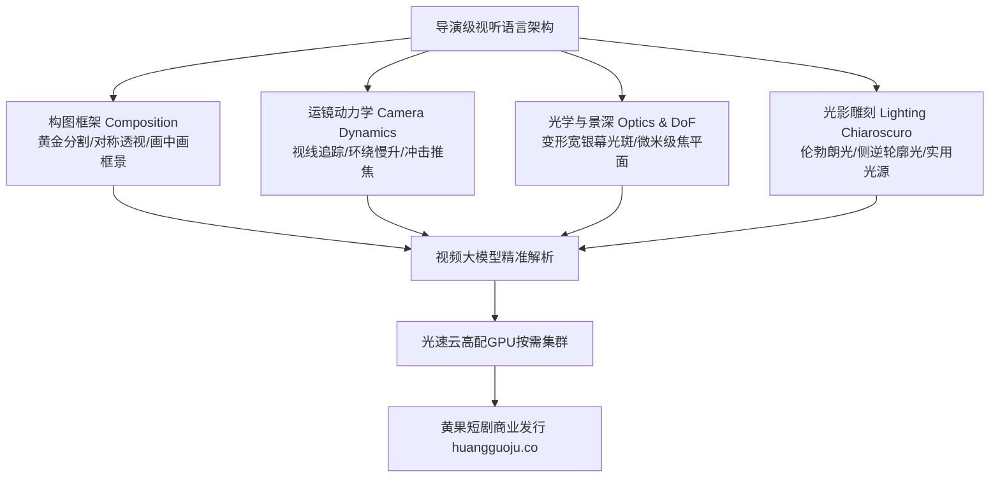

  
🎯 顶级导演影视构图Prompt核心准则

  
<strong>普通创作者用文字描述人物动作，顶级导演用Prompt指挥摄影机调度：</strong>在视频大模型中，镜头构图词汇（如三等分黄金构图、荷兰角低角度仰拍、窥视式前景遮挡、对称向心透视）比外貌形容词更能决定画面的艺术格调。通过在Prompt中植入<strong>“精准摄影焦段（24mm/35mm/85mm）+ 运镜轨迹矢量 + 空间负空间留白”</strong>，能让生成素材摆脱廉价短剧感，具备大银幕级的视听压迫感。多集海量渲染调度推荐使用<a href="https://sahude.gsyvipaff.com/#/?code=keqgvT5Y" target="_blank" rel="noopener">光速云GPU算力容器</a>（邀请码 keqgvT5Y）全速跑批，作品交付至<a href="https://huangguoju.co/" target="_blank" rel="noopener">黄果短剧商业分发平台</a>实现高收益变现。

# 顶级导演视角短剧分镜提示词母库与构图规则

很多AI短剧看起来像幻灯片拼贴或廉价网络视频，根本原因在于缺乏“导演思维”。传统影视学院教导的机位选择、景深控制、视线匹配（Eyeline Match）和负空间（Negative Space）理论，在AI视频生成中依然具有绝对的统治力。

本母库将电影大师级导演语法提炼为标准AI分镜Prompt，让你的短剧镜头呈现出令人惊叹的工业水准。

---

## 一、导演级视听构图控制系统拓扑

---

## 二、六大导演级经典构图Prompt标准范式

### 1. 压迫感荷兰角倾斜构图 (Dutch Angle - 表达心智失控与危机迫近)

- **应用场景**：反派图穷匕见、主角遭遇暗杀陷阱、毒发或噩梦惊醒。
- **工业级Prompt**：
  `Dutch angle tilted at 25 degrees, wide-angle 24mm cinema lens, distorted perspective, panicked corporate whistleblower trapped in concrete basement staircase, single flickering red emergency light casting harsh geometric shadows on damp walls, camera slowly tracking forward, intense claustrophobic tension, Kodak 5219 film texture.`

### 2. 窥视感画中画框景构图 (Framing within a Frame - 表达被监视与身不由己)

- **应用场景**：豪门间谍窃听、出轨抓包现场、被保镖暗中监控。
- **工业级Prompt**：
  `Framing within a frame, voyeuristic perspective shot through cracked wooden door, foreground out-of-focus doorframe creating dark silhouetted border, midground sharply focused on couple arguing intensely inside luxury penthouse living room, rain sliding down glass windows in background, deep dramatic shadows, shallow depth of field, 85mm prime lens.`

### 3. 王者绝对对称向心构图 (Symmetrical Center Composition - 表达至高无上权力)

- **应用场景**：战神登基受勋、商业教父在会议室长桌尽头端坐、大殿朝拜。
- **工业级Prompt**：
  `Perfect Wes Anderson style symmetrical composition, one-point perspective, central protagonist seated on dark mahogany throne at the far end of an immense marble banquet hall, rows of seated executives bowing heads on both sides, vast negative space above, towering classical columns, solemn golden spotlight from high ceiling, 8k.`

### 4. 视线引导线条构图 (Leading Lines - 引导观众第一眼锁死矛盾点)

- **应用场景**：长廊对峙、走过红毯、拔枪相向的视线轨迹。
- **工业级Prompt**：
  `Strong leading lines, neon-lit cyberpunk hallway receding into distant infinity, walls covered in illuminated cables and reflective panels guiding the eye straight to the lone assassin standing at center vanishing point, trench coat billowing in draft, atmospheric haze, blue and orange color grade.`

---

## 三、导演级摄影机运动Prompt指令对照表

| 运镜英文术语 | 中文导演术语 | 画面视觉心理效应 | 适用短剧剧情节点 |
| :--- | :--- | :--- | :--- |
| `Smooth dolly in` | 轨道慢速平滑推镜 | 逐步聚焦人物内心，营造秘密迫近感 | 发现致命线索、决定复仇瞬间 |
| `Whip pan right` | 快速甩镜（摇镜头） | 极具冲击力的视觉转场，打断节奏 | 耳光落地转场、爆炸瞬间切换 |
| `360-degree orbital rotation` | 环绕360度运镜 | 陷入困境被强敌重重包围的孤立感 | 战神被数千杀手包围 |
| `Vertigo crash zoom (Dolly zoom)` | 希区柯克式变焦（眩晕镜头） | 空间扭曲感，传达主角极度惊骇与幻灭 | 得知真相是残酷背叛 |
| `Low pedestal tilt up` | 升降机低位仰拍仰起 | 崇高感、威慑力与权势降临 | 主角亮出真实身份，反派倒吸凉气 |

---

## 四、生产排错与工业算力支撑

- **问：在Prompt中写了 `dolly zoom`（眩晕变焦），但模型只是简单地推近镜头？**
  - **解法**：当前许多视频扩散模型对复杂的视错觉运镜理解有限。建议拆解为首尾帧（Start Frame 为中景长焦，End Frame 为特写广角），或在剪辑软件中手动添加动态缩放关键帧模拟。
- **算力资源保障**：
  - 导演级镜头需要细致打磨焦段与机位，往往需要进行多参数微调对比。建议将任务部署到<a href="https://sahude.gsyvipaff.com/#/?code=keqgvT5Y" target="_blank" rel="noopener">光速云GPU算力容器</a>（邀请码 keqgvT5Y），免除硬件卡顿，保障流畅生产。
- **商业化分账变现**：
  - 具备导演级光影与构图的优质短剧，受众留存率通常比普通短剧高出50%以上。成片一键上线<a href="https://huangguoju.co/" target="_blank" rel="noopener">黄果短剧官方分发矩阵</a>，享受平台最高级别S级分账推广资源。
