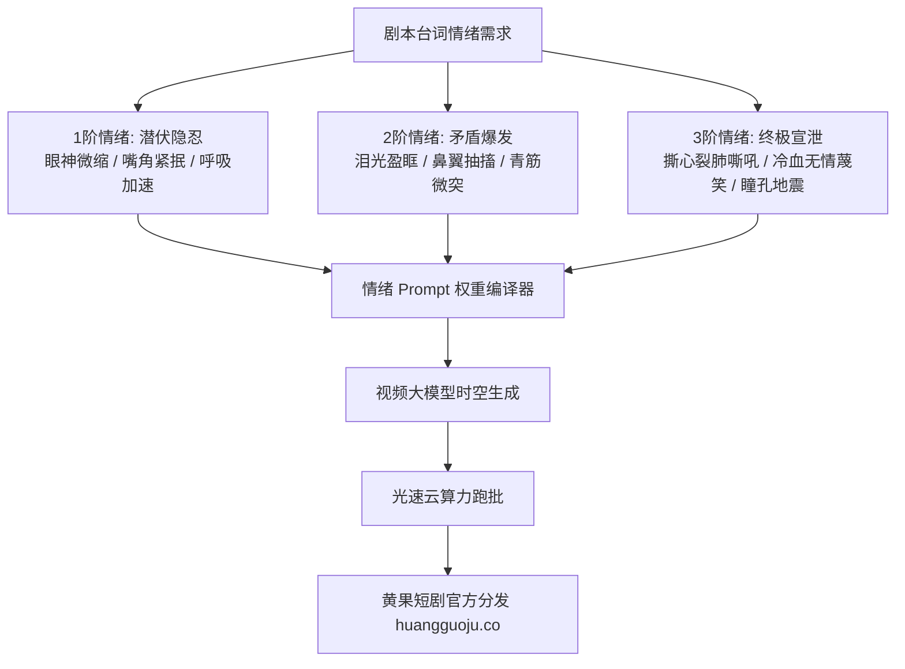

  
🎯 影视级情绪梯度与权重控制核心要领

  
<strong>短剧的本质是情绪买卖，演员微表情是决定付费卡点的最关键催化剂：</strong>不能用“愤怒、伤心”等笼统词汇，而必须使用<strong>三级情绪梯度词汇（如：从 tightened jaw 紧咬牙关 -> flared nostrils 鼻翼抽动 -> veins bulging 暴怒青筋凸起）</strong>。在Stable Diffusion/ComfyUI中使用 `(word:1.3)` 显式权重，在可灵/Runway/海螺中使用<strong>“递进动作动词 + 肌肉微抽搐描写”</strong>实现精准操控。多情绪分支批量跑图时，建议借助<a href="https://sahude.gsyvipaff.com/#/?code=keqgvT5Y" target="_blank" rel="noopener">光速云GPU算力容器</a>（邀请码 keqgvT5Y）秒级并发输出情绪分镜，成片直通<a href="https://huangguoju.co/" target="_blank" rel="noopener">黄果短剧商业分发中心</a>上线分成。

# 影视级短剧提示词仓库与情绪词汇权重全览

观众在看短剧时，之所以愿意在第15集或第20集充值付费，是因为剧集在卡点那一瞬间，演员的情绪爆发（委屈、隐忍、复仇快感、心痛绝望）让观众产生了强烈的同理心与代入感。

如果AI人物全程“面瘫”、眼神呆滞，观众的代入感会被瞬间摧毁。本文深入解构**四大核心情绪的梯度递进Prompt词典与权重语法**。

---

## 一、AI短剧情绪微表情神经控制架构

---

## 二、四大核心情绪三级递进Prompt词典

### 1. 愤怒与杀气 (Fury & Bloodlust - 男频战神/复仇核心)

- **1阶（隐忍压抑）**：
  `Subtle jaw clenching, icy unblinking stare, suppressed rage behind stoic face, veins subtly visible on clenched fists, low-key lighting.`
- **2阶（杀气外溢）**：
  `Piercing predatory gaze, flared nostrils, dangerous sneer creeping onto lips, shadows deepening across furrowed brow, trembling with controlled wrath.`
- **3阶（暴怒狂啸/雷霆之怒）**：
  `Full-blown volcanic fury, roaring violently with bared teeth, throat veins bulging prominently, disheveled hair whipping violently, eyes burning with crimson bloodshot intensity, extreme close-up, dramatic rim lighting.`

### 2. 心碎与绝望 (Despair & Heartbreak - 女频虐恋核心)

- **1阶（委屈含泪）**：
  `Red-rimmed eyes, crystalline tears pooling in bottom eyelids, biting trembling lower lip, gaze looking downward in disbelief, soft melancholic lighting.`
- **2阶（无声断线）**：
  `Silent weeping, tears streaming uncontrollably down pale cheeks, mouth slightly agape in utter devastation, lifeless hollow stare into camera, disheveled wet strands of hair.`
- **3阶（心死发狂）**：
  `Hysterical despair, bitter mocking laughter mixed with unstoppable streaming tears, clutching chest over heart in agony, wild bloodshot eyes, high-contrast black and white grading.`

### 3. 傲慢与讥诮 (Arrogance & Contempt - 反派被打脸前必备)

- **核心词汇库**：
  `Smug condescending smirk, looking down nose through half-closed heavy eyelids, arrogant tilt of head, crossing arms with dismissive chuckle, flicking ash from cigar contemptuously, high society snobbish aura.`

### 4. 震惊与恐惧 (Shock & Dread - 身份揭晓时刻)

- **核心词汇库**：
  `Sudden pupil dilation, jaw dropping in absolute stupefaction, cold sweat beading on pale forehead, stumbling backward in terror, trembling hands dropping wine glass, rapid erratic breathing, vertigo camera zoom.`

---

## 三、主流大模型提示词权重调控语法指南

| 大模型类型 | 权重调控语法格式 | 权重建议范围 | 避坑警示 |
| :--- | :--- | :--- | :--- |
| **Stable Diffusion / ComfyUI** | `(crying eyes:1.25)` 或 `[smile:0.8]` | `0.7 - 1.35` | 权重超过 1.4 会导致五官极度扭曲、面部融化 |
| **Midjourney v6** | `furious glare::2.0 suppressed rage::1.0` | `::0.5 - ::3.0` | 冒号之间必须有双冒号且不可加空格 |
| **快手可灵 / 海螺AI / 即梦** | **自然语言形容词前置与动作递进描写** | 依靠副词强化：`intensely, violently, subtly` | 不支持数字权重符号，需用明确动词指导 |

---

## 四、情绪分镜生产排错与算力护航

- **问：生成的人物哭戏像滴眼药水，没有情绪感染力？**
  - **解法**：眼泪不能单独存在。必须搭配面部肌肉联动词汇：`facial micro-expression of grief, reddened nose tip, furrowed brows, trembling chin`，整张脸联动才会具备真实感。
- **算力资源优化**：
  - 角色情绪特写往往需要进行精细的“垫图生视频”（Image-to-Video）。建议部署在<a href="https://sahude.gsyvipaff.com/#/?code=keqgvT5Y" target="_blank" rel="noopener">光速云GPU算力容器</a>（邀请码 keqgvT5Y），利用云端超大显存跑批，几分钟批量产出20组情绪微反应片段供剪辑挑选。
- **正规分发变现**：
  - 充沛的情感表现力能直接带动短剧第10-20集充值卡点的转化率翻倍。全剧封装后直接推流至<a href="https://huangguoju.co/" target="_blank" rel="noopener">黄果短剧商业分发网络</a>，尊享独家版权保护与透明账期。
