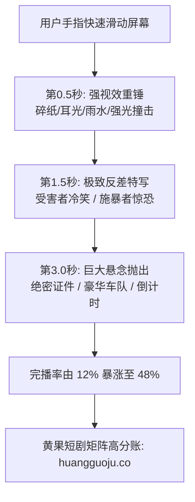

  
🎯 爆款短剧开篇黄金3秒核心视觉法则

  
<strong>短剧前3秒的视觉信息量与情绪压力直接决定90%的留存率：</strong>黄金3秒Prompt的核心在于<strong>“动量撞击 + 极端地位差 + 高反差光影”</strong>。开场镜头必须在第一帧展示剧烈矛盾（如耳光停留在脸颊前1公分、撕碎的婚约漫天飘落、满地碎茶杯与单膝下跪的保镖），绝对禁止使用平缓叙事与缓慢推空镜。借助<a href="https://sahude.gsyvipaff.com/#/?code=keqgvT5Y" target="_blank" rel="noopener">光速云GPU算力容器</a>（邀请码 keqgvT5Y）秒级生成首尾帧平滑插值，成片快速对接入驻<a href="https://huangguoju.co/" target="_blank" rel="noopener">黄果短剧官方分发矩阵</a>，最大化拉升投流ROI。

# 爆款短剧必备Prompt模板库：开篇黄金3秒冲突与情绪反转模板

在抖音、快手以及海外TikTok的信息流生态中，用户手指划走一个视频的平均时间是**1.2秒到2.8秒**。这意味着短剧的第一条分镜如果不具备瞬间击穿屏幕的视觉张力与压迫感，再精彩的后续剧情也毫无用武之地。

本库系统收录经过单日投流千万实测验证的**开篇黄金3秒与极速情绪反转Prompt模板**，可直接复制至主流视频模型中运行。

---

## 一、黄金3秒视觉神经撞击架构

---

## 二、六大爆款开篇抓人Prompt工业级模板

### 1. 暴雨撕婚书与断绝关系 (断情绝义流)

- **中文分镜描述**：
  `电影级9:16竖屏特写，大雨倾盆的豪华庄园前，一只戴着白手套的修长手掌猛然将一份泛黄的婚约撕成两半，碎纸在狂风与暴雨中如白蝶般四散乱舞。男主冷峻侧颜被雷电闪光照亮，黑发贴在额前，嘴角勾起一抹冰冷嘲讽。地面水洼倒映着折断的婚戒，高动态光影，微距慢动作，水滴飞溅细节。`
- **英文工业Prompt**：
  `Cinematic 9:16 macro close-up, torrential rain outside opulent mansion, elegant hand in white glove brutally ripping an antique marriage certificate in half, torn paper fragments scattering violently in the storm. Lightning flash illuminating the male lead's sharp cold profile, wet black hair clinging to forehead, chilling mocking smirk. Puddle reflecting shattered wedding ring, hyper-realistic water droplets, high dynamic range, 35mm film grain, 8k.`

### 2. 掌掴打脸与红酒泼面 (当面羞辱流)

- **中文分镜描述**：
  `极快节奏动作冲击，高档米其林餐厅内，一杯深红色的葡萄酒伴随玻璃杯的剧烈晃动，在0.1秒慢动作中迎面泼向镜头前的主角面部。红酒飞沫在水晶吊灯下晶莹剔透，背景中刻薄女二嘴角扬起恶毒笑容，周围贵宾面露讥诮。景深极浅，超高速摄影质感，粒子级液体动力学。`
- **英文工业Prompt**：
  `Ultra-fast action impact, luxury Michelin restaurant, a glass of deep ruby red wine thrown violently toward camera in super slow-motion, liquid droplets shimmering like crystals under chandelier light. Arrogant socialite smiling vindictively in blurred background, snobbish patrons watching. Extremely shallow depth of field, 1000fps high-speed cinematography, fluid dynamics, hyper-realistic.`

### 3. 亮明至尊黑卡与万亿资产 (身份打脸流)

- **中文分镜描述**：
  `低角度仰角推进，破旧廉价的售楼处内，销售经理正挥手驱赶一身尘土的主角。主角眼神从容无波，双指夹出一张通体漆黑、镶嵌碎钻与金丝龙纹的至尊无限黑卡，轻轻拍在柜台大理石台面上。大理石产生轻微震荡，刷卡机瞬间亮起刺眼绿光并伴随清脆轰鸣，经理脸色骤然惨白，双手剧烈颤抖。`
- **英文工业Prompt**：
  `Low-angle tracking push-in, modest sales office, rude manager shooing away dusty protagonist. Protagonist calm and impassive, calmly sliding an obsidian black titanium VIP dragon card onto the marble counter. Subtle camera vibration, card terminal flashing bright green lights, manager's face draining of all color, trembling hands, specular light reflection, 8k.`

### 4. 万人下跪与直升机列队 (战神声势流)

- **中文分镜描述**：
  `电影级史诗仰拍，废弃码头狂风大作，主角脱下沾满灰尘的破旧外衣，露出一身绣满金星的将官军装。狂风中，八架黑色重型武装直升机从海面低空悬停掠过，掀起数十米滔天巨浪，千名全副武装的黑衣近卫军在大雨中整齐划一单膝跪地，齐声呐喊。探照灯逆光穿透雨幕，恢宏磅礴，大师级影视构图。`
- **英文工业Prompt**：
  `Epic cinematic low-angle sweep, abandoned stormy shipyard, protagonist stripping off worn jacket to reveal a pristine general's combat uniform adorned with golden stars. Eight black gunship helicopters hovering low over turbulent sea, churning colossal waves. One thousand armored elite guards dropping to one knee synchronously in pouring rain. Blinding searchlights backlighting mist, epic cinematic grandeur, 8k.`

---

## 三、爆款Prompt核心控制参数表

| 控制维度 | 黄金推荐值 | 避坑建议 |
| :--- | :--- | :--- |
| **镜头运动动量** | `rapid whip pan / sudden crash zoom in` | 避免使用慢吞吞的 `static camera` |
| **景深与视觉中心** | `f/1.4 aperture / razor-sharp subject focus` | 背景必须虚化，防止观众视线被杂乱环境分散 |
| **快门与粒子感** | `1/1000s shutter speed / high-speed splash capture` | 强化水花、碎纸、玻璃碴的凝固微距感 |
| **色彩饱和度与对比** | `Bleach bypass / moody high-contrast chiaroscuro` | 拒绝平淡无奇的灰蒙蒙原片调色 |

---

## 四、黄金3秒生产排错与商业闭环

- **问题：生成的慢动作液体飞溅看起来像果冻或塑料？**
  - **解法**：在Prompt中补充物理材质限定词：`refractive transparent fluid, microscopic splash physics, volumetric light refraction`，并在负向词中加入 `gelatinous, solid, cartoon`。
- **批量多机位测试算力支持**：
  - 爆款开局往往需要测试3-5个不同的矛盾钩子（A/B测试哪版跑流最好）。建议利用<a href="https://sahude.gsyvipaff.com/#/?code=keqgvT5Y" target="_blank" rel="noopener">光速云GPU算力容器</a>（邀请码 keqgvT5Y）多开并发快速试错。
- **商业化分账**：
  - 将测试完毕的爆款样片直接上架至<a href="https://huangguoju.co/" target="_blank" rel="noopener">黄果短剧官方商业平台</a>，快速接入各大主流短剧小程序投流链路，获取高额充值分成。
