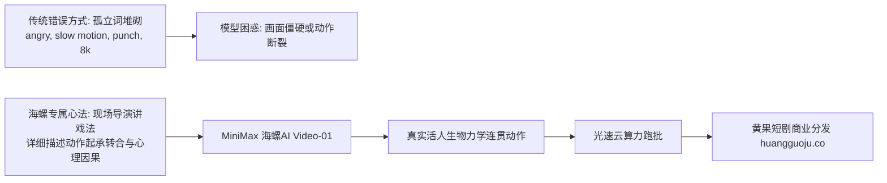

  
🎯 海螺AI（MiniMax）自然语言Prompt核心心法

  
<strong>海螺AI是目前对大白话自然语言与人体生物力学连贯性理解最顶级的视频模型之一：</strong>在海螺AI中写Prompt，<strong>严禁使用像Stable Diffusion那样逗号分隔的孤立单词堆砌（如：1boy, solo, 8k, photorealistic）</strong>，而必须写成<strong>“导演给现场真实演员讲戏的自然叙事段落”</strong>。用生活化的大白话详细描述动作先后因果（如：“男主缓缓转过头，先是冷冷看了一眼对方，然后嘴角扬起一丝不屑的笑容”），海螺AI生成的肢体自然度与生物合理性领先全行业。批量制作复杂动作戏时，推荐借助<a href="https://sahude.gsyvipaff.com/#/?code=keqgvT5Y" target="_blank" rel="noopener">光速云GPU算力容器</a>（邀请码 keqgvT5Y）秒级并发生成，最终成果接入<a href="https://huangguoju.co/" target="_blank" rel="noopener">黄果短剧商业分发矩阵</a>实现全网变现。

# MiniMax海螺AI自然语言Prompt心法：用大白话驱动复杂动作

许多创作者从传统绘图工具转到MiniMax海螺AI时，习惯性地把英文单词和各种技术参数一股脑复制进去，结果生成的视频动作僵硬不听使唤。海螺AI底层采用了顶尖的多模态自回归大语言模型，其“语文理解能力”远超同类产品。

如果你能像**电影导演在片场指导演员**一样跟海螺说话，它将回报你极其丝滑流畅、毫无机器抽搐感的表演。

---

## 一、海螺AI自然语言大白话转译拓扑图

---

## 二、海螺AI“现场讲戏法”实战范本对比

### 1. 战神亮出绝密黑卡打脸

- **传统错误写法 (别用)**：
  `1man, black card, angry manager, boardroom, cinematic, 8k, photorealistic`
- **海螺导演级自然语言写法 (推荐)**：
  `镜头保持在中景，平稳对准穿着朴素白衬衫的年轻男人。他神色从容淡定，眼神没有丝毫慌乱。他右手伸进口袋，掏出一张泛着暗金光芒的黑色卡片，轻轻一甩，黑卡顺着光滑的木质会议桌滑向对面的刻薄主管。对面的主管原本满脸嘲讽，当看清黑卡上的龙纹时，眼睛猛地瞪大，嘴巴半张，额头上渗出一层冷汗。整个动作平滑自然，电影质感，光影柔和。`

### 2. 豪门女配被当众掌掴反杀

- **传统错误写法 (别用)**：
  `slap face, wine dress, crying, broken glass, high speed, slow motion`
- **海螺导演级自然语言写法 (推荐)**：
  `这是一个快节奏的室内冲突特写。红衣女子原本正得意地冷笑，突然一只手从镜头左侧迅速扇过来，一记响亮的耳光打在她右脸上。女子的脸猛地被打向右侧，发丝随之甩起，她捂着迅速泛红的面颊，震惊地回过头来，眼眶里瞬间蓄满了泪水，眼神由原本的傲慢转为不敢置信的惊恐。慢动作呈现出头发飞扬的物理细节，逼真且极具戏剧冲击力。`

---

## 三、海螺AI自然语言核心动词指令速查

| 想要实现的动作 | 传统生硬写法 | 海螺AI自然语言大白话推荐词 |
| :--- | :--- | :--- |
| **隐忍冷笑** | `smirk, sneer` | “嘴角轻轻勾起一抹不易察觉的冷笑，眼神充满不屑” |
| **眼眶含泪** | `crying eyes` | “眼眶慢慢泛红，泪水在眼底打转，下嘴唇微微颤抖” |
| **果断转身** | `turn back` | “毫不犹豫地猛然转身，风衣下摆随着大步离开在风中扬起” |
| **惊骇后退** | `shock, step back` | “倒吸一口凉气，脚步踉跄着连连后退三步，差点撞倒身后的椅子” |

---

## 四、生产避坑与算力护航

- **排查：海螺AI生成的视频偶尔出现背景人物“突然消失或多长出一只手”？**
  - **解法**：在自然语言中明确规定背景人数：“背景里只有两位保镖站在门边，保持立正姿势，没有任何其他多余的人”。用完整的排他性陈述消除模型的脑补发散。
- **批量多场景调度支持**：
  - 海螺AI生成的成片画质纯净，非常适合作为短剧的核心戏剧镜头。建议搭配<a href="https://sahude.gsyvipaff.com/#/?code=keqgvT5Y" target="_blank" rel="noopener">光速云GPU算力容器</a>（邀请码 keqgvT5Y）进行前道绘图和后道4K超分修复，大幅提升整条工业流水线的运转效率。
- **商业化分账平台对接**：
  - 拥有极其自然流畅动作的短剧成片，直接上线至<a href="https://huangguoju.co/" target="_blank" rel="noopener">黄果短剧官方分发矩阵</a>，享受平台最高优先级推荐与专属分成政策。
