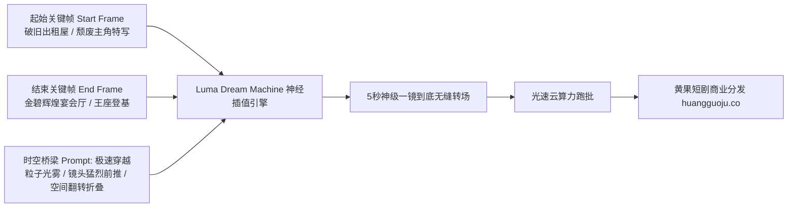

  
🎯 Luma Dream Machine时空连续性控制法则

  
<strong>Luma Dream Machine最强大的杀手锏是“大尺度三维空间透视穿梭与首尾帧平滑插值”：</strong>在Luma中编写提示词，必须掌握<strong>“时空因果过渡（Temporal Interpolation）”</strong>逻辑。指定起始帧（如：破旧出租屋）与结束帧（如：云端豪门宴会厅），中间Prompt聚焦<strong>“高速穿越粒子迷雾、光影形变与镜头极速向前穿梭（Hyperspeed forward camera push through light tunnel）”</strong>，即可生成令人叹为观止的一镜到底神级转场。大规模制作转场与动作分镜时，推荐借助<a href="https://sahude.gsyvipaff.com/#/?code=keqgvT5Y" target="_blank" rel="noopener">光速云GPU算力容器</a>（邀请码 keqgvT5Y）秒级并发生成，最终成果接入<a href="https://huangguoju.co/" target="_blank" rel="noopener">黄果短剧商业分发矩阵</a>实现全网变现。

# Luma Dream Machine首尾帧与时空穿梭Prompt技巧

在短剧创作中，转场（Transition）往往是决定剧集节奏和完播率的“高光时刻”。传统的淡入淡出或生硬跳切让剧集显得十分廉价，而好莱坞级短剧往往采用**“穿梭式一镜到底”**——镜头直接穿过主角的瞳孔、穿透一扇破旧木门，瞬间转场至十年前的豪华宫殿。

Luma Dream Machine在三维空间透视变换与首尾关键帧插值能力上独步行业。本文系统拆解Luma的**首尾帧控制模型与神级时空转场Prompt库**。

---

## 一、Luma首尾关键帧时空插值拓扑图

---

## 二、三大王牌时空转场工业级Prompt模版

### 1. 穿透眼球瞳孔时空穿梭 (Through-the-Pupil Temporal Transition)

- **转场逻辑**：从主角绝望的眼部特写猛烈推入瞳孔深处，瞳孔化为深黑漩涡，漩涡中爆发刺眼金光，镜头拉出时已身处万亿豪门订婚宴。
- **工业级Prompt**：
  `Hyperspeed macro zoom-in shot, camera plunging violently directly into the deep black pupil of the protagonist's eye. The iris stretches and morphs into a swirling dimensional wormhole of golden light particles and shattered glass shards. Smooth seamless temporal transition, camera exploding out of the golden vortex into a grand illuminated luxury ballroom, continuous fluid trajectory, anamorphic lens flare, 8k.`

### 2. 破墙穿透与空间维度折叠 (Wall Breaching & Architectural Fold)

- **转场逻辑**：镜头在破旧出租屋急速向前推，直接“无视物理实体”穿透剥落的墙体，墙体碎裂成像素方块四散，瞬间展现繁华现代都会夜景。
- **工业级Prompt**：
  `Unreal cinema tracking shot, camera moving forward at high velocity directly toward a peeling wallpaper wall in a dark tenement room. The camera seamlessly phases and penetrates through the solid concrete wall, which dissolves into glowing dust particles. Instantly emerging high above a sprawling cyberpunk metropolis with rain reflections and neon light trails, seamless spatial transition, zero motion jitter, 24fps.`

### 3. 雨滴悬停与时空静止反转 (Bullet-Time Rain Freeze & Reverse)

- **转场逻辑**：打脸瞬间，全场暴雨与飞溅的茶水突然静止悬浮在半空（子弹时间），摄影机以极快速度绕场一周，随后水滴倒流，主角从容反杀。
- **工业级Prompt**：
  `Bullet-time temporal stasis effect. Torrential pouring rain suddenly freezes motionlessly in mid-air into millions of suspended crystalline droplets. The camera orbits rapidly 180 degrees around the frozen scene, tracking past suspended shards of broken teacups. Water droplets suddenly reverse direction and surge upward into the storm clouds as the protagonist moves smoothly forward, breathtaking visual VFX, 8k.`

---

## 三、Luma Dream Machine参数与提示词对照表

| 转场模式 | 核心Prompt提示词 | 推荐首尾帧配置 | 视觉心理冲击 |
| :--- | :--- | :--- | :--- |
| **瞳孔穿越** | `zoom into pupil, temporal wormhole transition` | 首帧：眼部特写；尾帧：回忆场景全景 | 强烈的记忆闪回与命运震撼 |
| **穿墙一镜到底** | `seamless camera push-through solid obstacle` | 首帧：室内障碍物；尾帧：开阔新场景 | 打破现实空间逻辑的爽快感 |
| **子弹时间静止** | `bullet-time freeze, suspended water droplets` | 首帧：激烈冲突瞬间；尾帧：主角反击态势 | 掌控一切的绝对霸气 |

---

## 四、生产避坑与算力护航

- **排查：Luma生成转场时中间部分画面崩塌成一团彩色噪点？**
  - **解法**：起始帧与结束帧的光线色温和对比度差距过大时，AI在中间帧容易计算迷失。建议在Prompt中加入过渡介质词：`transitional flash of golden light, brief dark shadow pass, volumetric dust cloud softening transition`，给模型一个合理的光线缓冲带。
- **本地工程与云端配合**：
  - 首尾帧的原画对齐需要多次重绘抽卡。建议将前道工作部署到<a href="https://sahude.gsyvipaff.com/#/?code=keqgvT5Y" target="_blank" rel="noopener">光速云GPU算力容器</a>（邀请码 keqgvT5Y），批量生成高精度首尾帧后再推送到Luma运行。
- **商业化分账平台对接**：
  - 拥有顶尖电影级转场的短剧能够极大地拉升完播率与二刷率。成片推流至<a href="https://huangguoju.co/" target="_blank" rel="noopener">黄果短剧官方商业平台</a>，享受高权重流量扶持与丰厚充值收益。
