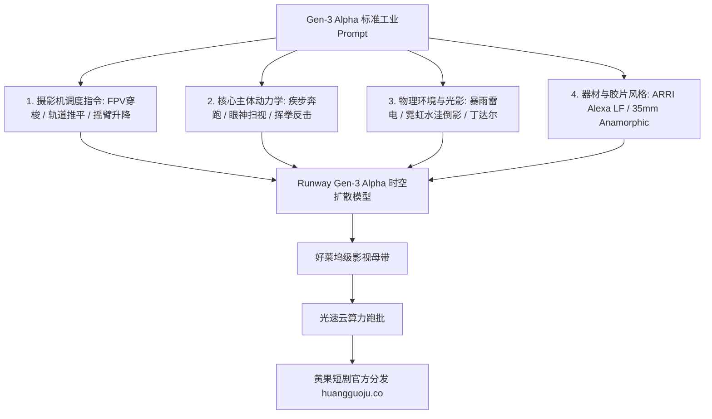

  
🎯 Runway Gen-3 Alpha工业级运镜Prompt法则

  
<strong>Runway Gen-3 Alpha是全球公认摄影机动力学控制最严谨的电影级视频模型：</strong>在Gen-3中写Prompt，必须遵循<strong>【摄影机轨迹（Camera Path） + 主体运动（Subject Kinetics） + 场景光影与天气（Lighting & Environment） + 电影摄影器材后缀（Cinematic Rig）】</strong>的四段式语法结构。使用精确的电影专业运镜词汇（如 FPV drone dive, Steadicam tracking, Low orbital dolly），能百分百激发Gen-3的时空连续性优势。面对跨剧集多机位大工程时，推荐接入<a href="https://sahude.gsyvipaff.com/#/?code=keqgvT5Y" target="_blank" rel="noopener">光速云GPU算力容器</a>（邀请码 keqgvT5Y）作为前道原画与后道超分算力底座，最终成果推流至<a href="https://huangguoju.co/" target="_blank" rel="noopener">黄果短剧商业分发平台</a>实现高收益变现。

# Runway Gen-3 Alpha专业摄影机运动Prompt指令速查

在好莱坞与顶级广告制作团队中，Runway Gen-3 Alpha被誉为“虚拟片场的数字摄影师”。它对镜头运动方向、焦距变换、景深过渡以及复杂时空动力学的还原精度，处于全球第一梯队。

然而，如果用随意散漫的词句给Gen-3下达指令，它往往只能发挥出30%的潜能。本文系统拆解**Gen-3 Alpha官方推荐的四段式工业语法结构与顶级运镜Prompt库**。

---

## 一、Gen-3 Alpha四段式工业语法架构拓扑图

---

## 二、六大好莱坞级摄影机运镜Prompt范本

### 1. 穿梭FPV无人机俯冲 (FPV Drone High-Speed Dive - 宏大空镜与追逐)

- **工业级Prompt**：
  `Dynamic high-speed FPV drone dive, camera steeply plunging vertically down along the reflective glass facade of an ultra-modern 80-story skyscraper in a rainstorm. Gliding effortlessly past glowing office windows, suddenly leveling out smoothly 2 meters above wet street level, racing through neon-lit traffic at incredible kinetic velocity. Raindrops streaking across camera lens, vibrant blue anamorphic lens flare, motion blur, 8k resolution.`

### 2. 斯坦尼康平稳贴身跟拍 (Steadicam Tracking Shot - 紧张走戏与杀气逼人)

- **工业级Prompt**：
  `Continuous Steadicam tracking shot moving backward smoothly at brisk walking pace, maintaining tight chest-level framing on the male commander walking purposefully through an underground tactical bunker. Emergency red beacon lights rhythmically rotating overhead, casting pulsing crimson shadows across his scarred chiseled face. Armed soldiers parting respectfully on either side, flawless temporal consistency, 24fps.`

### 3. 升降吊臂大范围俯视 (Crane Up & Reveal Shot - 震撼排场揭晓)

- **工业级Prompt**：
  `Cinematic Technocrane shot starting from a tight ground-level close-up of protagonist's leather boots resting in a rain puddle, smoothly ascending 15 meters into the air while tilting downward. Grandly revealing an immense fleet of fifty black luxury SUVs forming a giant perimeter, hundreds of bodyguards holding black umbrellas in pouring rain, epic architectural scale, volumetric vehicle headlights cutting through mist.`

### 4. 环绕360度低空掠过 (Low-Altitude Orbital Sweep - 战神拔剑备战)

- **工业级Prompt**：
  `Low-angle 360-degree orbital rotational sweep gliding smoothly at knee height around a lone martial artist drawing a glowing ancient sword in an abandoned bamboo grove. Camera spins with silky precision, bamboo leaves caught in vortex breeze, moonlight glinting off the polished steel blade edge, flawless spatial coherence, Kodak 5219 aesthetic.`

---

## 三、Runway官方推荐摄影机运动词汇速查表

| 运镜英文术语 | 中文专业术语 | 运动物理轨迹 | 适用短剧剧情节拍 |
| :--- | :--- | :--- | :--- |
| `Fast zoom in` | 极速推焦 | 瞬间将焦点从全景拉入主角面部 | 发现惊天秘密、身份反转 |
| `Slow pan right` | 慢速右摇 | 摄影机水平轴平滑向右旋转扫描 | 展示豪门宴会、扫视围观群众 |
| `Pedestal up` | 垂直抬升 | 摄影机在垂直垂直轨道平滑向上升起 | 战神从受辱下跪到站起称王 |
| `Dolly track left` | 轨道左平移 | 摄影机架在轨道上与演员平行侧移跟拍 | 走廊并排对话、暗流涌动交锋 |
| `Dutch tilt roll` | 荷兰倾斜滚转 | 摄影机沿光轴旋转倾斜25度 | 精神失常、遭下毒迷幻、重伤 |

---

## 四、生产避坑与算力护航

- **排查：Gen-3 生成的视频动作幅度太小，像静态微动图？**
  - **解法**：在Prompt中加强动能因果词汇（Kinetic Action Verbs）：例如加上 `rapidly strides forward, violently swings arm, camera aggressively swoops in`，并在UI面板将 **Motion 控制滑块调至 5 - 7** 之间。
- **本地工程与云端配合**：
  - Runway每秒生成成本较高，通常先在本地或云端测试低成本分镜样图。建议搭配使用<a href="https://sahude.gsyvipaff.com/#/?code=keqgvT5Y" target="_blank" rel="noopener">光速云GPU算力容器</a>（邀请码 keqgvT5Y），批量产出高质量垫图原画后再输入Runway，做到“百发百中”。
- **商业化分账平台对接**：
  - 拥有Runway顶级好莱坞运镜质感的短剧在海外TikTok出海与国内精品短剧专区极具杀伤力。成片直接提交至<a href="https://huangguoju.co/" target="_blank" rel="noopener">黄果短剧官方分发矩阵</a>，享受独家流量包与高额充值分成。
