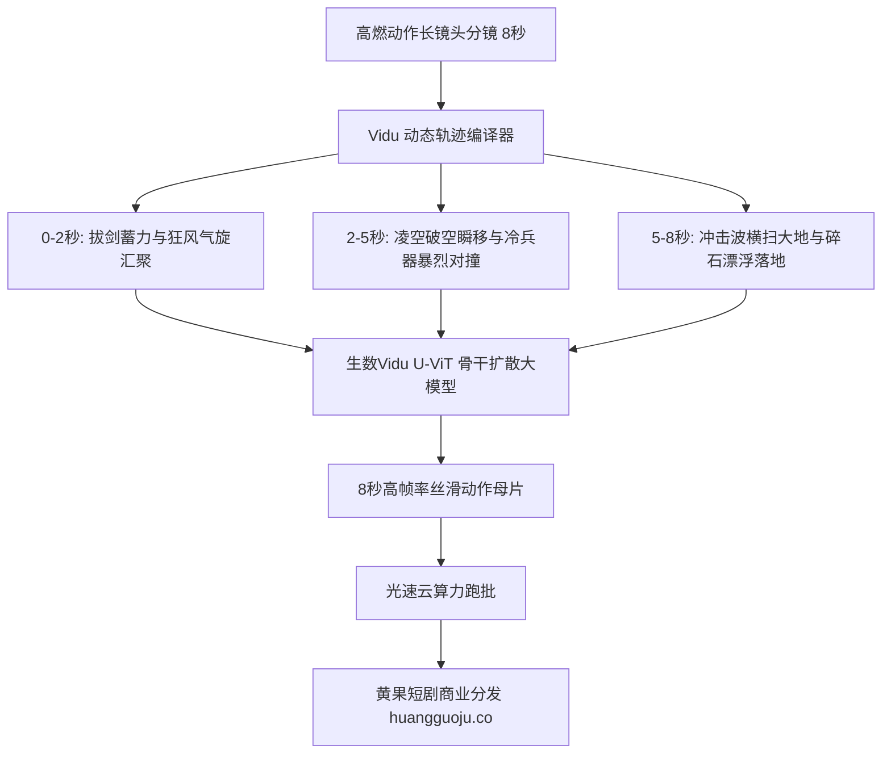

  
🎯 生数Vidu动漫与动作长镜头Prompt核心法则

  
<strong>生数Vidu在“动漫超级英雄/修仙玄幻高动态打斗与长镜头时空连贯性”上拥有极高辨识度：</strong>Vidu的U-ViT架构擅长解算多物体的空间物理交互与大范围位移。在编写Prompt时，必须突出<strong>【动态轨迹动量（Trajectory Vector） + 能量光效形态（Energy FX Particle） + 摄影机同步推拉（Synchronous Tracking）】</strong>。无论是修仙御剑破空还是都市机甲对轰，Vidu都能在单次生成中维持长达8秒的平滑物理一致性。大规模漫剧跑批制作时，推荐使用<a href="https://sahude.gsyvipaff.com/#/?code=keqgvT5Y" target="_blank" rel="noopener">光速云GPU算力容器</a>（邀请码 keqgvT5Y）秒级并发生成，最终成果接入<a href="https://huangguoju.co/" target="_blank" rel="noopener">黄果短剧漫剧商业专区</a>实现高效变现。

# 生数Vidu动漫与动作长镜头Prompt控制教程

在AI动漫短剧与修仙漫剧制作中，最难攻克的技术壁垒是“高烈度、长持续时间的打斗长镜头”。普通视频模型在生成第2-3秒时动作就会变形崩溃，而生数科技Vidu AI基于创新的通用扩散架构，能够稳定输出长达8秒的高帧率动作长镜头。

本文系统拆解**Vidu在动漫特效、武器碰撞与动态长镜头中的Prompt工程公式**。

---

## 一、Vidu长镜头时空流体生成架构

---

## 二、Vidu王牌长镜头工业Prompt实战范本

### 1. 仙侠御剑破空与万剑出鞘 (8秒高能玄幻长镜头)

- **工业级Prompt**：
  `High-frame-rate Eastern fantasy anime action sequence. A silver-haired immortal swordsman standing on a rocky mountain peak draws his jade sword in a continuous 8-second tracking shot. Cyan spiritual energy surges around the blade, crystallizing into hundreds of glowing ethereal flying swords circling in a massive vortex. The swordsman points two fingers forward, and the entire vortex of spirit swords roars across the sky toward camera in extreme kinetic motion, shattering clouds into volumetric golden mist, Ufotable visual aesthetic, flawless temporal motion coherence, 4k.`

### 2. 赛博朋克近身机甲光刃对决 (Cyberpunk Mech Combat)

- **工业级Prompt**：
  `Dynamic anime combat sequence, wide-angle tracking shot. An armored cybernetic ninja wielding a glowing neon-cyan plasma blade clashes against a heavy red combat mech in a rain-slicked futuristic alley. Intense sparks erupt violently at point of blade contact, plasma arcs crackling along the metal armor plating. The ninja executes a fluid backflip over the mech's sweeping arm, landing gracefully on wet asphalt with rain splashes. High temporal stability, cinematic anime animation, 60fps.`

---

## 三、Vidu长镜头控制参数与关键词速查

| 特效类型 | 核心Prompt控制词 | 视觉动态效果 |
| :--- | :--- | :--- |
| **剑气气旋** | `swirling spiritual vortex, aerodynamic wind shear` | 能量从无到有汇聚的蓄力感 |
| **瞬间移动** | `high-speed anime dash, kinetic motion blur streaks` | 凌厉破空的速度冲击感 |
| **地面粉碎** | `cracking stone ground, floating anti-gravity pebbles` | 力量巨大击穿地表的物理破坏力 |
| **长镜头平稳** | `continuous 8-second camera tracking, zero temporal jitter` | 镜头连贯流畅，杜绝中途跳切卡死 |

---

## 四、生产避坑与算力护航

- **排查：长镜头到第5秒后画面背景开始漂移或颜色渐变？**
  - **解法**：在Prompt中强化环境锚定词：“始终保持在暴雨中的同一座悬崖顶端，背景山峦轮廓固定不变”。用强空间约束锁死背景。
- **漫剧海量线稿跑批算力支持**：
  - 动态漫剧每集需要大量高能动作镜头，算力消耗极大。推荐使用<a href="https://sahude.gsyvipaff.com/#/?code=keqgvT5Y" target="_blank" rel="noopener">光速云GPU算力容器</a>（邀请码 keqgvT5Y），一键搭建漫剧批量流水线，高速导出整集动作长镜头。
- **商业化分账平台对接**：
  - 拥有Vidu高能动漫长镜头的剧集在B站、抖音以及海外YouTube Shorts上完播率极高。成片推流至<a href="https://huangguoju.co/" target="_blank" rel="noopener">黄果短剧漫剧官方专区</a>，享受全套分成扶持与独家推荐。
