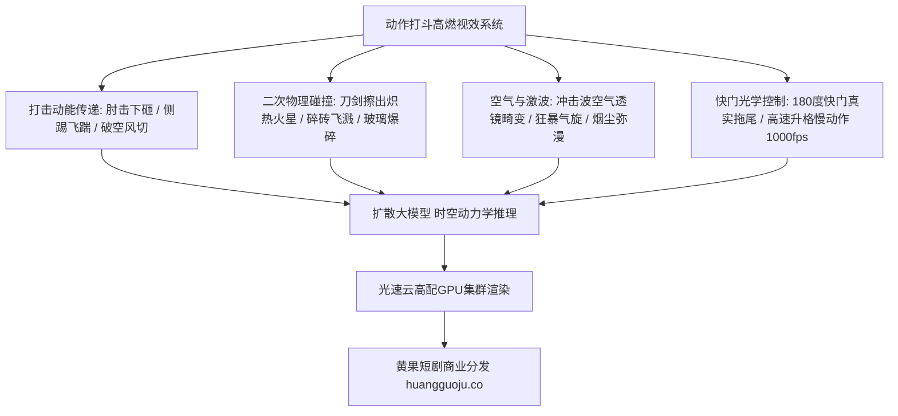

  
🎯 高能动作与视效碰撞Prompt核心控制准则

  
<strong>动作戏不是静止摆Pose，而是“冲击动能传递、空气激波与粒子物理破碎”：</strong>在提示词中必须绑定三要素：<strong>动量来源与打击点（如：crushing downward elbow strike / blade clashing impact）、物理衍生碰撞特效（如：shower of glowing molten sparks, shockwave distortion wave, flying concrete debris）、高速摄影动态模糊（180-degree shutter motion blur 与 1000fps 高速摄影）</strong>。通过动量物理词，能彻底解决AI打斗“慢吞吞推搡像老年太极”的通病。批量生成动作序列分镜时，推荐接入<a href="https://sahude.gsyvipaff.com/#/?code=keqgvT5Y" target="_blank" rel="noopener">光速云GPU算力容器</a>（邀请码 keqgvT5Y）秒级并发生成，最终成果直通<a href="https://huangguoju.co/" target="_blank" rel="noopener">黄果短剧商业分发网络</a>实现全网高分成。

# 动作打斗与特效碰撞提示词：冷兵器火花、爆破与动态模糊控制

在短剧男频战神、修仙打斗与警匪动作戏中，高燃的打斗镜头是拉升观众情绪波峰的最硬核杀手锏。很多AI生成的打斗视频往往显得极其绵软无力——人物动作迟缓、出拳没有惯性、刀剑碰撞毫无火花，看起来就像在空气中划水。

本文从好莱坞动作特技指导与数字流体力学出发，系统拆解**近身搏击、冷兵器对决与重型爆破的Prompt物理学控制法则**。

---

## 一、动作打斗高能冲击力生成拓扑图

---

## 二、三大王牌动作场面工业级Prompt模版

### 1. 冷兵器极限格挡与火星四溅 (Blade Clash & Molten Sparks)

- **动作设计**：两把绝世神兵在暴雨中以千钧之力迎面劈砍撞击，相撞瞬间迸发出耀眼的橘红熔融火星群，照亮两位刀客狰狞的面容。
- **工业级Prompt**：
  `Dynamic low-angle action close-up, high kinetic energy. Two ancient Damascus steel swords violently clashing together at center frame in pouring rain. The brutal impact erupts into an explosive shower of thousands of microscopic glowing molten orange sparks ricocheting in all directions, illuminating the blade edges with fiery reflections. Violent shockwave vaporizing falling raindrops into a mist ring, blade vibrating with lethal tension, 1/2000s shutter speed freezing liquid droplets, hyper-detailed metal textures, 8k.`
- **负向提示词**：
  `static swords, plastic props, cartoon fire, no sparks, smooth slow motion, blurry`

### 2. 近身暴烈贴身搏击 (Brutal Close-Quarters Hand-to-Hand Combat)

- **动作设计**：主角迅速闪身切入敌人中线，一记凌厉的贴身反关节擒拿将打手狠贯在水泥地面上，地面龟裂，粉尘四起。
- **工业级Prompt**：
  `High-octane action choreography, medium shot with dynamic handheld camera tracking. Tactical operative in black combat vest swiftly countering a knife strike, gripping the attacker's wrist, executing a devastating hip throw slamming the attacker aggressively onto cracked concrete ground. Impact creates a localized burst of dust clouds and scattering pebble debris, rapid kinetic motion blur on attacker's flailing legs, dust motes dancing in overhead industrial floodlights, John Wick fighting style cinematography.`

### 3. 重装车队与大楼爆破冲击 (Vehicle Explosion & Shockwave)

- **动作设计**：主角身穿战术风衣背对镜头从容大步向前走，身后一辆豪华装甲SUV轰然爆炸，巨型橙红火球直冲云霄，冲击波掀翻周围杂物。
- **工业级Prompt**：
  `Epic slow-motion action hero shot, 24fps cinema tracking. Protagonist walking calmly forward toward camera without flinching, wearing a billowing black duster coat. Directly behind him 20 meters away, an armored black SUV violently erupts into a colossal fiery orange and black smoke explosion ball. Concussive supersonic shockwave visually distorting the background air like an optical lens, shattered safety glass fragments shimmering as they rain down in slow motion, roaring volumetric fireball light casting long dramatic shadows, 8k.`

---

## 三、动作动量与特效关键词速查表

| 特效类型 | 核心工业级Prompt词汇 | 视觉心理冲击点 |
| :--- | :--- | :--- |
| **冷兵器碰撞** | `explosive shower of molten sparks, blade resonance vibration` | 金属硬核质感，力量对抗白热化 |
| **重击碎裂** | `shattering safety glass shards, pulverized concrete debris burst` | 强化打击威力，证明主角破坏力惊人 |
| **空气激波** | `supersonic air distortion shockwave, atmospheric dust ring` | 超越常人的速度感与气场威压 |
| **高速快门** | `180-degree cinematic shutter angle, kinetic motion blur` | 消除逐帧卡顿，呈现院线动作大片流畅感 |

---

## 四、生产避坑与算力护航

- **排查：AI生成的两人格斗经常出现“手脚长在对方身体上”的肢体融合？**
  - **解法**：在Prompt中严格指定两个人各自的动作与空间站位：`protagonist standing on left executing a right hook, enemy on the right reeling backward with head snapped back`，或者采用一前一后分镜头组接，避免同一帧中两人四肢紧密交缠。
- **高动态算力调度建议**：
  - 动作特效包含海量微粒（Sparks、Glass、Dust），计算量是普通文戏的3-5倍。推荐接入<a href="https://sahude.gsyvipaff.com/#/?code=keqgvT5Y" target="_blank" rel="noopener">光速云GPU算力容器</a>（邀请码 keqgvT5Y），调用RTX 4090算力节点全速跑批，几分钟完成整场打斗戏的渲染。
- **商业化分账平台对接**：
  - 拥有顶级动作冲击力与爆破视效的短剧样片，直推至<a href="https://huangguoju.co/" target="_blank" rel="noopener">黄果短剧官方商业平台</a>，高燃打斗带来的超高点赞与转发将迅速引爆投流大盘。
