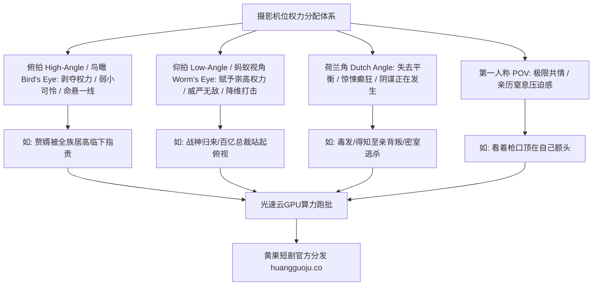

  
🎯 影视镜头机位与机位高度Prompt控制法则

  
<strong>摄影机机位的高度与角度决定了画面中权力的分配与戏剧心理关系：</strong>仰拍赋予主角“神性与无可匹敌的统治力”；俯拍压迫角色“渺小无助与受审视的屈辱感”；主观POV视角将观众直接拉入角色第一人称产生极限心跳感；倾斜荷兰角（Dutch Angle）直接暗示秩序崩溃与心理癫狂。通过在Prompt中精准标注<strong>机位高度（Ground level / Eye level / Bird's eye）与摄影角度（Low-angle / High-angle / Worm's eye）</strong>，能大幅增强镜头叙事厚度。批量渲染多机位分镜时，推荐使用<a href="https://sahude.gsyvipaff.com/#/?code=keqgvT5Y" target="_blank" rel="noopener">光速云GPU算力容器</a>（邀请码 keqgvT5Y）秒级并发生成，最终成果推流至<a href="https://huangguoju.co/" target="_blank" rel="noopener">黄果短剧商业分发平台</a>实现高收益变现。

# 镜头机位与视角提示词指南：俯拍、仰拍与荷兰角工业级控制

许多刚接触AI视频的创作者，生成的画面永远是千篇一律的“平视胸部中景”（Eye-level Medium Shot）。这种平淡无奇的视角就像用手机自拍，完全无法表达短剧中的阶级碾压、打脸高潮与危机四伏。

在专业电影工业中，**摄影机的位置本身就是在讲故事**。本文系统拆解五大经典影视机位视角的Prompt编写规范与心理学暗示法则。

---

## 一、影视机位权力关系拓扑图

---

## 二、五大经典机位视角工业级Prompt全套范本

### 1. 蚂蚁仰拍视角 (Worm's Eye / Extreme Low-Angle - 绝对威压与统治力)

- **戏剧心理**：凸显主角不可撼动的巍峨身躯，地面向上看，人物如山岳般不可逾越。
- **工业级Prompt**：
  `Extreme worm's-eye view, ground-level camera pointing steeply upward at a 75-degree angle. Protagonist in heavy black leather trench coat standing tall with legs shoulder-width apart, coat hem billowing in the wind. Night sky filled with swirling thunderclouds and lightning flashes directly behind his head, creating a terrifying celestial silhouette. Rain puddles reflecting his boots on cracked asphalt, anamorphic 24mm wide-angle lens, dramatic distortion emphasizing towering power, 8k.`
- **负向提示词**：
  `high angle, eye level, flat lighting, smiling, short stature, weak posture`

### 2. 审判鸟瞰视角 (Bird's Eye View / God's Eye - 宿命感与被困牢笼)

- **戏剧心理**：从百米高空垂直向下拍摄，角色如同棋盘上的蝼蚁，象征命运的无情俯视。
- **工业级Prompt**：
  `Perpendicular top-down bird's-eye view, directly looking straight down from 100 feet in the air. A solitary drenched woman in pale white dress collapsed in the exact center of a sprawling geometric maze garden at night. Rain cascading down into the vertical frame, harsh cold silver searchlight illuminating her isolated figure from above, deep noir shadows radiating outwards, cinematic graphic composition, 35mm film aesthetic.`

### 3. 癫狂荷兰倾斜视角 (Dutch Angle / Tilted Camera - 心理崩塌与危机)

- **戏剧心理**：地平线倾斜20-30度，视觉重心失衡，观众产生本能的眩晕与紧张感。
- **工业级Prompt**：
  `Extreme Dutch angle, camera aggressively tilted 30 degrees off horizontal axis, wide-angle 21mm lens. Corporate traitor backing away in a dimly lit server room with flickering red alarm strobe lights, sweating profusely with wide panicked pupils, heavy shadows slanting diagonally across the frame. Dynamic visual instability, claustrophobic atmosphere, cinematic motion blur on edges, sharp dramatic lighting.`

### 4. 沉浸式第一人称视角 (Subjective POV Shot - 身临其境的生死搏杀)

- **戏剧心理**：观众就是主角本人，直接面对刀尖、耳光或伸过来的百亿黑卡。
- **工业级Prompt**：
  `First-person POV shot from the perspective of the protagonist lying on the floor looking up. A menacing villain dressed in a luxury Italian suit stepping aggressively forward, his shiny black leather oxford shoe kicking directly toward the camera in extreme slow motion. Behind him, the lavish chandelier spins slightly, lens flare reflecting off his golden signet ring, visceral physical impact, hyper-realistic depth of field.`

### 5. 隔绝窥视越肩机位 (Over-The-Shoulder / OTS Shot - 秘密对峙与博弈)

- **戏剧心理**：隔着前景角色的肩膀拍摄对方，建立空间相对位置与对话张力。
- **工业级Prompt**：
  `Classic cinematic over-the-shoulder shot, dark blurred silhouette of female antagonist's shoulder and intricate ear jewelry in immediate foreground left. Sharp razor focus on male protagonist sitting across the mahogany desk, his calculating amber eyes locked in cold confrontation, cigarette smoke wafting between them. Shallow depth of field, warm amber desk lamp fill light, 85mm prime lens.`

---

## 三、机位提示词指令与数学参数对照表

| 机位术语 | 英文核心Prompt词 | 推荐镜头焦距 | 推荐适用情节 |
| :--- | :--- | :--- | :--- |
| **极端仰拍** | `worm's-eye low angle looking up at 60 deg` | 24mm (广角畸变拉长身姿) | 战神亮相、打脸反转、王座登基 |
| **上帝俯拍** | `god's eye view, directly looking down` | 35mm (大视野俯视全貌) | 车祸现场、雪地暴毙、被困废墟 |
| **倾斜荷兰角** | `dutch angle tilted 25 degrees` | 28mm (增强失衡动态) | 发现阴谋、毒药发作、神经质暴怒 |
| **第一人称POV** | `first-person POV perspective shot` | 18mm / 24mm (贴近人眼视线) | 被掌掴、被枪指头、接过婚约 |

---

## 四、生产排错与算力护航

- **排查：写了 `low-angle`（仰拍），但模型仍然生成的是水平视角的画面？**
  - **解法**：在Prompt中强化地面和天空的空间特征，例如加上 `camera placed on the ground, pointing up toward the sky, protagonist towering above camera frame`，给模型极明确的空间几何参照。
- **多机位批量并发支持**：
  - 优秀的分镜需要正反打、越肩与仰拍的机位交替组接。建议利用<a href="https://sahude.gsyvipaff.com/#/?code=keqgvT5Y" target="_blank" rel="noopener">光速云GPU算力容器</a>（邀请码 keqgvT5Y）一键下发多机位脚本并发跑图，免去本地显存卡顿烦恼。
- **商业化分账平台直连**：
  - 具有电影级视听调度机位的短剧作品，成片推流至<a href="https://huangguoju.co/" target="_blank" rel="noopener">黄果短剧官方分发渠道</a>，享受平台S级流量池倾斜，获得高额充值分成。
