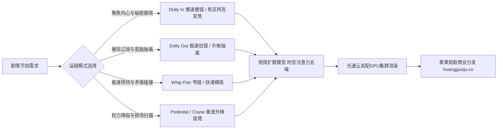

  
🎯 摄影机运镜动力学Prompt核心要要诀

  
<strong>静止的画面是PPT，流动的运镜才是真正的电影：</strong>在可灵、即梦、海螺与Runway等视频大模型中，控制摄影机运动必须<strong>将“运镜轨迹（Camera Trajectory）+ 速度加速度（Constant / Exponential / Deceleration）+ 焦点追踪（Focus Tracking）”</strong>三者绑定。避免使用“运镜激烈、镜头晃动”等容易撕裂时空编码的模糊词，改用<strong>标准化专业电影镜头动词（如：Smooth dolly in, Rapid whip pan, Slow crane down）</strong>。批量生成连续运镜镜头时，建议使用<a href="https://sahude.gsyvipaff.com/#/?code=keqgvT5Y" target="_blank" rel="noopener">光速云GPU算力容器</a>（邀请码 keqgvT5Y）秒级并发生成，最终成果接入<a href="https://huangguoju.co/" target="_blank" rel="noopener">黄果短剧商业分发矩阵</a>实现全网变现。

# 摄影机运动动力学提示词：推拉摇移与希区柯克变焦

很多AI短剧视频在画面动起来的瞬间，常常伴随着背景融化、人物五官撕裂变形或者画面莫名其妙地剧烈翻滚。其本质原因在于提示词中的摄影机运动指令缺乏**物理动力学约束**。

本手册针对视频扩散模型底层的注意力空间分布，系统梳理**六大主力运镜模式的工业级Prompt写法与控速规范**。

---

## 一、摄影机运镜时空连续性拓扑图

---

## 二、六大主力运镜模式工业Prompt指令全解

### 1. 轨道平滑推进 (Smooth Dolly In - 情绪聚焦与危机逼近)

- **适用场景**：主角下定决心复仇、反派露出真实面目、发现血迹线索。
- **工业级Prompt**：
  `Smooth cinematic dolly-in tracking shot, steady camera gliding forward at constant moderate speed along polished marble floor. Focusing tightly onto the male protagonist's steely face, starting from a medium shot at 3 meters and smoothly closing in to an extreme close-up of his unblinking eyes within 5 seconds. Background neon office lights gradually blurring into creamy circular bokeh, silky motion fluidity, zero camera shake, 4k 60fps.`

### 2. 宏大抽离拉镜 (Cinematic Dolly Out - 宿命孤独与大结局)

- **适用场景**：大战告捷孤身离去、惨遭家族抛弃孤立无援、剧终落幕。
- **工业级Prompt**：
  `Epic slow dolly-out shot, camera starting on a tight close-up of a broken crystal wine glass in a puddle of red wine, steadily and smoothly pulling backward and upward. Revealing the solitary figure of the heroine standing motionless in a vast empty ballroom, dozens of towering Corinthian pillars framing the composition, melancholy atmosphere, seamless motion coherence, 35mm film grain.`

### 3. 震撼甩镜头转场 (Whip Pan / Swish Pan - 动作冲击与时空跳切)

- **适用场景**：掌掴打脸瞬间、爆炸转场、两个对手激烈言语交锋。
- **工业级Prompt**：
  `Rapid whip pan right, high-speed camera snap from the furious face of the arrogant executive directly to the calm sneering expression of the protagonist across the conference table. Intense horizontal motion blur streaking across the center frame, snapping to instantaneous razor-sharp freeze frame focus on the protagonist's eyes, dynamic kinetic rhythm, cinematic 24fps.`

### 4. 希区柯克式眩晕变焦 (Dolly Zoom / Vertigo Effect - 心理世界天崩地裂)

- **适用场景**：发现最爱的人竟然是杀父仇人、得知家族破产、惊天绝密揭晓。
- **工业级Prompt**：
  `Classic Hitchcock vertigo dolly zoom effect. Camera physically tracking smoothly backward while the focal lens zooms in simultaneously. Protagonist's horrified face remains identically sized at center frame with trembling lips and dilated pupils, while the background room perspective visibly warps, stretches, and recedes into dizzying cavernous depth. Deep psychological horror, flawless optical distortion, dramatic rim light.`

### 5. 环绕360度轨迹运镜 (360-Degree Orbital Sweep - 战神被围与英雄气概)

- **适用场景**：暴雨中面对上千杀手包围、男女主热烈相拥亲吻。
- **工业级Prompt**：
  `Smooth 360-degree rotational tracking shot orbiting seamlessly around the central swordsman standing poised in heavy rain. The camera rotates smoothly around him at steady waist height, blurred rain mist and flashing lightning sweeping across background in a fluid horizontal panorama, glorious volumetric backlighting, cinematic fluidity.`

---

## 三、摄影机动力学Prompt参数控制矩阵

| 运镜英文关键词 | 中文摄影指令 | 推荐运镜速度控制词 | 容易出现的AI瑕疵与对策 |
| :--- | :--- | :--- | :--- |
| `Smooth dolly in` | 平滑推镜 | `at steady constant slow speed` | 避免速度突变导致面部抽搐，必须固定速度 |
| `Rapid whip pan` | 极速甩镜 | `high-speed snap, horizontal motion blur` | 容易引起画面撕裂，需配合后处理超分 |
| `Slow pedestal up` | 垂直上升升降机 | `gliding vertically upward smoothly` | 保持地平线水平，避免歪斜 |
| `Low tracking shot` | 低空贴地跟拍 | `gliding 10cm above ground parallel to subject` | 需增加地面物理倒影词，防止漂浮感 |

---

## 四、生产避坑与算力护航

- **排查：运镜过程中背景物体融化、或者生成了两个主角？**
  - **解法**：在Prompt中明确唯一的运动主体：`static background environment, only the camera is moving smoothly, single protagonist firmly centered`，并在负向词中加入 `duplicate person, shifting background, morphing architecture`。
- **高动态算力调度建议**：
  - 复杂的运镜动力学计算对视频模型的显存吞吐量要求极高。本地运行极易发生显存泄漏报错，建议使用<a href="https://sahude.gsyvipaff.com/#/?code=keqgvT5Y" target="_blank" rel="noopener">光速云GPU算力容器</a>（邀请码 keqgvT5Y），一键开启RTX 4090算力节点，高速并发输出流畅大运镜。
- **商业化分账平台对接**：
  - 拥有好莱坞级动感运镜的短剧在投流测试中点击率（CTR）通常可提升40%以上。成片一键上线至<a href="https://huangguoju.co/" target="_blank" rel="noopener">黄果短剧官方分发矩阵</a>，享受平台专属扶持分成。
