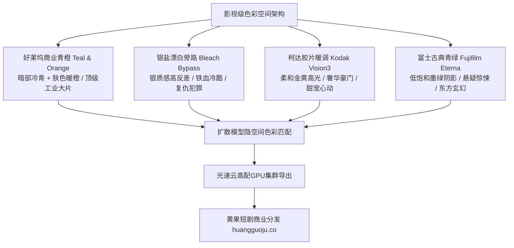

  
🎯 电影级色彩空间与胶片色彩Prompt核心法则

  
<strong>色彩是短剧潜意识层面的情绪催眠大师：</strong>写实电影感的核心在于精准调用经典电影胶片基底与调色风格（LUT）：<strong>现代商业大片首选“好莱坞青橙对冲（Teal and Orange）”；压抑复仇/硬派动作首选“银盐漂白旁路（Bleach Bypass 高反差低饱和）”；温暖甜宠首选“柯达 Kodak Portra 400 暖调高光”；悬疑古风首选“富士 Fujifilm Eterna 柔和青绿灰调”</strong>。在Prompt中加入底片胶卷型号与颗粒度参数，画面能彻底告别数字数码干燥感。全剧多集色彩跑批渲染时，推荐使用<a href="https://sahude.gsyvipaff.com/#/?code=keqgvT5Y" target="_blank" rel="noopener">光速云GPU算力容器</a>（邀请码 keqgvT5Y）秒级并发生成，成片快速推送到<a href="https://huangguoju.co/" target="_blank" rel="noopener">黄果短剧官方分发矩阵</a>实现全网变现。

# 电影级调色与胶片色彩Prompt：柯达、富士与好莱坞LUT调色指南

很多新手生成的AI短剧画面，要么像廉价网络短视频那样“高饱和度大红大绿”，要么发灰发脏像生硬的原始LOG素材。在真正的影视母带处理中，色彩方案不仅决定了画面的高级感，更代表了整部短剧的情绪基调。

本文系统拆解四大经典好莱坞电影调色体系与**胶片乳剂特征在Prompt中的精确表达方式**。

---

## 一、影视色彩情绪空间拓扑图

---

## 二、四大王牌调色方案工业级Prompt模版

### 1. 好莱坞商业标杆：青橙对冲调色 (Blockbuster Teal & Orange)

- **调色原理**：利用色轮上互补的180度对冲色，将阴影和背景染成深邃的青蓝（Teal），将人物皮肤保持在健康温暖的暖琥珀橙（Warm Amber），人物跃然屏上。
- **工业级Prompt**：
  `Cinematic color grading, blockbuster teal and orange color palette. Deep rich cyan-teal crushed shadows in the background and rainy streets, beautifully contrasting against warm saturated golden-amber skin tones and practical indoor lighting. High dynamic range, professional colorist grading by Company 3, Kodak 2383 print film emulation, clean separation between subject and shadows, 8k.`
- **负向提示词**：
  `monochrome, dull flat colors, muddy skin tones, oversaturated reds, bad white balance`

### 2. 硬派铁血复仇：银盐漂白旁路 (Bleach Bypass - 《拯救大兵瑞恩》《大追捕》质感)

- **调色原理**：保留胶片显影中的金属银盐颗粒，导致画面饱和度极低、暗部死黑、中间调极高反差，呈现粗粝残酷的金属铁血感。
- **工业级Prompt**：
  `Bleach bypass cinematic processing, gritty desaturated color grading. Extremely high contrast with silver metallic sheen across highlights, deep crushed pitch-black shadows, overall saturation reduced by 60% while maintaining harsh cold steel blues and desaturated army greens. Tactile 35mm film grain, gritty urban combat aesthetic, raw visceral texture, directed by David Fincher aesthetic.`

### 3. 奢华豪门/温暖治愈：柯达经典胶片 (Kodak Vision3 500T & Portra 400)

- **调色原理**：柯达独有的温暖高光滚降（Roll-off），让水晶吊灯、阳光与豪宅金箔呈现如油脂般细腻的奶油暖黄色，人脸白里透红。
- **工业级Prompt**：
  `Shot on 35mm Kodak Vision3 500T 5219 motion picture film. Characteristic warm golden highlight roll-off, rich organic amber undertones, delicate pastel skin tones with authentic natural flush. Gentle organic halation glowing faintly around bright light sources, fine authentic silver halide film grain, nostalgic luxury aesthetic, soft shadow detail.`

### 4. 悬疑古风/东方仙侠：富士电影胶片 (Fujifilm Eterna 500)

- **调色原理**：低饱和度、偏青绿的阴影调、幽静如深潭的墨色，营造神秘、肃穆、超然出尘的东方美学。
- **工业级Prompt**：
  `Authentic Fujifilm Eterna 500 cinema color stock. Muted desaturated color palette with subtle cold celadon-green and slate-blue undertones in the shadows. Ethereal soft contrast, dreamy mist diffusion, subdued peaceful saturation, cinematic Eastern aesthetic, sorrowful elegant visual poetry, 8k.`

---

## 三、调色专用关键词与胶片颗粒参数表

| 调色风格 | 英文核心Prompt词 | 适用短剧剧情类型 | 画面视觉心理效应 |
| :--- | :--- | :--- | :--- |
| **青橙对冲** | `blockbuster teal and orange, Kodak 2383 LUT` | 现代战神、商业商战、豪门对决 | 顶级院线大片工业感，极度吸睛 |
| **漂白旁路** | `bleach bypass, gritty desaturated, high silver contrast` | 越狱、追凶、卧底背叛、硬派动作 | 残酷、冷血、不容喘息的压迫感 |
| **柯达暖调** | `Kodak Portra 400, warm golden highlight roll-off, halation` | 女频甜宠、初恋心动、豪门宴会 | 梦幻奢华、温暖浪漫、富贵感 |
| **富士青绿** | `Fujifilm Eterna, muted celadon green shadows, soft contrast` | 仙侠修真、雨夜古刹、心理悬疑 | 清冷孤傲、深不可测、出尘感 |

---

## 四、生产避坑与算力护航

- **排查：Prompt写了 `teal and orange`，但画面变成了大片失真的艳蓝色和荧光橙？**
  - **解法**：不要单独使用色彩词，必须加上调色约束词：`subtle cinematic color grade, natural skin tone preservation, crushed shadows`，防止模型直接对全屏暴力泼漆。
- **批量多剧集调色跑批算力支持**：
  - 胶片颗粒与色彩仿真需要极高的色彩位深（10-bit / 12-bit HDR）计算。推荐使用<a href="https://sahude.gsyvipaff.com/#/?code=keqgvT5Y" target="_blank" rel="noopener">光速云GPU算力容器</a>（邀请码 keqgvT5Y），开辟RTX 4090算力节点秒级导出高动态调色样片。
- **商业化分账平台对接**：
  - 具备好莱坞院线调色母带质感的成片，直接上线至<a href="https://huangguoju.co/" target="_blank" rel="noopener">黄果短剧官方分发矩阵</a>，享受平台最高优先级推荐与专属分成政策。
