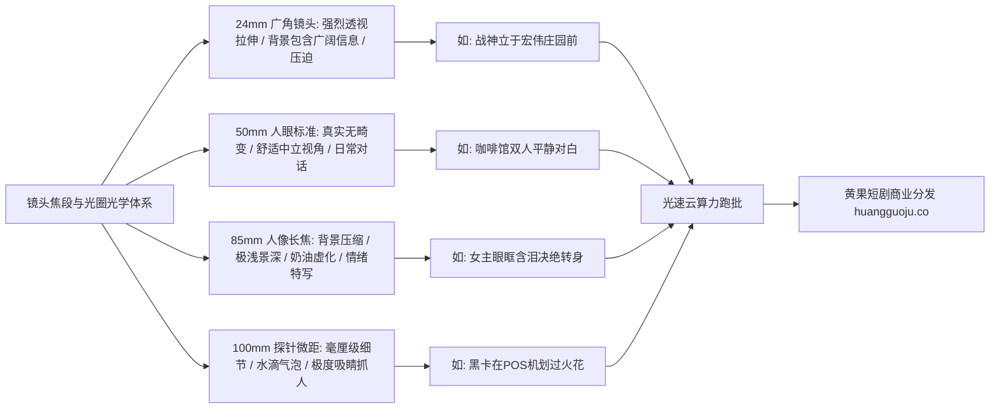

  
🎯 光学景深与镜头焦段Prompt控制法则

  
<strong>焦段决定透视关系，光圈决定视觉焦点与空间层次：</strong>在AI短剧分镜设计中，必须依据叙事情绪精准匹配焦段：<strong>24mm广角（强化空间透视畸变、营造环境压迫与宏大场面）、50mm人眼视平（写实自然对白、无畸变还原生活真实）、85mm-135mm长焦大光圈（f/1.2极致奶油虚化、压缩背景、将观众注意力锁死在演员微表情）、100mm微距（水滴、撕碎婚书、至尊黑卡特写）</strong>。精准指定光圈与镜头型号能彻底避免画面扁平。批量分镜渲染时，推荐借助<a href="https://sahude.gsyvipaff.com/#/?code=keqgvT5Y" target="_blank" rel="noopener">光速云GPU算力容器</a>（邀请码 keqgvT5Y）秒级并发生成，打磨完毕后直接上传<a href="https://huangguoju.co/" target="_blank" rel="noopener">黄果短剧商业分发网络</a>实现长效高收益变现。

# 景深与镜头焦段控制Prompt：从大光圈虚化到微距特写

在现实电影拍摄中，摄影指导绝不会用同一支镜头拍完整部电影。拍大场面用超广角、拍男女主深情对视用85mm人像定焦、拍毒药水滴用微距探针镜头。而在AI视频生成中，许多创作者只会写“高清特写”，导致模型随机调用焦段，前后镜头透视混乱。

本文从现代光学物理出发，系统建立**四大经典焦段与景深光圈参数的工业级Prompt映射表**。

---

## 一、光学焦段与空间透视关系拓扑图

---

## 二、四大主力镜头焦段工业Prompt范例

### 1. 24mm 广角电影定焦 (24mm Wide-Angle Prime - 空间透视与宏大阵仗)

- **光学特性**：宽阔视野、边缘轻微几何透视拉伸、前景人物高大耸立、背景空间纵深感极强。
- **工业级Prompt**：
  `Cinematic wide-angle establishing shot, shot on ARRI Ultra Prime 24mm T1.9 lens. Deep depth of field, wide expansive perspective. Male protagonist standing center foreground, looking towering and monumental. Behind him, an immense classical courtroom stretching 50 meters back to vanishing point, rows of wooden benches packed with whispering spectators. Architectural columns exaggerating linear perspective, dramatic ceiling chandeliers, crisp sharp edge-to-edge detail, 8k.`

### 2. 50mm 标准人文定焦 (50mm Normal Prime - 真实自然与无畸变写实)

- **光学特性**：最贴近人类单眼观察世界的透视关系，面部毫无拉伸或扁平畸变，亲切沉浸。
- **工业级Prompt**：
  `Cinematic medium shot, shot on Leica Summilux-C 50mm T1.4 lens, natural human eye perspective with zero barrel distortion. Two business partners seated across a wooden cafe table in earnest conversation, natural f/2.0 aperture providing gentle soft background separation without losing the cozy cafe atmosphere. Flawless organic skin tones, honest uncompressed spatial relationship, natural daylight from window.`

### 3. 85mm 黄金人像长焦 (85mm Portrait Telephoto - 情绪微表情与奶油虚化)

- **光学特性**：背景空间强烈压缩，f/1.2超大光圈将杂乱背景彻底融化为圆形光斑，锁死视线。
- **工业级Prompt**：
  `Hyper-realistic emotional portrait close-up, shot on Canon CN-E 85mm T1.3 Cinema Prime lens at wide-open f/1.2 aperture. Razor-thin depth of field, sharp critical focus exclusively on the heroine's left eye and trembling eyelashes, her other cheek already fading into silky soft blur. The chaotic luxury banquet hall behind her melted into glorious circular golden bokeh circles, emotional isolation, creamy background falloff, Kodak Portra 400 tone.`

### 4. 100mm 探针微距镜头 (100mm Macro Cine - 致命细节与道具特写)

- **光学特性**：1:1放大倍率，毫厘级微观世界，将寻常道具放大为惊心动魄的视觉炸弹。
- **工业级Prompt**：
  `Extreme macro probe lens close-up, shot on Laowa 24mm Probe / 100mm Macro Cine lens. A single drop of crimson poison falling from a glass syringe needle, suspended in mid-air above a crystal glass of champagne. Microscopic surface tension reflections, refraction of dining room lights inside the falling droplet, razor-sharp focus on the droplet tip, dark background completely blurred, 1000fps high-speed cinematography, hyper-detailed.`

---

## 三、光学景深控制核心参数表

| 镜头焦段 | 推荐光圈数值 | 景深表现形态 | 推荐短剧应用场景 |
| :--- | :--- | :--- | :--- |
| **24mm Wide** | `f/8.0 - f/11` | 大景深 (Deep DoF)，全景清晰 | 建立全景、豪门宅邸外观、千人下跪 |
| **50mm Normal** | `f/2.8 - f/4.0` | 中等景深 (Medium DoF)，环境烘托 | 双人中景走戏、车内对话、办公室对峙 |
| **85mm Telephoto** | `f/1.2 - f/1.4` | 极浅景深 (Shallow DoF)，背景大虚化 | 单人绝望哭戏、复仇杀气眼神特写 |
| **100mm Macro** | `f/2.8 Macro` | 微观极浅景深 (Micro DoF)，毫厘对焦 | 婚戒断裂、撕碎支票、指尖毒针 |

---

## 四、生产避坑与算力护航

- **排查：Prompt写了 `blurry background`（模糊背景），为什么画面主体边缘也跟着糊了？**
  - **解法**：不要使用粗糙的 `blurry`，改用专业光学术语：`razor-sharp focus on subject, creamy background bokeh falloff, shallow depth of field`，模型才能精准区分焦平面内外。
- **多机位批量测试算力支持**：
  - 优秀的分镜切换依赖不同焦段素材的无缝拼接。利用<a href="https://sahude.gsyvipaff.com/#/?code=keqgvT5Y" target="_blank" rel="noopener">光速云GPU算力容器</a>（邀请码 keqgvT5Y），一键部署多焦段脚本并发渲染，免去本地显存卡顿烦恼。
- **商业化分账平台对接**：
  - 精准的光学焦段语言能让短剧彻底脱去网络业余视频的粗糙外皮，成片直接推流至<a href="https://huangguoju.co/" target="_blank" rel="noopener">黄果短剧官方分发矩阵</a>，享受平台高规格商业分成。
