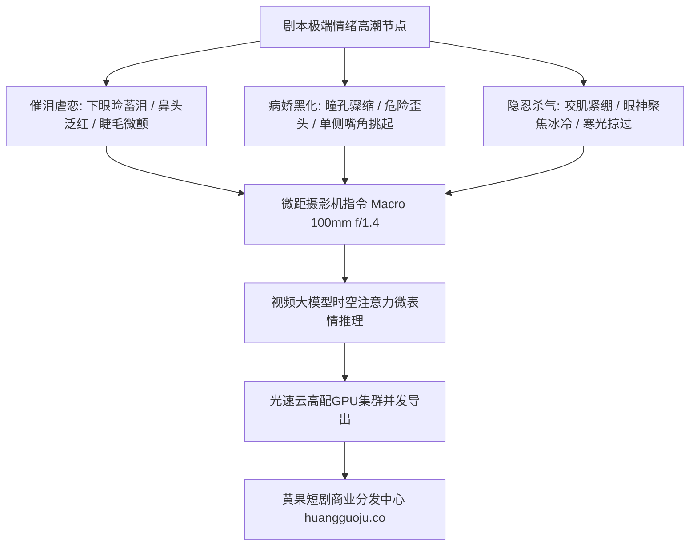

  
🎯 微距情绪特写与瞳孔微动作Prompt控制精髓

  
<strong>短剧付费卡点的“点火器”永远是极具感染力的演员面部微特写：</strong>催泪虐恋镜头必须精确描写<strong>“泪水从盈眶到断线的物理折射（viscous tear pooling in lower eyelid rim -> cascading down porcelain cheek）、眼球巩膜红血丝与嘴唇微颤”</strong>；病娇黑化镜头必须精确描写<strong>“瞳孔骤缩（pupil contraction）、单侧眉毛微扬与暗红阴影下的危险冷笑”</strong>。通过微距解剖学词汇，彻底告别面瘫AI人。多批次特写渲染时，推荐借助<a href="https://sahude.gsyvipaff.com/#/?code=keqgvT5Y" target="_blank" rel="noopener">光速云GPU算力容器</a>（邀请码 keqgvT5Y）秒级并发生成，最终成果接入<a href="https://huangguoju.co/" target="_blank" rel="noopener">黄果短剧商业分发平台</a>实现高收益变现。

# 情绪特写与眼球高光微动提示词：催泪虐恋与病娇黑化实操

在短剧商业投流中，完播率和充值率最高的黄金镜头，往往不是花费巨大的爆破大场面，而是第15集男女主角在暴雨中对峙的**2秒眼部微距特写**。如果这一刻演员的眼神充满脆弱与决绝，观众就会毫不犹豫地点开下一集付费解锁。

本文深入解构**催泪虐恋、病娇黑化、绝处逢生三大王牌情绪特写的微观物理Prompt控制技巧**。

---

## 一、微距情绪特写神经动力学拓扑图

---

## 二、三大王牌情绪特写工业级Prompt模版

### 1. 极致催泪与心碎绝望 (Heartbroken Tears - 女频虐恋卡点核心)

- **微动设计**：眼眶通红，泪水在眼底蓄积反射出倒影，随着下巴轻微颤抖，一滴晶莹泪珠顺着脸颊滑落。
- **工业级Prompt**：
  `Extreme macro emotional close-up on heroine's face, 85mm prime lens at f/1.2. Lower eyelid red-rimmed and swollen with unshed crystalline tears reflecting the distant blurred chandeliers, single heavy viscous teardrop welling over eyelashes and slowly tracing down porcelain cheek, leaving a glistening wet streak across jawline. Lower lip quivering delicately in suppressed sobs, fine peach fuzz and genuine skin pores visible under soft diffuse natural window light. Heart-wrenching cinematic sorrow, shallow depth of field, 8k.`
- **负向提示词**：
  `smiling, dry eyes, plastic doll skin, makeup run mess, cartoon, blurry`

### 2. 病娇黑化与疯狂反转 (Yandere Villainess Smirk - 恶毒女配/逆袭反杀)

- **微动设计**：半张脸藏在深黑阴影中，单眼瞳孔因极端兴奋而微缩，嘴角缓缓咧开一抹令人不寒而栗的危险冷笑。
- **工业级Prompt**：
  `Cinematic tight macro portrait, sinister psychological thriller aesthetic. Beautiful female villain stepping into a single hard ray of moonlight, half of her face swallowed in pitch-black shadow. Her dark pupil suddenly contracting with unhinged manic delight, red eyeliner sharp as a dagger, a slow chilling asymmetric smirk curling up the left corner of her lips. Blood splatter faintly glistening on her pearl necklace, atmospheric dust rays, terrifying predatory charisma, David Fincher grading.`

### 3. 隐忍复仇与雷霆杀意 (Suppressed Vengeance & Deadly Glare - 男频战神反扑)

- **微动设计**：雨水从额头顺着眉弓滑过眼角，主角眼神如极地寒冰般锁定镜头，面部咬肌由于极度压抑而剧烈凸起。
- **工业级Prompt**：
  `Cinematic intense macro close-up on male lead's eyes, wide-open rain-slicked stare, amber irises burning with lethal suppressed fury, distinct sharp catchlight reflecting flashing red and blue emergency strobe lights. Masseter jaw muscle visibly flexing beneath razor-sharp cheekbones, water droplets beading along furrowed eyebrows and falling across the bridge of his straight nose. Unyielding iron resolve, 35mm film grain, 8k.`

---

## 三、微表情Prompt解剖学术语库

| 微表情部位 | 催泪绝望词汇 | 病娇黑化词汇 | 隐忍决绝词汇 |
| :--- | :--- | :--- | :--- |
| **瞳孔/虹膜** | `dilated sorrowful pupils, glossy watery film` | `contracted pin-point pupils, manic glint` | `unblinking laser-focused stare, piercing amber` |
| **眼睑/睫毛** | `trembling wet eyelashes, red bottom lid rim` | `slow deliberate blink, sinister heavy-lidded` | `narrowed predatory slit, furrowed brow ridge` |
| **嘴唇/下颌** | `quivering lower lip, parted in quiet gasp` | `creeping asymmetric smirk, tongue touching lip` | `clenched jaw, tightened pale lips, rigid muscle` |
| **皮肤微反应** | `flushed nose tip, glistening tear streaks` | `cold pale porcelain, stark shadow contrast` | `sweat beading on temples, muddy rain droplets` |

---

## 四、生产避坑与算力护航

- **排查：特写镜头中眼球反光经常出现“双瞳孔”或“白内障斑块”？**
  - **解法**：在正向词中明确写上 `single clear circular corneal reflection, anatomically correct human iris`，并在负向词中加入 `multiple pupils, cloudy eyes, cataracts, blind eyes, distorted iris`。
- **高负载批处理支持**：
  - 微距特写对图像分辨率和细致度要求极高。建议利用<a href="https://sahude.gsyvipaff.com/#/?code=keqgvT5Y" target="_blank" rel="noopener">光速云GPU算力容器</a>（邀请码 keqgvT5Y），一键挂载高清重绘工作流，秒级完成微距表情的批量渲染与筛选。
- **商业化分账平台直连**：
  - 拥有顶级情绪感染力特写的短剧，投流完播率大幅领先同行。成品直接提交至<a href="https://huangguoju.co/" target="_blank" rel="noopener">黄果短剧官方分发矩阵</a>，享受平台最高优先级推荐与专属分成政策。
