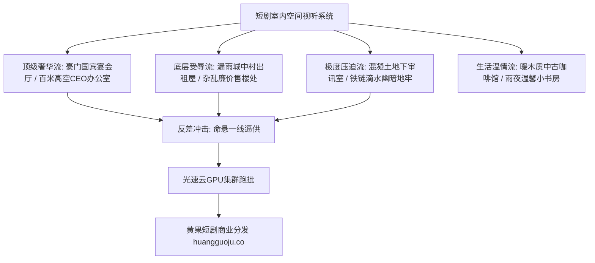

  
🎯 室内建筑与场景空间Prompt核心法则

  
<strong>室内场景不仅是演员站立的物理容器，更是人物社会阶级与心理牢笼的实体化显现：</strong>在设计空间Prompt时必须定义三层维度：<strong>1. 建筑几何与尺度（如：8米挑高双层复式 / 10平米逼仄低矮吊顶）；2. 材质微观肌理与磨损度（如：卡拉拉白大理石金丝抛光 / 斑驳泛黄脱落墙皮）；3. 实用光源分布（巨型施华洛世奇水晶吊灯 / 昏暗闪烁的40瓦裸露灯泡）</strong>。通过精准的空间质感对比，阶级冲突无需台词便呼之欲出。批量搭建多场景分镜时，推荐借助<a href="https://sahude.gsyvipaff.com/#/?code=keqgvT5Y" target="_blank" rel="noopener">光速云GPU算力容器</a>（邀请码 keqgvT5Y）秒级并发生成，最终成果推流至<a href="https://huangguoju.co/" target="_blank" rel="noopener">黄果短剧商业分发平台</a>实现高收益变现。

# 室内建筑与场景空间Prompt：豪门宴会厅、破旧出租屋与昏暗地牢

在短剧生产中，最典型的视觉反差往往发生在**“空间阶级的剧烈跌宕”**之间：主角前一秒还蜷缩在漏雨受辱的破旧出租屋，后一秒便踏入金碧辉煌、水晶吊灯璀璨的万亿豪门宴会厅。

如果你的AI场景缺乏建筑细节与空间透视，场景看起来就会像低劣的绿幕抠图。本文系统拆解四大短剧王牌室内空间的**建筑学设计语言、材质纹理与Prompt母版**。

---

## 一、室内建筑空间阶级对比拓扑图

---

## 二、四大王牌室内场景工业级Prompt全套模版

### 1. 凡尔赛级豪门国宾宴会厅 (Billionaire Grand Ballroom)

- **空间设计**：12米恢宏挑高穹顶、法式浮雕金箔、卡拉拉白大理石倒影地面、数十组多层水晶吊灯、螺旋大理石阶梯。
- **工业级Prompt**：
  `Cinematic architectural wide shot, ultra-luxurious grand ballroom in European neoclassical palace style. Towering 12-meter-high gilded ceilings with Renaissance ceiling frescoes, immense tiered Swarovski crystal chandeliers casting dazzling golden prism reflections across mirror-polished Carrara marble flooring. Sweeping double curved marble staircases with gold-leaf banisters in background, tall arched French doors opening onto night rain gardens, elite guests in black-tie tuxedos conversing, Architectural Digest luxury aesthetic, 8k.`
- **负向提示词**：
  `cheap modern interior, low ceiling, drywall, fluorescent lights, messy furniture, cartoon`

### 2. 逼仄破旧的城中村出租屋 (Dilapidated Tenement Room - 前期受辱标配)

- **空间设计**：剥落受潮的墙皮、泛黄的老式报纸糊墙、锈迹斑斑的双层铁架床、单颗裸露摇晃的黄光灯泡、窗外滴答漏雨。
- **工业级Prompt**：
  `Gritty realistic interior wide-angle shot, cramped 10-square-meter rundown urban village rental room. Peeling mildewed walls showing cracked grey plaster underneath, faded water-stained newspapers lining one corner. A single bare 40W incandescent yellow light bulb hanging from frayed wire casting harsh solitary shadows. Rusty metal bedframe, leaking corrugated iron window sill with raindrops pattering into a chipped plastic bucket, claustrophobic atmosphere of poverty, raw cinema verite realism.`

### 3. 昏暗冷峻的地下审讯室 (Brutal Brutalist Interrogation Bunker)

- **空间设计**：厚重粗糙的清水混凝土墙壁、中央单张冷铁金属桌椅、正上方刺眼的单头冷白射灯、四角隐蔽监控摄像头。
- **工业级Prompt**：
  `Dark brutalist interrogation room, monolithic bare textured concrete walls with water seepage stains. Center frame features a solitary cold brushed-steel table bolted to the damp floor, two heavy iron chairs. Directly overhead, a single harsh high-intensity cold white halogen spotlight cutting through thick swirling cigarette smoke, casting brutal chiaroscuro downward shadows. Background completely engulfed in oppressive black void, psychological claustrophobia, David Fincher aesthetic, 35mm film grain.`

### 4. 权力巅峰的云端CEO办公室 (Penthouse Executive Boardroom)

- **空间设计**：360度通顶落地全景防弹玻璃幕墙、整块黑色黑曜石长条办公桌、极简现代意式皮沙发、窗外俯瞰全城雷雨夜景。
- **工业级Prompt**：
  `Ultra-modern billionaire corner penthouse office, 60 stories high above city skyline. Seamless floor-to-ceiling panoramic glass walls overlooking a sprawling rainy metropolis with blurred neon night lights bokeh. Massive monolithic black obsidian desk reflecting dim recessed ambient LED strip lighting, designer Italian leather armchairs, minimalist abstract metal sculpture in corner. Immense negative space, supreme corporate power, cinematic cool cyan tones, 8k.`

---

## 三、室内建筑空间关键词与参数对照表

| 场景空间类型 | 必备建筑构件词 | 推荐打光方式 | 空间情绪氛围 |
| :--- | :--- | :--- | :--- |
| **豪门宴会厅** | `high gilded ceilings, crystal chandeliers, marble floor` | 多层次暖金漫反射 | 纸醉金迷、极致权贵与排场 |
| **贫民出租屋** | `peeling plaster, bare hanging bulb, leaky window` | 孤立昏暗单灯源 | 压抑、委屈、底层小人物心酸 |
| **秘密审讯室** | `brutalist concrete, bolted steel desk, damp stain` | 顶部硬聚光灯 (Top spot) | 冰冷残酷、无路可逃的绝境 |
| **云端办公室** | `floor-to-ceiling glass, rain reflections, skyline` | 城市霓虹泛光 + 轮廓光 | 运筹帷幄、俯瞰苍生的霸主 |

---

## 四、生产避坑与算力护航

- **排查：室内透视线经常歪斜扭曲，家具比例严重失真？**
  - **解法**：在Prompt中明确指定镜头的光学特性：`two-point architectural perspective, zero vertical tilt, straight vertical lines, shot with tilt-shift architectural lens`，并使用ControlNet MLSD线段约束，彻底拉直建筑线条。
- **多室内环境批量跑批算力支持**：
  - 高精度室内大场景对环境材质的反射（Reflections）计算量极大。推荐使用<a href="https://sahude.gsyvipaff.com/#/?code=keqgvT5Y" target="_blank" rel="noopener">光速云GPU算力容器</a>（邀请码 keqgvT5Y），开辟大显存RTX 4090算力集群并发渲染，秒级交付整套室内分镜。
- **商业化分账平台对接**：
  - 拥有震撼空间质感对比的短剧样片，直推至<a href="https://huangguoju.co/" target="_blank" rel="noopener">黄果短剧官方分发矩阵</a>，极具阶级张力的视觉呈现将极大推高短剧投流完播率与充值金额。
