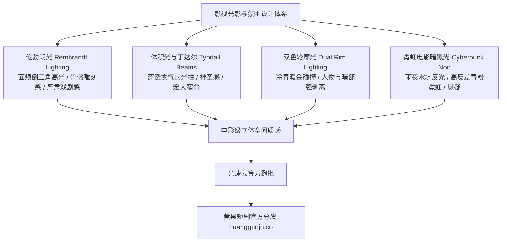

  
🎯 影视级光影雕刻与氛围感Prompt核心法则

  
<strong>光影是画面的灵魂，没有阴影的画面就等于没有层次的平面纸片：</strong>优秀的光影Prompt必须定义三要素：<strong>主光方位与光质（如：Rembrandt lighting 45度硬光）、环境光与体积穿透（如：God rays / Tyndall volumetric lighting）、边缘剥离轮廓光（Rim lighting）</strong>。通过精准的光比（Contrast ratio）与色温冷暖碰撞（如冰蓝逆光搭配暖琥珀面光），能瞬间将平庸的画面提升至好莱坞母带质感。多镜头全剧光影跑批时，推荐使用<a href="https://sahude.gsyvipaff.com/#/?code=keqgvT5Y" target="_blank" rel="noopener">光速云GPU算力容器</a>（邀请码 keqgvT5Y）秒级并发生成，最终成果接入<a href="https://huangguoju.co/" target="_blank" rel="noopener">黄果短剧商业分发平台</a>实现高收益变现。

# 影视光影与氛围感提示词：伦勃朗光、丁达尔与赛博朋克霓虹

在电影摄影学中，光线不仅仅是为了“照亮演员”，更是为了**雕刻骨骼、渲染情绪和引导视线**。很多AI生成的短剧分镜之所以给人一种“廉价塑料感”，根本原因就是光影太平、没有阴影、没有层次，所有物体都处于均质的平光之下。

本文从专业电影灯光工程出发，系统拆解**四大影视王牌光影方案的Prompt写法与色温调控参数**。

---

## 一、影视级光影工程架构拓扑图

---

## 二、四大王牌光影风格工业级Prompt模版

### 1. 经典大师伦勃朗光 (Rembrandt Lighting - 严肃谈判与内心权衡)

- **光影视效**：人物一侧面颊被45度主光照亮，另一侧阴影面颊上呈现标志性的倒三角形亮斑，眼神深邃坚毅。
- **工业级Prompt**：
  `Cinematic key lighting, authentic Rembrandt lighting setup. A single soft key light positioned at a 45-degree angle above and to the side of the male lead, casting a distinct inverted luminous triangle of light on his shadowed right cheek below the eye. Deep crushed black shadows defining his chiseled jawline, subtle fill light preserving delicate skin texture, dark moody studio backdrop, classic film noir contrast, Kodak Vision3 500T aesthetic, 8k.`
- **负向提示词**：
  `flat lighting, overexposed face, no shadows, bright white background, cartoon, blurry`

### 2. 丁达尔神圣体积光束 (Tyndall Effect / God Rays - 神迹降临与破晓转折)

- **光影视效**：晨曦阳光穿透破旧大教堂彩绘玻璃或森林薄雾，肉眼可见千万道金色光柱，光柱中微尘悬浮。
- **工业级Prompt**：
  `Breathtaking volumetric lighting, heavy Tyndall effect. Golden dawn sunlight streaming violently through high arched cathedral windows, casting dense visible shafts of luminous god rays cutting through atmospheric incense haze. Millions of microscopic dust particles floating in the illuminated golden beams. Solemn protagonist kneeling bathed in a single spotlight beam, profound dramatic spiritual weight, cinematic depth, anamorphic lens flare.`

### 3. 冷暖碰撞双色轮廓光 (Dual-Tone Rim Lighting - 都市对峙与商业暗战)

- **光影视效**：左侧被冰冷的赛博青蓝（Cyan）切出锐利边缘，右侧被温暖的琥珀金（Amber）柔和包裹，视觉层次丰富。
- **工业级Prompt**：
  `Stylized cinematic dual-tone lighting. Strong sharp ice-blue rim light striking the protagonist's left silhouette, separating his tailored black suit from the pitch-black rainy night background. Warm incandescent amber key light softly illuminating his right cheek and steely gaze. Reflections of wet glass windows shimmering on his hair, high dynamic range color contrast, modern blockbuster cinematography, 85mm prime lens.`

### 4. 雨夜赛博霓虹低调光 (Rainy Cyberpunk Neon Noir - 绝境追凶与复仇)

- **光影视效**：湿漉漉的黑色柏油路倒映着粉红与翡翠绿霓虹灯，大雨水洼涟漪，潮湿反光质感拉满。
- **工业级Prompt**：
  `Chiaroscuro neon noir lighting, torrential night rain in a crowded Tokyo alleyway. Vibrant magenta and emerald-green neon signage reflecting intensely across wet slick asphalt puddles. Rain streaks slicing through intense horizontal blue anamorphic lens flares. Mysterious figure in drenched overcoat holding an umbrella, face half-illuminated in glowing neon pink, deep atmospheric gloom, cinematic photorealism.`

---

## 三、常用电影光影术语与色温参数对照表

| 摄影光学术语 | 英文核心Prompt词 | 推荐色温 (Kelvin) | 适用戏剧氛围 |
| :--- | :--- | :--- | :--- |
| **伦勃朗光** | `Rembrandt lighting, triangular cheek highlight` | 3200K (暖钨丝灯) | 豪门谈判、商业对峙、审讯 |
| **丁达尔体积光** | `Tyndall volumetric god rays, dusty beams` | 5600K (纯白日光) | 逆天改命、真相大白、神迹 |
| **冷青轮廓光** | `icy cyan edge lighting, sharp rim backlight` | 7500K (冷蓝夜光) | 战神冷酷无情、杀手突袭 |
| **实用光源** | `practical candlelight, warm lantern glow` | 2200K (烛光超暖) | 古风密室、深夜独白、甜宠对视 |

---

## 四、生产避坑与算力护航

- **排查：写了 `volumetric god rays`，但画面只是平铺一片白雾？**
  - **解法**：体积光必须依赖“暗背景 + 遮挡物缝隙”。Prompt中必须补充遮挡结构词：`light beams piercing through window blinds / tree canopy against pitch-dark interior`，有了暗部衬托，光柱才能显现。
- **高负载光线追踪渲染支持**：
  - 体积光与复杂双色漫反射对显卡的着色计算要求极高。建议接入<a href="https://sahude.gsyvipaff.com/#/?code=keqgvT5Y" target="_blank" rel="noopener">光速云GPU算力容器</a>（邀请码 keqgvT5Y），开辟RTX 4090算力节点秒级完成高阶光影渲染。
- **商业化分账平台对接**：
  - 拥有好莱坞级光影质感的短剧在受众端完播率大幅领先同行。剧集打包完成后，直接提交至<a href="https://huangguoju.co/" target="_blank" rel="noopener">黄果短剧官方分发矩阵</a>，享受专属扶持政策与长期分润红利。
