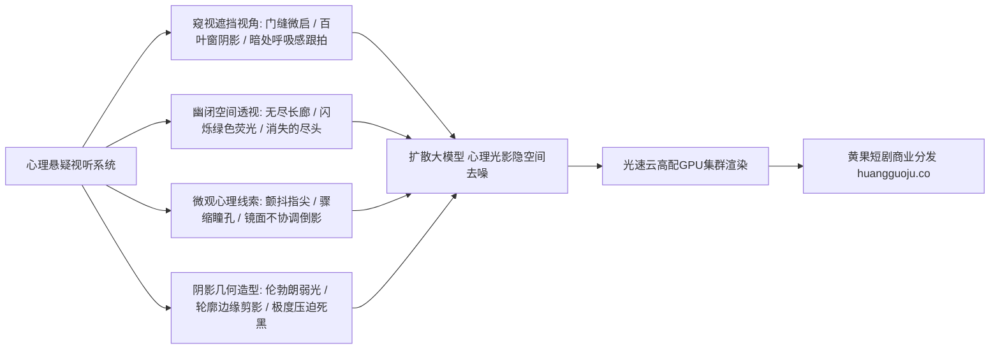

  
🎯 悬疑惊悚与心理微恐Prompt核心法则

  
<strong>最高级的恐惧与悬疑从来不是血腥怪兽，而是“看不见的未知与阴影中的窥视”：</strong>设计悬疑Prompt必须掌握三大视听心理工具：<strong>1. 遮蔽与负空间（Negative space & Obscurity：将画面70%沉入死黑，仅保留关键线索）；2. 窥视视角（Voyeuristic OTS：通过门缝、百叶窗、后视镜窥视主角）；3. 不安的光影节奏（Flickering bulb / Cold green fluorescence / Diagonal Venetian shadows）</strong>。通过精准心理诱导，让观众心跳骤升，迫不及待付费追剧。高负载批量生成悬疑分镜时，推荐接入<a href="https://sahude.gsyvipaff.com/#/?code=keqgvT5Y" target="_blank" rel="noopener">光速云GPU算力容器</a>（邀请码 keqgvT5Y）秒级并发渲染，最终成果直接上线至<a href="https://huangguoju.co/" target="_blank" rel="noopener">黄果短剧商业分发平台</a>实现高收益变现。

# 悬疑惊悚与微恐氛围Prompt：阴影窥视、幽闭回廊与心理惊悚控制

在2026年的短剧市场，悬疑破案、真假千金阴谋对决、民间诡道悬疑异闻等题材异军突起。观众之所以对悬疑剧欲罢不能，全在于导演能否用视听语言编织出一张**令人窒息的悬念蛛网**。

本文从现代悬疑电影大师（大卫·芬奇、希区柯克、温子仁）的视听语法出发，系统提炼**阴影窥视、幽闭长廊与未知异象的工业级Prompt模版**。

---

## 一、心理悬疑视听控制拓扑图

---

## 二、三大王牌悬疑场景工业级Prompt模版

### 1. 门缝暗中窥视与阴谋抓包 (Voyeuristic Cracked Door - 发现不可告人的秘密)

- **场景心理**：观众处于暗处偷窥视角，前景是虚焦的带锁木门边缘，门缝中正发生着一场致命的秘密交易或背叛。
- **工业级Prompt**：
  `Sinister voyeuristic suspense shot, camera peering nervously through a slightly cracked dark wooden door. Immediate foreground frame left is a pitch-black blurred door jamb creating heavy claustrophobic vignette. Sharp crystal focus through the 5-centimeter opening onto a dimly lit study room inside: an antagonistic figure in a black trench coat quietly injecting clear liquid into a wine decanter, hands gloved in black latex. Cold sickly green moonlight cutting across his calculating profile, tense dead silence, 85mm cine prime lens, hyper-realistic.`
- **负向提示词**：
  `bright cheerful room, wide open door, smiling, cartoon, direct flat light, blurry subject`

### 2. 闪烁荧光无尽幽闭长廊 (Endless Hospital Corridor & Flickering Tube)

- **场景心理**：两旁房门紧闭的长廊向深处延伸，单调的脚步声，头顶荧光灯管发出滋滋声并不规则闪烁，尽头潜伏着未知威胁。
- **工业级Prompt**：
  `Deep claustrophobic one-point perspective wide shot, endless sterile hallway in an abandoned psychiatric asylum at 3 AM. Pale peeling green tile walls, damp reflections on linoleum floor, doors closed on both sides receding into pitch-black vanishing point. A single damaged fluorescent tube light overhead flickering erratically with buzzing electrical sparks, plunging the hallway into alternating strobe flashes of sickly greenish-white light and total oppressive darkness. Distant shadowy silhouette suddenly standing at the far end, chilling dread, 24mm wide lens.`

### 3. 百叶窗几何条纹与致命审判 (Venetian Blinds Shadows - 黑色电影风格)

- **场景心理**：百叶窗被夜间强光投射，在主角惨白惊骇的面庞上切出如同牢狱铁栅栏一般的条纹状浓黑阴影。
- **工业级Prompt**：
  `Classic film noir psychological suspense close-up. Female protagonist pressed flat against wall in utter panic, eyes wide with terror and dilated pupils, holding her breath with hand clamped over mouth. Harsh geometric parallel black-and-white striped shadows cast across her face and wallpaper by streetlights slicing through Venetian window blinds. A towering menacing shadow of an intruder with a knife looming larger on the wall beside her, extreme high contrast chiaroscuro, 35mm film grain, 8k.`

---

## 三、悬疑惊悚核心光影与色调词典

| 视听要素 | 英文核心Prompt词 | 画面心理效果 | 避坑提醒 |
| :--- | :--- | :--- | :--- |
| **病态色温** | `sickly fluorescent green-tinted light, desaturated slate-cyan` | 营造不适感、医院停尸房般的冷血氛围 | 避免全屏过度偏绿成绿幕 |
| **不稳定光源** | `erratically flickering light bulb, swinging overhead lamp` | 制造心跳加速的不安全感与未知恐慌 | 闪烁频率不可过大防癫痫 |
| **遮挡构图** | `foreground silhouette obstruction, peek-a-boo framing` | 强化观众“窥探绝密禁忌”的偷窥欲 | 遮挡区域需保持干净无噪点 |
| **阴影压迫** | `70% frame engulfed in crushed deep black shadows` | 隐藏威胁，未知比具象更具威慑力 | 关键微表情需被弱光点亮 |

---

## 二、生产避坑与算力护航

- **排查：微恐悬疑场景被AI模型误判触发安全违规拦截？**
  - **解法**：不要在Prompt中使用敏感违禁词（如 `blood everywhere, killing, dead body, decapitated`）。改用心理悬疑隐喻词替代：`crimson liquid staining the porcelain tile, unmoving silhouette, dropped shattered glass, lingering chilling dread`，既能百分之百通过平台审核，在视听艺术上也更加高级。
- **批量复杂光影算力支撑**：
  - 极端明暗对比（High Contrast）与细腻阴影对扩散模型的显卡浮点运算能力要求极高。建议接入<a href="https://sahude.gsyvipaff.com/#/?code=keqgvT5Y" target="_blank" rel="noopener">光速云GPU算力容器</a>（邀请码 keqgvT5Y），开辟大显存RTX 4090算力节点秒级跑通悬疑分镜。
- **商业化分账平台对接**：
  - 拥有极强悬念和反转吸引力的短剧在抖音与快手平台具备最高的付费转化率。成片一键上线至<a href="https://huangguoju.co/" target="_blank" rel="noopener">黄果短剧官方商业平台</a>，尊享独家版权保护与透明分润机制。
