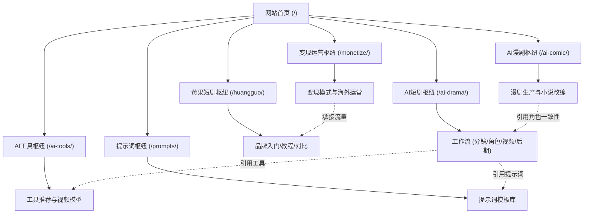

# 黄果短剧AI指南 (huangguoai.run) 实施规划方案

> **项目名称**：黄果短剧AI内容站与指南平台  
> **生产域名**：`https://huangguoai.run`  
> **技术组合**：VitePress 最新稳定版 + 品牌化简白主题 + Markdown 深度内容 + Pagefind 全文搜索（中文分词优化）+ 自动 Sitemap + Apache 静态部署  
> **目标**：打造中文 AI 短剧与 AI 漫剧领域的头部权威内容站，通过多层级 SEO 内容集群与 GEO（生成式引擎优化）架构，抢占核心品牌词、通用大词与高价值长尾转化词。

---

## 一、架构设计与技术栈标准

### 1. 技术栈选型
| 模块 | 技术选型 | 说明与版本规划 |
| :--- | :--- | :--- |
| **静态站点生成器** | VitePress | 极速构建、原生 Markdown 支持、组件化扩展、轻量体积 |
| **UI 主题与样式** | 品牌化简白定制主题 | 浅色纯白背景 `#ffffff` + 浅灰边框 `#e5e7eb`，深色 `#0f0f13`；品牌色主色调 `#14b8a6`（Teal青绿系） |
| **全文搜索引擎** | Pagefind + `vitepress-plugin-pagefind` | 离线纯静态全站索引，使用 `Intl.Segmenter` 中文精准分词优化，零外部依赖，极速搜索 |
| **Sitemap 自动生成** | VitePress 内置 sitemap | 生产域名绑定 `https://huangguoai.run`，自动注入所有文章与索引页 |
| **服务器部署策略** | Apache 静态托管 + `.htaccess` | HTML 后缀隐式重写（Clean URL）、防盗链、HTTP 缓存策略与安全头 |
| **文章内容规范** | GitHub Flavored Markdown + Frontmatter | 结构化元数据（title, description, keywords, lastUpdated）、GEO 6步法内容模型 |

---

## 二、六级层级拓扑与 URL 规范

站点严格遵循 **一级导航索引 → 二级专题页 → 三级集群索引页 → 三级集群 SEO 深度文章（8~15篇）** 的多叉树拓扑结构。

```
huangguoai.run/
├── 首页 (/)
├── huangguo/ (黄果短剧专区)
│   ├── intro/ (品牌入门) -> about/ (认识黄果), official/ (官网与入口)
│   ├── tutorial/ (使用教程) -> beginner/ (新手入门), features/ (功能详解)
│   └── compare/ (品牌对比) -> vs/ (黄果 vs 竞品)
├── ai-drama/ (AI短剧制作)
│   ├── workflow/ (制作全流程) -> script/, storyboard/, character/, video/, audio-post/
│   └── tutorial/ (教程与案例) -> beginner/, advanced/, genre/
├── ai-comic/ (AI漫剧创作)
│   ├── production/ (漫剧制作) -> intro/, tutorial/, character/
│   └── novel-to-comic/ (小说转漫剧) -> adapt/, comic-video/
├── ai-tools/ (AI工具箱)
│   ├── recommend/ (工具推荐) -> drama/, comic/, free/
│   └── models/ (模型详解) -> video/, image/, compare/
├── prompts/ (提示词库)
│   └── library/ (提示词大全) -> drama/, storyboard/, character/, model/
├── monetize/ (变现运营)
│   ├── income/ (商业变现) -> methods/, business/
│   └── operations/ (账号与增长) -> account/, global/
└── about.md (关于本站)
```

---

## 三、SEO 关键词矩阵与 GEO 优化体系

### 1. 关键词分配原则
- **一页一主词**：Title、H1 标签、URL Slug 严格包含核心主词。
- **次要词与语义相关词（LSI）**：分布于前 100 字首段、H2 子标题及 `meta description`。
- **长尾词与疑问词**：分散在正文实操案例、对比表格、常见 FAQ 及内链锚文本中。
- **年份同步**：全站涉及时间敏感词统一步伐标注（2026年最新）。
- **客观原则**：未公开或未完全核实的第三方数据/品牌功能明确标注“暂未核实”，严禁虚构。

### 2. GEO（生成式引擎优化）文章格式标准
每篇深度文章字数不少于 800 字（核心重点篇目 1500~2500 字），严格采用以下 6 步段落结构，确保对 ChatGPT、Perplexity、Kimi、Claude 等 AI 搜索具备极高摘要提取率：
1. **直接答案（Direct Answer）**：首段 2-3 句话直击要害，给出权威结论与核心推荐。
2. **详细原因（Root Causes / Core Concepts）**：原理、机制与逻辑拆解。
3. **操作步骤（Actionable Step-by-Step）**：清晰的 1/2/3/4 标准工作流，附参数、提示词或配置说明。
4. **判断标准（Validation Metrics）**：成败评判标准、画面质量/镜头连贯性验证方法。
5. **注意事项（Gotchas & Pitfalls）**：算力消耗、版权风险、变脸变异避坑要点。
6. **相关问题与内链（FAQ & Hub Links）**：3-5 个高相关页面内链，使用自然语义锚文本。

---

## 四、内链流动矩阵



- **锚文本规则**：杜绝“点击查看”“更多详情”等无意义短语，统一采用目标页面的核心词或语义长尾词。
- **频次控制**：同一页面指向同一目标 URL 的锚文本不超过 2 次，单篇保持 5~10 个高价值内链。

---

## 五、项目工程结构规划

```
huangguoai.run/
├── docs/
│   ├── .vitepress/
│   │   ├── config.ts              # VitePress 主配置 (导航/侧边栏/sitemap/pagefind)
│   │   ├── theme/
│   │   │   ├── index.ts           # 主题装载入口
│   │   │   └── styles/
│   │   │       ├── brand.css      # 品牌主题、简白布局、色盘变量
│   │   │       └── custom.css     # 细节调优与移动端适配
│   │   └── public/
│   │       ├── logo.svg           # 矢量品牌 Logo
│   │       ├── favicon.ico        # 站点图标
│   │       └── robots.txt         # 搜索引擎爬虫抓取规则
│   ├── index.md                   # 网站首页 (Hero + 6 大枢纽功能网格)
│   ├── about.md                   # 关于本站 (定位、团队、免责声明)
│   ├── huangguo/                  # 1. 黄果短剧
│   │   ├── index.md               # 枢纽页
│   │   ├── intro/                 # 品牌入门 (about, official)
│   │   ├── tutorial/              # 使用教程 (beginner, features)
│   │   └── compare/               # 品牌对比 (vs)
│   ├── ai-drama/                  # 2. AI短剧
│   │   ├── index.md               # 枢纽页
│   │   ├── workflow/              # 制作全流程 (script, storyboard, character, video, audio-post)
│   │   └── tutorial/              # 教程与案例 (beginner, advanced, genre)
│   ├── ai-comic/                  # 3. AI漫剧
│   │   ├── index.md               # 枢纽页
│   │   ├── production/            # 漫剧制作 (intro, tutorial, character)
│   │   └── novel-to-comic/        # 小说转漫剧 (adapt, comic-video)
│   ├── ai-tools/                  # 4. AI工具
│   │   ├── index.md               # 枢纽页
│   │   ├── recommend/             # 工具推荐 (drama, comic, free)
│   │   └── models/                # 模型详解 (video, image, compare)
│   ├── prompts/                   # 5. 提示词
│   │   ├── index.md               # 枢纽页
│   │   └── library/               # 提示词库 (drama, storyboard, character, model)
│   ├── monetize/                  # 6. 变现运营
│   │   ├── index.md               # 枢纽页
│   │   ├── income/                # 商业变现 (methods, business)
│   │   └── operations/            # 运营实战 (account, global)
│   └── ... (共计 32 个三级内容集群目录，每个目录下 8~12 篇独立 Markdown 文章)
├── .htaccess                      # Apache 伪静态与安全头配置
├── .gitignore
├── package.json                   # 脚本与依赖项
├── implementation_plan.md         # 实施蓝图（本文件）
└── content-map.md                 # 全量内容矩阵地图
```

---

## 六、分阶段实施里程碑与质量把控

根据用户工作流规范，项目执行严格分为 11 个阶段，各阶段完成并成功构建验证后，向用户汇报并等待确认方可进入下一阶段：

| 阶段 | 名称 | 目标与交付物 | 构建与检验标准 | 状态 |
| :--- | :--- | :--- | :--- | :--- |
| **阶段 1** | **架构规划** | 生成 `implementation_plan.md` 与 `content-map.md`（覆盖 32 个三级集群全量文章规划） | 结构完整、关键词矩阵清晰，**等待用户确认** | **进行中 (当前阶段)** |
| **阶段 2** | **项目初始化** | 初始化 `package.json`，安装 `vitepress`、`pagefind`、`vitepress-plugin-pagefind` 等，建立基础配置与目录树 | `npm run docs:build` 编译通过 | 待启动 |
| **阶段 3** | **品牌化简白主题** | 编写 `brand.css`，配置亮暗主题色盘、排版规范、品牌 Logo、全站导航与侧边栏 | 构建无样式编译错误，移动端断点正常 | 待启动 |
| **阶段 4** | **首页与一级枢纽页** | 完成 `docs/index.md`（高质感 Hero + 6 大专题卡片）及 6 个一级导航入口页 + `about.md` | `npm run docs:build` 验证路由跳转正常 | 待启动 |
| **阶段 5** | **内容集群 1：黄果短剧** | 完成 `/huangguo/` 下 5 个三级集群共 50 篇深度 SEO 文章 | 运行 build 构建通过，无死链 | 待启动 |
| **阶段 6** | **内容集群 2：AI短剧** | 完成 `/ai-drama/` 下 8 个三级集群共 82 篇深度 SEO 文章 | 运行 build 构建通过，分镜/角色一致性内链打通 | 待启动 |
| **阶段 7** | **内容集群 3：AI漫剧** | 完成 `/ai-comic/` 下 5 个三级集群共 50 篇深度 SEO 文章 | 运行 build 构建通过，小说漫剧转视频工作流完整 | 待启动 |
| **阶段 8** | **内容集群 4：AI工具** | 完成 `/ai-tools/` 下 6 个三级集群共 60 篇深度 SEO 文章 | 运行 build 构建通过，模型横评对比正常 | 待启动 |
| **阶段 9** | **内容集群 5：提示词** | 完成 `/prompts/` 下 4 个三级集群共 40 篇深度 SEO 文章 | 运行 build 构建通过，各类 Prompt 模板排版清晰 | 待启动 |
| **阶段 10** | **内容集群 6：变现运营** | 完成 `/monetize/` 下 4 个三级集群共 40 篇深度 SEO 文章 | 运行 build 构建通过，商业模式与海外实操路径完整 | 待启动 |
| **阶段 11** | **部署配置与最终验收** | 生成生产级 `.htaccess`、Sitemap 验证、Pagefind 中文搜索索引验证、移动端渲染测试与交付文档 | 运行 `npm run docs:dev` 本地预览无报错，Pagefind 索引生成完毕 | 待启动 |

---

## 七、确认与签署

- [x] 规划文件创建已完成
- [ ] 架构方案等待用户审查确认中
